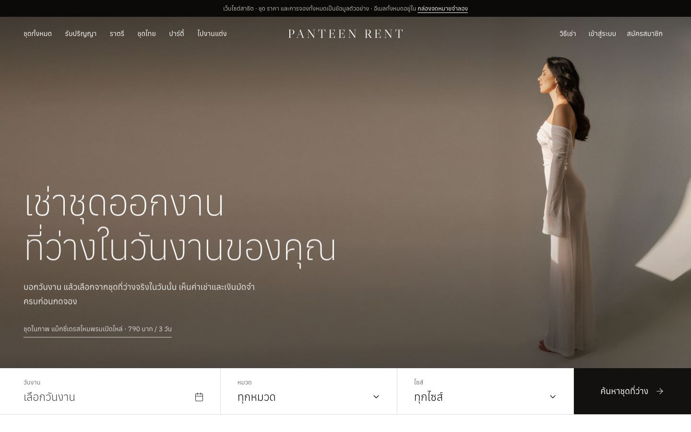

# Panteen Rent

A dress-rental website for a women's rental shop (graduation, evening, Thai traditional, party and wedding-guest dresses), with a full back office for the staff who run it. Customers pick an event date and see only the dresses that are actually free that day. They choose pickup at the shop, parcel delivery or same-day messenger, and either return at the shop or send the dress back by post. They pay by PromptPay QR and upload a slip, then follow the parcel. They report the condition on arrival and, after the shop inspects the returned dress, see an itemised deposit refund. Written in plain PHP and MySQL/MariaDB with no framework and no Composer, so it runs from a XAMPP `htdocs` folder as-is. The UI is in Thai.

All data in the app is demo data: the dresses, prices, members, phone numbers and bookings are invented, and every page says so while demo mode is on. Photos are under the Pexels License; the photographers are listed on `/credits`.



**Full guide (Thai, with screenshots of every screen): [docs/PROJECT-GUIDE.md](docs/PROJECT-GUIDE.md)**

---

## Why it exists

A small rental shop runs on LINE chats, a paper calendar and bank-app screenshots. The questions that go wrong are always the same: *is this dress free that weekend, counting the courier and the cleaning day?*, *did this slip really come in?*, *was that tear there before we shipped it?*, *how much of the deposit goes back?* Each of those is a rule in this app, with a test behind it. The shop gets one place where every booking moves through fixed states. Staff see one screen of what to do today, and every baht can be traced back to a slip, a receipt and a line item.

## Features

Read from the code, accurate as of the current `main`.

### Customers

- **Availability by event date.** The search on the home page and the filters on `/dresses` take an event date and mark each dress free or taken for it. The lock window counts outbound transit, the rental days, return transit and a cleaning day (`app/Services/Availability.php`).
- **Dress page.** Photo gallery, measurements (bust, waist, hip, length) compared with the member's own saved measurements, an availability calendar and a live price quote (`/api/dress/{code}/quote`).
- **Delivery and return options.** Delivery is pickup, parcel (metro 80 THB / upcountry 120 THB, 1 or 2 transit days, 14:00 cutoff) or messenger (metro only, 250 THB). Return is at the shop or by parcel with a prepaid label packed in the box. The zone comes from the province; the ship-by date comes from transit days and the cutoff (`app/Services/Shipping.php`).
- **Address book.** Up to 5 addresses with a default. A booking stores a copy of the address, so editing the book never redirects a parcel already booked.
- **Booking hold and payment.** A booking holds the dress for 24 hours. The PromptPay QR carries the exact amount (EMVCo payload with CRC16, `app/Services/PromptPay.php`). There is a countdown and a slip upload. A member can have at most 3 unpaid holds.
- **Parcel tracking and arrival report.** Each booking shows the carrier, tracking number and tracking link. The customer confirms receipt and has 24 hours to report the dress's condition with up to 6 photos; anything reported there is never charged at inspection.
- **Return by post.** The customer enters the carrier, tracking number, drop-off date and a photo of the drop-off receipt. Lateness counts to the postmark date, not to the day the parcel reaches the shop.
- **Inspection result and dispute.** An itemised damage list with notes and the refunded deposit. The customer can dispute once, within 3 days, with up to 6 photos.
- **Receipts.** Sequential per Buddhist-era year (`RC69-0001`): payment receipt, return settlement and damage adjustment, all printable.
- **Account.** Profile and measurements, favourites, in-app notifications, fitting appointments (30-minute slots, 2 fitting rooms), email verification and password reset.

### Staff and admins (`/admin`)

- **Today.** Pickups, returns (with running late fees), parcels to ship and to inspect, fittings, holds about to expire, and the next 7 days.
- **Front-desk booking.** Find or register a member, then pick a dress, dates, and the same delivery and return options customers get (with the member's saved addresses). Record cash, transfer or PromptPay on the spot, or leave a 24-hour hold. The booking's channel is recorded for reports.
- **Slip review.** Each card shows the slip beside the amount due and the amount claimed. Approve to confirm the booking and issue the receipt; reject with a reason and the booking goes back to awaiting payment.
- **Shipping queue** (`/admin/shipping`). Six tabs in work order: to ship, out for delivery, awaiting return, returns in transit, to inspect, open disputes. Late items are flagged.
- **Labels.** One printable sheet with the outbound label, a prepaid return label, and a packing list with tick boxes and the booking's QR code.
- **Tracking validation per carrier.** Thailand Post `AA123456789TH`, J&T 12 digits, Kerry/Flash 8–20 alphanumerics. Delivery failed, lost parcel, resend or switch to pickup (the delivery fee is refunded only if nothing was shipped).
- **Scan** (`/admin/scan`). A barcode scanner or the phone camera reads a dress tag or booking QR and jumps to the next step. The dress QR tags print from the costume page.
- **Inspection.** A 6-point checklist, accessories ticked off from the dress's list, and damage lines from a shop-wide price table (fixed THB or % of the dress's value, capped at that value). It includes photos, the outcome for the dress (back on rent, repair, or retire), and a live settlement summary. Closing the inspection issues the settlement receipt, records the refund or the amount still owed, and emails the customer.
- **Dispute reply.** Answer the customer and optionally reduce the damage charge; the refund and an adjustment receipt are recorded automatically.
- **Damage price table** (`/admin/damage-types`). 15 defaults across 7 areas of the dress. Admins edit them; staff can read them.
- **Schedule.** Three weeks of every dress, coloured by booking state, with the cleaning tail shown faded.
- **Dresses, categories, members, appointments.** Image upload with 4 generated sizes; account suspension and roles (admin only).
- **Reports.** Rentals, finance and appointments for any date range, printable and exportable to CSV (UTF-8 BOM, so Excel shows Thai). Finance keeps shop income separate from deposits held.
- **Settings** (admin only). Shop details, PromptPay and bank, rental rules (base days, maximum length, cleaning days, hold hours, cancellation cutoff, booking horizon), shipping fees, transit and windows, email and SMTP with a test button, and demo mode.

### Booking states

Transitions are a fixed table in `BookingService::TRANSITIONS`; nothing skips a step.

| State | Meaning | Next |
|---|---|---|
| `pending_payment` | Held, waiting for payment | `awaiting_verification`, `confirmed` (cash), `cancelled`, `expired` |
| `awaiting_verification` | Slip uploaded | `confirmed`, `pending_payment` (rejected), `cancelled` |
| `confirmed` | Paid, waiting for pickup or dispatch | `picked_up`, `shipped`, `cancelled` |
| `shipped` | Parcel on its way | `picked_up` (delivered), `confirmed` (failed or lost) |
| `picked_up` | The customer has the dress | `returning`, `returned` |
| `returning` | Return parcel sent or received, awaiting inspection | `returned` |
| `returned` | Inspected and settled | — |

### Money, in one place

```
rent      = base price (covers 3 days) + extra days × extra-day price
due       = rent + deposit + delivery fee + return fee
late fee  = max(0, return or postmark date − return date) × late fee per day
damage    = Σ unit price × qty   (percent items use the dress's value; total capped at that value)
refund    = max(0, deposit − late fee − damage);   anything above the deposit is recorded as owed
```

`app/Services/Pricing.php` (`quote()`, `settle()`) and `app/Services/Inspection.php` hold these; the unit tests pin them.

## Architecture

A front controller and a small hand-written core instead of a framework.

```
public/index.php      the only web entry point: bootstrap, security headers, session, /healthz, dispatch
app/Core/             Router, Middleware (guest/auth/verified/staff/admin), DB (PDO wrapper with transactions),
                      Auth (bcrypt, lockout), Csrf, Session, Validator (Thai messages), Upload (GD re-encode),
                      View, Mailer + SmtpClient (TLS/SSL, no library), Config
app/Services/         every business rule: BookingService, Availability, Pricing, Shipping, Fulfilment,
                      Inspection, Photos, Addresses, Receipts, Counter, PromptPay, Catalog, Appointments,
                      Reminders, Notifier, Reports, Settings, Status, Tokens, DemoSeeder
app/Controllers/      thin: read input, call a service, render a view (Admin/ for the back office)
app/Views/            PHP templates; layouts for shop, admin, mail and print
app/routes.php        113 routes, each with its middleware
```

- **Double booking.** `BookingService` locks the dress row (`SELECT … FOR UPDATE`) inside a transaction and re-checks the lock window before inserting. `tests/race.php` fires 6 processes at the same dress and date and expects exactly one booking.
- **Document numbers.** `Counter` hands out gap-free yearly sequences (`PT69-0001` bookings, `RC69-0001` receipts) under a row lock.
- **Reminders.** `Reminders::run()` expires unpaid holds and sends pickup, return, overdue, parcel and fitting reminders. Each reminder has a dedupe key, so running it twice sends nothing twice. It runs from `cli/cron.php`, or on page views at most every 10 minutes when no cron is set.
- **Settings.** Defaults live in code (`Settings::DEFAULTS`) and the admin's changes in the `settings` table; `/how-to-rent` reads the live values.
- **Database.** 21 tables in `database/schema.sql`; `database/panteen_rent.sql` is the same schema plus demo data for a phpMyAdmin import. The ER diagram and table dictionary are in the guide (section 12).

## Requirements

- PHP 8.1 or newer with `pdo_mysql`, `mbstring`, `gd` and `openssl` (developed on PHP 8.5, container on 8.3)
- MySQL 8+ or MariaDB 10.4+ (XAMPP ships MariaDB 10.4)
- Apache with `mod_rewrite`, or PHP's built-in server for local use
- Node.js 20+ only for the browser tests and the linters

## Usage

### XAMPP (Windows)

1. Copy the folder to `C:\xampp\htdocs\panteen-rent`.
2. Start **Apache** and **MySQL** in the XAMPP Control Panel.
3. Create the database with demo data, either way:
   ```
   cd C:\xampp\htdocs\panteen-rent
   C:\xampp\php\php.exe cli\install.php
   ```
   or phpMyAdmin → Import → `database/panteen_rent.sql`. The demo bookings in the SQL file are dated from when it was exported; *Settings → Reset demo data* re-dates them to today.
4. Open http://localhost/panteen-rent/

Links detect the sub-folder by themselves. The root `.htaccess` routes every request into `public/` and blocks `app/`, `config/`, `storage/`, `database/` and `tests/`.

### XAMPP (macOS)

Tested with XAMPP 8.2.4 (PHP 8.2, MariaDB 10.4) on Apple silicon, where it runs under Rosetta.

```bash
# after copying the folder to /Applications/XAMPP/htdocs/panteen-rent
cd /Applications/XAMPP/htdocs/panteen-rent
chmod -R a+rX . && chmod -R 777 storage public/media   # Apache runs as "daemon"; without this you get 403
/Applications/XAMPP/bin/php cli/install.php
```

Start Apache and MySQL under *Manage Servers* in `manager-osx`, then open http://localhost/panteen-rent/. If Apache hangs on start, something else holds port 80 or 443 (Tailscale Serve, Docker and so on). XAMPP checks 443 because HTTPS is on, and `mv /Applications/XAMPP/etc/xampp/startssl /Applications/XAMPP/etc/xampp/startssl.off` turns it off. The Thai guide (section 13.2.1–13.2.2) has screenshots, including phpMyAdmin.

### Anywhere else

```bash
php cli/install.php                       # create the database, tables and demo data
php -S 127.0.0.1:8080 -t public public/index.php
```

| Command | What it does |
|---|---|
| `php cli/install.php` | Create the database and tables, then seed demo data |
| `php cli/install.php --no-seed` | Same without demo data; creates only `admin@panteen.test` / `Admin1234` |
| `php cli/seed.php` | Wipe and re-seed demo data (dates relative to today) |
| `php cli/cron.php` | Run reminders and expire unpaid holds once |
| `php tests/run.php` | Unit and HTTP tests (445) |

### Configuration

The defaults match XAMPP (`root`, no password). To change them, copy `config/config.example.php` to `config/config.php`:

| Key | Purpose |
|---|---|
| `db.*` | host, port, name, user, pass |
| `app.env` | `dev` shows error details and the mock mailbox to localhost only; use `production` on a server |
| `app.url` | Base URL for links in emails. If empty, the request host is trusted only when it is localhost or listed in `app.hosts` (so a forged `Host` header cannot redirect a password-reset link). |
| `app.key` | A long random string |
| `mail.driver` | `log` (store in the mock mailbox at `/dev/mailbox`) or `smtp` |
| `mail.smtp.*` | host, port, encryption, username, password. For Gmail use `smtp.gmail.com:587`, `tls` and a 16-character App Password. |

Containers set the same values through `PANTEEN_DB_HOST`, `PANTEEN_DB_PORT`, `PANTEEN_DB_NAME`, `PANTEEN_DB_USER`, `PANTEEN_DB_PASS`, `PANTEEN_APP_ENV`, `PANTEEN_APP_URL`, `PANTEEN_APP_KEY`, `PANTEEN_MAIL_DRIVER`, `PANTEEN_MAIL_FROM`, `PANTEEN_SMTP_HOST`, `PANTEEN_SMTP_USER` and `PANTEEN_SMTP_PASS` (read in `app/bootstrap.php`).

SMTP can also be set in the admin under *Settings → Email*, which has a *Send test email* button. Even in `smtp` mode, a copy of every message stays in the mock mailbox.

### Scheduled jobs

Without a cron the site runs its reminders on page views (at most every 10 minutes). To have them run on time anyway:

- Windows Task Scheduler, every 15 minutes: `C:\xampp\php\php.exe C:\xampp\htdocs\panteen-rent\cli\cron.php`
- Linux: `*/15 * * * * php /path/to/panteen-rent/cli/cron.php`

### Demo accounts

| Role | Email | Password |
|---|---|---|
| Admin | admin@panteen.test | Admin1234 |
| Staff | staff@panteen.test | Staff1234 |
| Member | member@panteen.test | Member1234 |

While demo mode is on, the login page offers one-click buttons for these accounts. Before real use, install with `--no-seed`, then change the admin's email and password. Turn off demo mode in *Settings* and set `app.env` to `production`.

### Tests

The test suites build and use a separate `panteen_test` database, recreated on every run.

```bash
php tests/run.php          # 445 tests: unit 242 + HTTP 203
php tests/run.php unit     # pricing, availability, states, the 6-process race, PromptPay, shipping, inspection, disputes
php tests/run.php http     # real requests: permissions, CSRF, IDOR, register → verify → book → slip → approve → receipt, parcels, inspection
```

Browser tests (Playwright, 138 checks) cover the whole customer and staff journey. They check every page at 1366 px and 390 px for horizontal overflow, plus the mobile menu and filter drawer and keyboard access.

```bash
cd tests/e2e && npm install && npx playwright install chromium && cd ../..
sh tests/serve-test.sh                  # terminal 1: test server on :8089
node tests/e2e/e2e.js ./shots           # terminal 2: run, saving screenshots to ./shots
```

Set `PANTEEN_DB_HOST` / `PANTEEN_DB_PORT` if the database is not on `127.0.0.1:3306`.

Static checks, all clean:

```bash
php phpstan.phar analyse -c tests/lint/phpstan.neon      # PHPStan level 6 (phpstan.phar 2.x)
cd tests/lint && npm install && cd ../..
tests/lint/node_modules/.bin/eslint --no-config-lookup -c tests/lint/eslint.config.mjs public/assets/js/app.js tests/e2e/e2e.js
tests/lint/node_modules/.bin/stylelint --config tests/lint/stylelintrc.json public/assets/css/app.css public/assets/css/admin.css
```

`public/assets/js/qrcode.js` is a third-party library (MIT) and is not linted.

## Deploy

`Dockerfile` builds PHP 8.3 + Apache with `gd`, `pdo_mysql` and OPcache, serves `public/`, and health-checks `/healthz`. That endpoint answers `ok` only when the database responds. `docker/entrypoint.sh` waits for the database, runs `cli/install.php` once if there are no tables (`PANTEEN_SEED=demo` adds demo data). It runs `cli/cron.php` every 10 minutes in the background and starts Apache.

The image runs in one of two ways:

- **Single container** (`coolify.yaml`, the live deploy). When `PANTEEN_DB_HOST` is not set, the entrypoint starts a MariaDB server inside the container, listening only on 127.0.0.1. It creates the `panteen_rent` database and a `panteen` user, and generates the database password and the app key on first start. Those are kept in `/var/lib/mysql/panteen-secrets.env` next to the data. Everything lives in the container, so **a redeploy starts from fresh demo data** unless persistent volumes are added for `/var/lib/mysql`, `/var/www/panteen/storage` and `/var/www/panteen/public/media`. On Coolify, create the application from this repository (it picks up `coolify.yaml` and builds with the *Dockerfile* build pack on port 80), then attach the domain.
- **Two containers** (`docker-compose.yml`): the web image plus MariaDB 10.11, with the database, slips, condition photos and dress images in named volumes that survive redeploys. Set `PANTEEN_DB_HOST=db` (the compose file does), and supply `SERVICE_PASSWORD_DB`, `SERVICE_PASSWORD_DBROOT` and `SERVICE_PASSWORD_64_APPKEY`. Coolify generates these for a *Docker Compose* application.
  ```bash
  SERVICE_PASSWORD_DB=... SERVICE_PASSWORD_DBROOT=... SERVICE_PASSWORD_64_APPKEY=... \
  PANTEEN_APP_URL=https://your.domain docker compose up -d
  ```

In either mode, set `PANTEEN_MAIL_DRIVER=smtp` plus the SMTP variables (or fill in *Settings → Email*) to send real email.

The repository contains no secrets.

## Security notes

- **Passwords.** Hashed with `password_hash` (bcrypt) and rehashed on login when the cost changes. Unknown emails are checked against a dummy hash, so a lookup takes the same time either way. Passwords need at least 8 characters with letters and digits.
- **Login throttling.** 5 failures per email or per IP lock login for 15 minutes.
- **Email tokens.** Verification and reset links store only a SHA-256 of the token, are single-use and expire.
- **Sessions.** Cookies are HttpOnly, `SameSite=Lax`, and `Secure` over HTTPS. The session ID is regenerated on login. Changing the password ends other sessions.
- **CSRF.** Every POST carries a token.
- **Authorisation.** Every route declares its middleware. A customer who opens another customer's booking, receipt, slip or photo gets a 404, not a 403.
- **Uploads.** JPEG, PNG and WebP only, detected from the content, not the extension. Limited to 5 MB, re-encoded through GD (which strips metadata) and saved under random names. Slips and condition photos live outside `public/` and are served only through permission-checked routes.
- **SQL and HTML.** Prepared statements everywhere, and every value is escaped with `e()` on output.
- **CSV export.** Cells that start with `=`, `+`, `-`, `@`, tab or carriage return get a leading `'` (formula injection).
- **Headers.** `X-Content-Type-Options: nosniff`, `X-Frame-Options: SAMEORIGIN`, `Referrer-Policy: same-origin`. There is no CSP; add one at the web server if needed.
- **Demo credentials are public.** The accounts above are printed here and on the login page. Never run a public instance with demo data and the default passwords.

## Project structure

```
public/            index.php, .htaccess
  assets/css       app.css (storefront), admin.css (back office), no build step
  assets/js        app.js (all behaviour), qrcode.js (MIT)
  assets/fonts     Anuphan, Libre Caslon Display (SIL OFL, self-hosted)
  assets/img       icons.svg sprite (Lucide, ISC), favicon
  media/           dress photos in 4 sizes (mini, thumb, normal, large) and site images
app/               bootstrap.php, routes.php, helpers.php, Core/, Services/, Controllers/, Views/
cli/               install.php, seed.php, cron.php
config/            config.example.php (copy to config.php, which is gitignored)
database/          schema.sql, panteen_rent.sql, photo-credits.json, seed-slips/, seed-fonts/
docker/            apache.conf, php.ini, mariadb.cnf (bundled database), entrypoint.sh
coolify.yaml       single-container Coolify deploy (Dockerfile build pack, port 80)
storage/           uploaded slips, condition photos, logs, cache (must be writable)
tests/             unit.php, http.php, shipping.php, race.php, run.php, e2e/ (Playwright), lint/
docs/              PROJECT-GUIDE.md (full Thai guide) and its screenshots
PRODUCT.md         product brief: users, purpose, tone
DESIGN.md          the design system as built: colour, type, spacing, components and the reasons for them
```

## Credits

- Photos: [Pexels License](https://www.pexels.com/license/). Each photographer is credited on `/credits` (data in `database/photo-credits.json`), and every image file carries its source in its metadata.
- Icons: [Lucide](https://lucide.dev) (ISC), `public/assets/img/LICENSE-lucide.txt`.
- Fonts: Anuphan and Libre Caslon Display (SIL Open Font License), with their licences in `public/assets/fonts/`.
- QR generator: `qrcode.js` by Kazuhiko Arase (MIT).
