# คู่มืออธิบายโปรเจกต์ Panteen Rent ฉบับละเอียด

> เอกสารนี้อธิบาย **ทุกส่วน** ของระบบเช่าชุดออนไลน์ Panteen Rent ตั้งแต่ภาพรวมสำหรับคนทั่วไป
> วิธีใช้งานทีละหน้าทั้งฝั่งลูกค้าและฝั่งร้าน กฎการคิดเงิน กรณีพิเศษทุกแบบ ไปจนถึงโครงสร้างโค้ด ฐานข้อมูล
> การติดตั้ง และการทดสอบ ภาพประกอบทั้งหมดเป็นภาพหน้าจอจริงจากระบบ (ข้อมูลในภาพเป็น **ข้อมูลตัวอย่าง** ทั้งหมด
> ชื่อ เบอร์โทร ที่อยู่ เป็นของสมมติ)

**อ่านส่วนไหนก่อนดี**

| คุณคือ | อ่านหัวข้อ |
|---|---|
| เจ้าของร้าน / คนที่อยากรู้ว่าระบบทำอะไรได้ | 1, 2, 3, 4 แล้วดูภาพในหัวข้อ 5 และ 6 |
| พนักงานหน้าร้าน | 4, 6, 8 |
| ลูกค้า (หรือคนเขียนคู่มือให้ลูกค้า) | 4, 5 |
| นักพัฒนา / คนดูแลระบบ | 7 ถึง 14 และภาคผนวก |

---

## สารบัญ

1. [ภาพรวม: ระบบนี้คืออะไร](#1-ภาพรวม-ระบบนี้คืออะไร)
2. [คำศัพท์ที่ใช้ในระบบ](#2-คำศัพท์ที่ใช้ในระบบ)
3. [ผู้ใช้ 4 แบบและสิทธิ์ของแต่ละแบบ](#3-ผู้ใช้-4-แบบและสิทธิ์ของแต่ละแบบ)
4. [การเช่า 1 ครั้งเดินทางอย่างไร (ภาพใหญ่)](#4-การเช่า-1-ครั้งเดินทางอย่างไร-ภาพใหญ่)
5. [ฝั่งลูกค้า: ทุกหน้าและทุกปุ่ม](#5-ฝั่งลูกค้า-ทุกหน้าและทุกปุ่ม)
6. [ฝั่งร้าน (หลังร้าน): ทุกหน้าและทุกปุ่ม](#6-ฝั่งร้าน-หลังร้าน-ทุกหน้าและทุกปุ่ม)
7. [กฎธุรกิจและสูตรคำนวณเงิน](#7-กฎธุรกิจและสูตรคำนวณเงิน)
8. [กรณีพิเศษทุกแบบและระบบจัดการอย่างไร](#8-กรณีพิเศษทุกแบบและระบบจัดการอย่างไร)
9. [การแจ้งเตือน อีเมล และงานตามเวลา](#9-การแจ้งเตือน-อีเมล-และงานตามเวลา)
10. [ความปลอดภัย](#10-ความปลอดภัย)
11. [โครงสร้างโค้ด](#11-โครงสร้างโค้ด)
12. [ฐานข้อมูล](#12-ฐานข้อมูล)
13. [การติดตั้งและการตั้งค่า](#13-การติดตั้งและการตั้งค่า)
14. [การทดสอบและการตรวจคุณภาพโค้ด](#14-การทดสอบและการตรวจคุณภาพโค้ด)
15. [ข้อจำกัดที่รู้อยู่และสิ่งที่ต่อยอดได้](#15-ข้อจำกัดที่รู้อยู่และสิ่งที่ต่อยอดได้)
16. [คำถามที่พบบ่อยและการแก้ปัญหา](#16-คำถามที่พบบ่อยและการแก้ปัญหา)
17. [ภาคผนวก](#ภาคผนวก): ก ทุกคอลัมน์ในฐานข้อมูล · ข ค่าตั้งร้าน · ค การแจ้งเตือนและอีเมล · ง กฎตรวจฟอร์ม · จ ฟังก์ชันช่วย · ฉ JavaScript

---

## 1. ภาพรวม: ระบบนี้คืออะไร

Panteen Rent คือ **เว็บไซต์ร้านเช่าชุดผู้หญิง** (ชุดรับปริญญา ราตรี ชุดไทย ปาร์ตี้ ไปงานแต่ง) ที่ทำงานครบทั้งสองฝั่ง

- **หน้าร้าน (ลูกค้าเห็น)** ลูกค้าบอกวันงาน ระบบแสดงเฉพาะชุดที่ว่างจริงในวันนั้น เลือกชุด เลือกว่าจะรับชุดที่ร้านหรือให้ส่งถึงบ้าน
  เลือกว่าจะคืนที่ร้านหรือส่งพัสดุคืน เห็นราคาทั้งหมดก่อนกดจอง จ่ายด้วย QR พร้อมเพย์แล้วแนบสลิป ติดตามพัสดุ
  แจ้งสภาพชุดตอนได้รับ ส่งชุดคืน และดูผลตรวจสภาพพร้อมเงินมัดจำที่ได้คืน
- **หลังร้าน (พนักงานและเจ้าของเห็น)** หน้า "วันนี้" บอกงานที่ต้องทำ ตรวจสลิป จองให้ลูกค้าที่มาหน้าร้าน แพ็กและส่งพัสดุ
  พิมพ์ใบปะหน้า สแกน QR ที่ป้ายชุด รับพัสดุคืน ตรวจสภาพด้วยเช็กลิสต์และตารางค่าเสียหาย ตอบข้อโต้แย้ง จัดการชุด สมาชิก
  นัดลองชุด ดูรายงาน และตั้งค่าร้าน

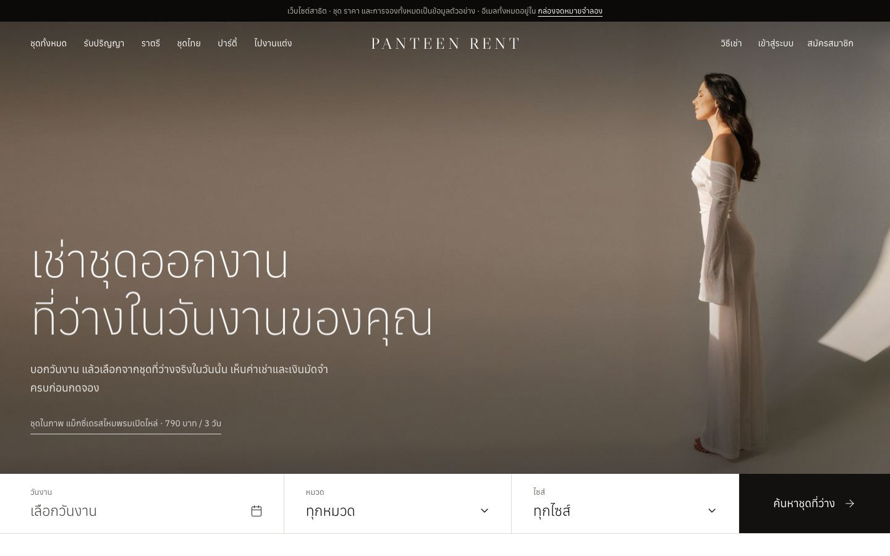
*หน้าแรก: ช่องค้นหาด้านล่างภาพให้กรอกวันงาน หมวด และไซส์ แล้วกด "ค้นหาชุดที่ว่าง"*

**เทคโนโลยีที่ใช้ (อธิบายแบบสั้น)**

| ส่วน | ใช้อะไร | ทำไม |
|---|---|---|
| ภาษาฝั่งเซิร์ฟเวอร์ | PHP 8.1 ขึ้นไป (เขียนเองทั้งหมด ไม่ใช้ framework ไม่ใช้ Composer) | วางในโฟลเดอร์ XAMPP แล้วใช้ได้ทันที |
| ฐานข้อมูล | MySQL 8+ หรือ MariaDB 10.4+ | XAMPP มีให้อยู่แล้ว |
| หน้าเว็บ | HTML ที่สร้างจาก PHP + CSS ไฟล์เดียว + JavaScript ไฟล์เดียว | ไม่ต้อง build ไม่ต้องติดตั้งอะไรเพิ่ม |
| ฟอนต์ | Anuphan (ไทย) และ Libre Caslon Display (โลโก้) เก็บในเครื่อง | เว็บโหลดเร็ว ไม่พึ่งเว็บอื่น |
| อีเมล | ส่งผ่าน SMTP (เช่น Gmail) หรือเก็บไว้ใน "กล่องจดหมายจำลอง" | สาธิตได้โดยไม่ต้องต่ออินเทอร์เน็ต |
| QR | สร้าง QR พร้อมเพย์ตามมาตรฐาน EMVCo เอง และสร้าง QR ป้ายชุดด้วยไลบรารี qrcode.js | ไม่ต้องสมัครบริการภายนอก |

---

## 2. คำศัพท์ที่ใช้ในระบบ

| คำ | ความหมาย |
|---|---|
| **วันงาน** | วันที่ลูกค้าจะใส่ชุดไปงาน |
| **วันรับชุด / วันคืนชุด** | ช่วงที่ชุด "อยู่กับลูกค้า" ใช้คิดค่าเช่าและค่าปรับ ไม่ว่าจะรับที่ร้านหรือรับทางพัสดุ |
| **ค่าเช่า 3 วันแรก** | ราคาเช่าครอบคลุม 3 วัน (วันรับ วันงาน วันคืน) ตั้งค่าได้ |
| **วันเพิ่ม** | วันที่เกิน 3 วัน คิดตาม "ราคาวันเพิ่ม" ของแต่ละชุด |
| **เงินมัดจำ** | จ่ายตอนจอง ได้คืนเมื่อคืนชุดตรงเวลาและสภาพดี ถ้ามีค่าปรับจะหักจากมัดจำก่อน |
| **ค่าปรับคืนช้า** | วันละกี่บาท ตามที่กำหนดไว้ในแต่ละชุด |
| **ค่าเสียหาย** | ค่าซ่อม/ซักพิเศษ/ของหาย คิดจาก "ตารางค่าเสียหาย" ของร้าน |
| **ล็อกชุด** | ช่วงวันที่ชุดไม่ว่างให้คนอื่นจอง = วันชุดออกจากร้าน ถึง วันชุดกลับถึงร้าน + วันซัก |
| **วันส่งออก (ship by)** | วันที่ร้านต้องส่งพัสดุออก เพื่อให้ถึงลูกค้าทันวันรับชุด |
| **ใบปะหน้าส่งคืน** | ใบปะหน้าที่ร้านจ่ายค่าส่งไว้แล้ว แนบในกล่อง ลูกค้าใช้ส่งชุดคืน |
| **โซนจัดส่ง** | "กรุงเทพฯ และปริมณฑล" (กรุงเทพฯ นนทบุรี ปทุมธานี สมุทรปราการ สมุทรสาคร นครปฐม) กับ "ต่างจังหวัด" |
| **ตรวจสภาพ** | ขั้นตอนที่ร้านตรวจชุดที่ได้คืน คิดค่าเสียหาย แล้วปิดการเช่า |
| **ข้อโต้แย้ง** | ลูกค้าไม่เห็นด้วยกับค่าเสียหาย ส่งเหตุผลและรูปให้ร้านทบทวนได้ 1 ครั้ง |
| **ช่องทาง (channel)** | การจองมาจาก "เว็บไซต์" (ลูกค้าจองเอง) หรือ "หน้าร้าน" (พนักงานจองให้) |
| **โหมดสาธิต** | แสดงแถบ "ข้อมูลตัวอย่าง" บนทุกหน้าและปุ่มบัญชีทดลอง ปิดได้ในตั้งค่าร้าน |

---

## 3. ผู้ใช้ 4 แบบและสิทธิ์ของแต่ละแบบ

| | ผู้เยี่ยมชม (ไม่ได้เข้าระบบ) | สมาชิก (member) | พนักงาน (staff) | ผู้ดูแลระบบ (admin) |
|---|:-:|:-:|:-:|:-:|
| ดูชุด ค้นหา ดูปฏิทินว่าง ดูราคา | ✓ | ✓ | ✓ | ✓ |
| สมัครสมาชิก / ลืมรหัสผ่าน | ✓ | | | |
| จองชุด (ต้องยืนยันอีเมลก่อน) | | ✓ | | |
| ชำระเงิน แนบสลิป ยกเลิก ติดตามพัสดุ ส่งคืน โต้แย้ง | | ✓ (เฉพาะการจองของตัวเอง) | | |
| สมุดที่อยู่ สัดส่วน ชุดที่ชอบ นัดลองชุด | | ✓ | | |
| เข้าหลังร้าน: ทุกหน้าด้านงานประจำวัน | | | ✓ | ✓ |
| ตรวจสลิป จองหน้าร้าน ส่งพัสดุ รับคืน ตรวจสภาพ ตอบโต้แย้ง | | | ✓ | ✓ |
| แก้ราคาในตารางค่าเสียหาย | | | ดูได้ | ✓ |
| ระงับบัญชี / เปลี่ยนบทบาทสมาชิก | | | | ✓ |
| ตั้งค่าร้าน อีเมล รีเซ็ตข้อมูลตัวอย่าง | | | | ✓ |

- ถ้าสมาชิกพยายามเปิดหน้าหลังร้าน จะได้หน้า "ไม่มีสิทธิ์" (403)
- ถ้าพยายามเปิดการจองของคนอื่น (เช่น เปลี่ยนเลขใน URL) จะได้ "ไม่พบหน้า" (404) ระบบไม่บอกด้วยซ้ำว่ามีการจองนั้นอยู่

**บัญชีทดลอง** (ใช้ได้เมื่อติดตั้งพร้อมข้อมูลตัวอย่าง)

| บทบาท | อีเมล | รหัสผ่าน |
|---|---|---|
| ผู้ดูแลระบบ | admin@panteen.test | Admin1234 |
| พนักงาน | staff@panteen.test | Staff1234 |
| สมาชิก | member@panteen.test | Member1234 |

> ⚠️ รหัสผ่านเหล่านี้เปิดเผยอยู่ในเอกสารและหน้าเข้าสู่ระบบ **ต้องเปลี่ยนก่อนเปิดใช้งานจริงเสมอ** (ดูหัวข้อ 13.4)

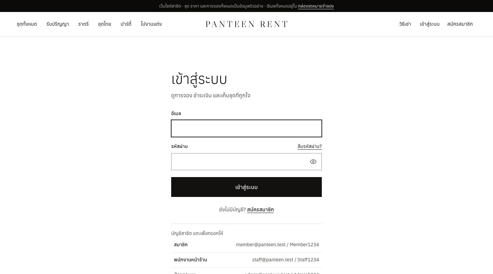
*หน้าเข้าสู่ระบบ: ในโหมดสาธิตมีปุ่มกรอกบัญชีทดลองให้ทันที*

---

## 4. การเช่า 1 ครั้งเดินทางอย่างไร (ภาพใหญ่)

### 4.1 ขั้นตอนตั้งแต่ต้นจนจบ

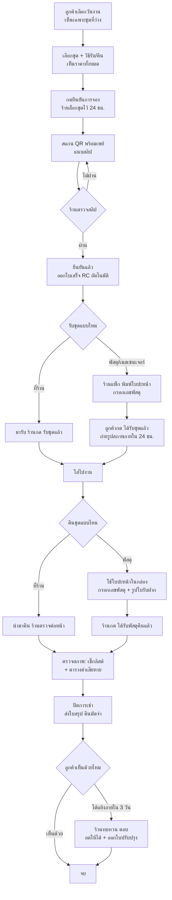

### 4.2 สถานะของการจอง

ทุกการจองมีสถานะเดียว ณ เวลาใดเวลาหนึ่ง และเปลี่ยนได้ตามลูกศรด้านล่างเท่านั้น (ระบบห้ามข้ามขั้น)

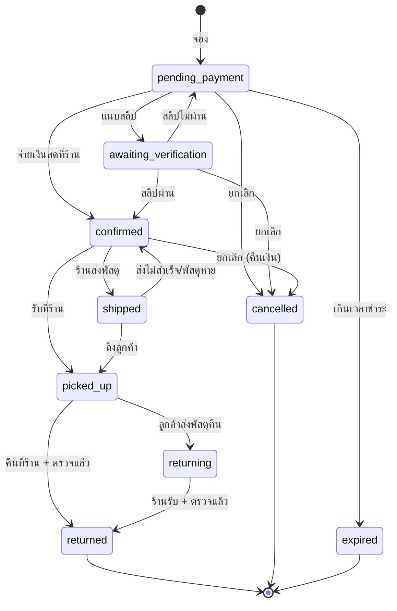

| รหัสสถานะ | ชื่อที่แสดงในเว็บ | ความหมาย | ชุดถูกล็อกไหม |
|---|---|---|:-:|
| `pending_payment` | รอชำระเงิน | จองแล้ว รอโอน (มีเวลาจำกัด) | ✓ จนหมดเวลา |
| `awaiting_verification` | รอร้านตรวจสลิป | ส่งสลิปแล้ว รอพนักงานตรวจ | ✓ |
| `confirmed` | ยืนยันแล้ว รอรับชุด | จ่ายครบ รอวันรับ/วันส่ง | ✓ |
| `shipped` | ร้านส่งชุดแล้ว ระหว่างขนส่ง | พัสดุออกจากร้านแล้ว | ✓ |
| `picked_up` | ชุดอยู่กับลูกค้า (กำลังเช่า) | ลูกค้ามีชุดอยู่ในมือ | ✓ |
| `returning` | ส่งชุดคืนแล้ว รอร้านตรวจรับ | พัสดุคืนกำลังมา หรือถึงแล้วรอตรวจ | ✓ |
| `returned` | คืนชุดแล้ว | ตรวจสภาพและปิดการเช่าแล้ว | ✓ เฉพาะวันซัก |
| `cancelled` | ยกเลิกแล้ว | ยกเลิกโดยลูกค้าหรือร้าน | ✗ |
| `expired` | หมดเวลาชำระ | ไม่จ่ายภายในเวลา ระบบยกเลิกให้อัตโนมัติ | ✗ |

### 4.3 สถานะของชุด

| สถานะ | ความหมาย |
|---|---|
| เปิดให้เช่า | แสดงในหน้าร้าน จองได้ |
| ซ่อม/ซักพิเศษ | ซ่อนจากการจองชั่วคราว (ตั้งจากหน้าตรวจสภาพหรือหน้าแก้ไขชุด) |
| เลิกให้เช่า | ซ่อนถาวร เช่น ชุดเสียหายหนักหรือสูญหาย |

ในหลังร้านจะเห็น "สถานะตอนนี้" ของชุดเพิ่มอีกชั้น: ว่างตอนนี้ / ติดจองวันนี้ / อยู่กับลูกค้า / อยู่ระหว่างขนส่ง / รอซักหลังคืน

---

## 5. ฝั่งลูกค้า: ทุกหน้าและทุกปุ่ม

### 5.1 หน้าแรก (`/`)

- เมนูบน: ชุดทั้งหมด และหมวดชุด (รับปริญญา ราตรี ชุดไทย ปาร์ตี้ ไปงานแต่ง) ด้านขวาคือ วิธีเช่า ชุดที่ชอบ การจองของฉัน แจ้งเตือน และเมนูบัญชี
- **แถบค้นหา** ใต้ภาพใหญ่: กรอกวันงาน หมวด ไซส์ แล้วกด "ค้นหาชุดที่ว่าง" ระบบพาไปหน้ารายการชุดที่ว่างจริงในวันนั้น
- ส่วนถัดลงไป: หมวดชุด ชุดเข้าใหม่ ขั้นตอนการเช่าแบบย่อ และข้อมูลร้าน
- แถบดำบนสุด "เว็บไซต์สาธิต…" แสดงเฉพาะเมื่อเปิดโหมดสาธิต

### 5.2 รายการชุด (`/dresses`, `/c/{หมวด}`)

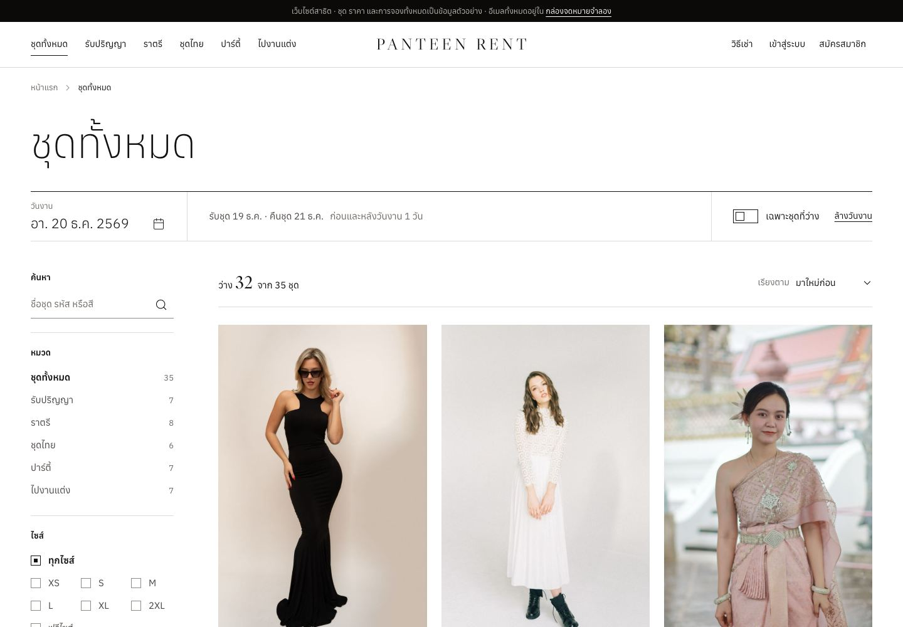

- **ตัวกรองด้านซ้าย**: วันงาน หมวด ไซส์ สี ช่วงราคา และ "พอดีกับสัดส่วนของฉัน" (ใช้สัดส่วนที่บันทึกไว้ในบัญชี)
- **เรียงลำดับ**: แนะนำ ราคาต่ำ→สูง ราคาสูง→ต่ำ มาใหม่
- เมื่อใส่วันงาน การ์ดชุดที่ **ไม่ว่าง** ในวันนั้นจะถูกตัดออก ไม่ต้องกดเข้าไปลุ้นทีละชุด
- บนมือถือ ตัวกรองยุบเป็นปุ่ม "ตัวกรอง" ที่เปิดเป็นแผงจากด้านข้าง

### 5.3 หน้าชุด (`/dress/{รหัสชุด}`)

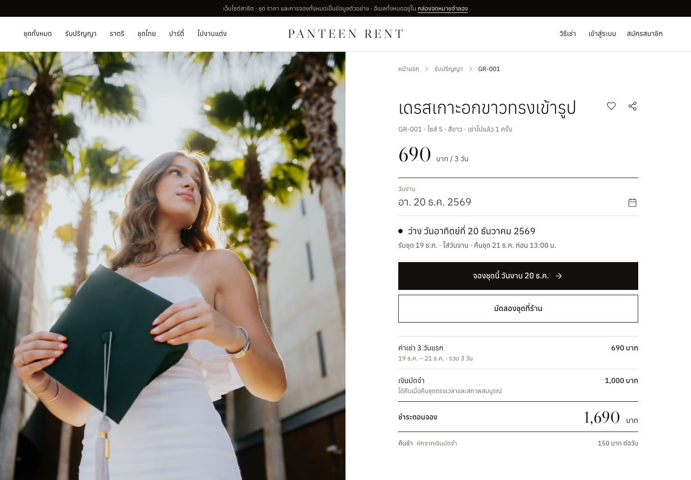

| ส่วน | อธิบาย |
|---|---|
| รูปชุด | ดูได้หลายรูป กดขยายได้ |
| ราคา | ค่าเช่า 3 วันแรก ราคาวันเพิ่ม เงินมัดจำ ค่าปรับคืนช้า |
| สัดส่วนชุด | รอบอก เอว สะโพก ความยาว (นิ้ว) ถ้าสมาชิกบันทึกสัดส่วนไว้ ระบบบอกว่า "พอดีกับสัดส่วนของคุณ" หรือไม่ |
| ปฏิทิน | วันที่ชุดไม่ว่างจะถูกปิด เลือกวันงานแล้วระบบเสนอวันรับ-คืนให้ |
| ใบเสนอราคา | คำนวณสดทันทีที่เปลี่ยนวัน (ผ่าน `/api/dress/{code}/quote`) |
| ของที่มากับชุด | เช่น ผ้าคล้องไหล่ เข็มขัด ใช้ในใบแพ็กของและตอนตรวจคืน |
| ปุ่มหัวใจ | เก็บเข้า "ชุดที่ชอบ" |

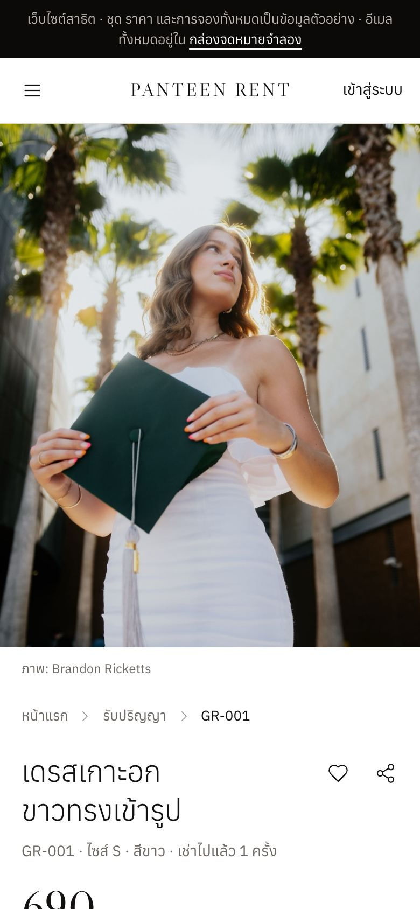

*หน้าชุดบนมือถือ (กว้าง 390 px): ทุกหน้าในระบบทดสอบแล้วว่าไม่ล้นจอ*

### 5.4 จองชุด (`/book/{รหัสชุด}`)

ต้องเข้าระบบและ **ยืนยันอีเมลแล้ว** จึงจองได้

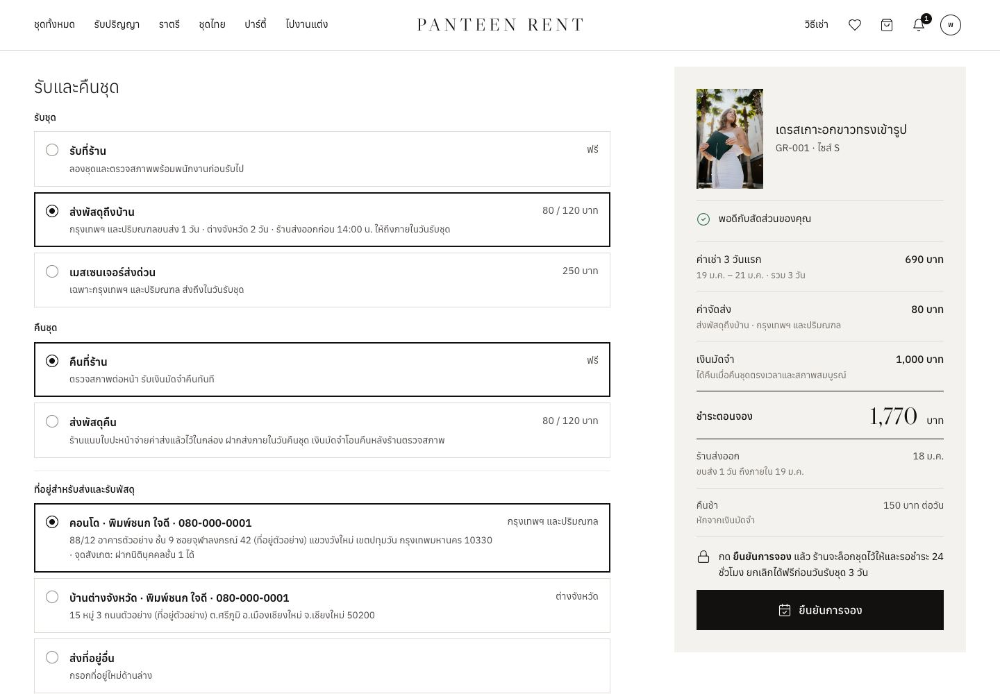

**ขั้นที่ 1: รับชุด** (เลือก 1 ใน 3)

| วิธี | ค่าบริการ (ค่าเริ่มต้น) | เงื่อนไข |
|---|---|---|
| รับที่ร้าน | ฟรี | ลองชุดและตรวจสภาพพร้อมพนักงาน |
| ส่งพัสดุถึงบ้าน | 80 บาท (กทม./ปริมณฑล) / 120 บาท (ต่างจังหวัด) | กทม. ขนส่ง 1 วัน ต่างจังหวัด 2 วัน ร้านส่งออกก่อน 14:00 น. ให้ถึงภายในวันรับชุด |
| เมสเซนเจอร์ส่งด่วน | 250 บาท | เฉพาะ กทม. และปริมณฑล ถึงในวันรับชุด |

**ขั้นที่ 2: คืนชุด** (เลือก 1 ใน 2)

| วิธี | ค่าบริการ | เงื่อนไข |
|---|---|---|
| คืนที่ร้าน | ฟรี | ตรวจสภาพต่อหน้า รับเงินมัดจำคืนทันที |
| ส่งพัสดุคืน | 80 / 120 บาท ตามโซน | ร้านแนบใบปะหน้าจ่ายค่าส่งแล้วไว้ในกล่อง ฝากส่งภายในวันคืนชุด มัดจำโอนคืนหลังตรวจสภาพ |

**ขั้นที่ 3: ที่อยู่** (เมื่อเลือกส่งพัสดุหรือเมสเซนเจอร์)

- เลือกจากสมุดที่อยู่ที่บันทึกไว้ หรือ "ส่งที่อยู่อื่น" แล้วกรอกใหม่ (ติ๊ก "บันทึกไว้ใช้ครั้งหน้า" ได้)
- ระบบดูจังหวัดเพื่อกำหนดโซน แล้วคิดค่าส่งและวันส่งออกใหม่ทันที

**กล่องสรุปด้านขวา** แสดง ค่าเช่า ค่าจัดส่ง ค่าส่งคืน เงินมัดจำ ยอดชำระตอนจอง วันร้านส่งออก และค่าปรับคืนช้า
กด **ยืนยันการจอง** แล้วร้านจะล็อกชุดไว้ให้และรอชำระ 24 ชั่วโมง

> ระบบตรวจซ้ำตอนกดยืนยันเสมอ ถ้ามีคนอื่นจองชุดเดียวกันตัดหน้าไปเสี้ยววินาที การจองที่สองจะถูกปฏิเสธพร้อมข้อความ
> (ทดสอบแล้วด้วยการยิงจองพร้อมกัน 6 process)

### 5.5 ชำระเงิน (`/bookings/{id}`)

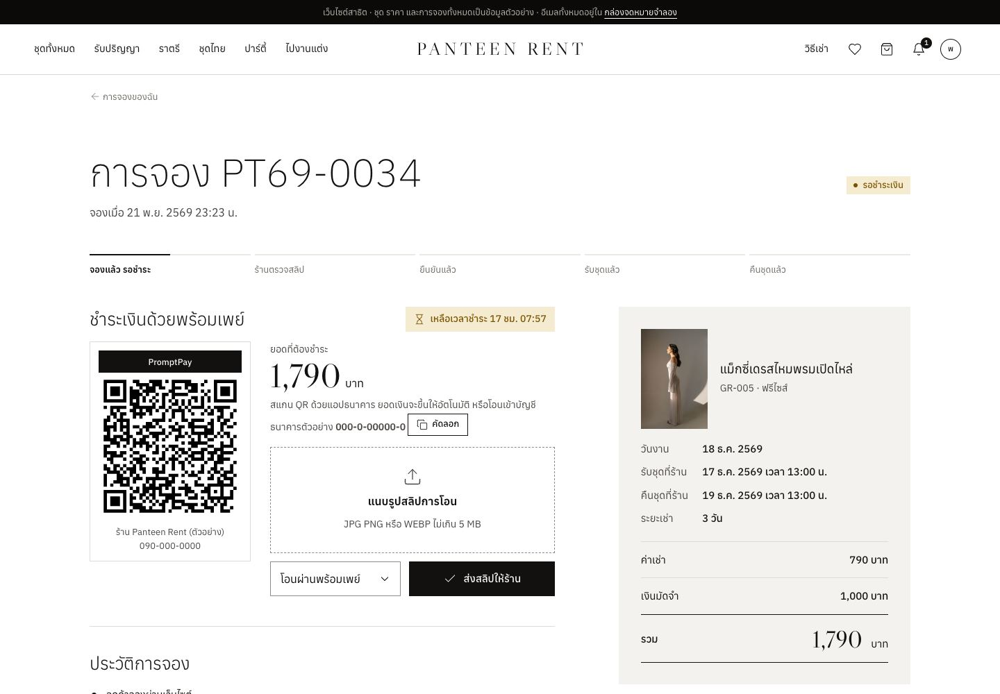

1. สแกน **QR พร้อมเพย์** (ยอดเงินฝังใน QR แล้ว) หรือโอนเข้าบัญชีที่แสดง (มีปุ่มคัดลอกเลขบัญชี)
2. แนบรูปสลิป (JPG PNG WEBP ไม่เกิน 5 MB) เลือกวิธีโอน แล้วกด **ส่งสลิปให้ร้าน**
3. สถานะเปลี่ยนเป็น "รอร้านตรวจสลิป" เมื่อร้านอนุมัติ จะได้แจ้งเตือน อีเมล และใบเสร็จ

- นาฬิกานับถอยหลัง "เหลือเวลาชำระ" บอกเวลาที่เหลือ เกินเวลาระบบยกเลิกให้อัตโนมัติและปล่อยชุดให้คนอื่น
- ถ้าสลิปไม่ผ่าน ร้านต้องใส่เหตุผล ลูกค้าเห็นเหตุผลและแนบสลิปใหม่ได้
- แถบความคืบหน้าด้านบนบอกว่าอยู่ขั้นไหน (การจองแบบรับที่ร้านมี 5 ขั้น แบบพัสดุมี 7 ขั้น)

### 5.6 ติดตามพัสดุและแจ้งสภาพตอนได้รับ

เมื่อร้านส่งพัสดุ หน้าการจองจะแสดงขนส่ง เลขพัสดุ ปุ่ม **คัดลอกเลขพัสดุ** และ **เปิดหน้าติดตามพัสดุ** ของขนส่งนั้น

เมื่อได้รับกล่อง ลูกค้ากด **ได้รับชุดแล้ว** และภายใน 24 ชั่วโมงสามารถ

- แนบรูปชุดตอนแกะกล่อง (ครั้งละไม่เกิน 6 รูป รูปละไม่เกิน 5 MB)
- เขียนหมายเหตุถ้าพบปัญหา เช่น "ตะขอหลุดมาตั้งแต่ในกล่อง"

ร้านจะเห็นรูปและหมายเหตุนี้ตอนตรวจคืน และ **ไม่คิดเงินจุดที่ลูกค้าแจ้งไว้แล้ว**

### 5.7 ส่งชุดคืนทางพัสดุ

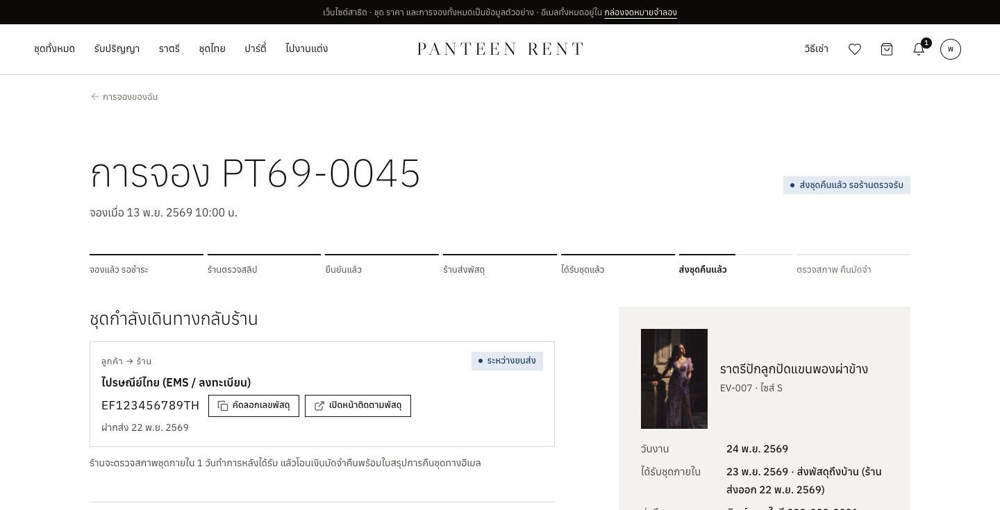

1. แพ็กชุดกลับลงกล่องเดิม ใช้ใบปะหน้าส่งคืนที่ร้านแนบไว้
2. ฝากส่งภายในวันคืนชุด
3. ในหน้าการจอง กรอก ขนส่ง เลขพัสดุ วันที่ฝากส่ง และแนบรูปใบรับฝาก (ไม่บังคับแต่ช่วยยืนยัน)
4. สถานะเป็น "ส่งชุดคืนแล้ว รอร้านตรวจรับ" **ร้านนับวันฝากส่งเป็นวันคืน** ลูกค้าไม่ถูกปรับเพราะขนส่งช้า

ระบบตรวจรูปแบบเลขพัสดุตามขนส่ง เช่น ไปรษณีย์ไทยต้องเป็น `EF123456789TH`, J&T ต้องเป็นตัวเลข 12 หลัก

| ขนส่งที่รองรับ | รูปแบบเลขพัสดุ |
|---|---|
| ไปรษณีย์ไทย (EMS / ลงทะเบียน) | อักษร 2 ตัว + เลข 9 หลัก + TH |
| KEX (Kerry Express) | อักษร/ตัวเลข 8–20 ตัว |
| Flash Express | อักษร/ตัวเลข 8–20 ตัว |
| J&T Express | ตัวเลข 12 หลัก |
| เมสเซนเจอร์ (Lalamove / Grab) | ไม่บังคับเลข |
| ขนส่งอื่น | อักษร/ตัวเลข/ขีด 6–30 ตัว |

### 5.8 ผลตรวจสภาพและการคืนมัดจำ

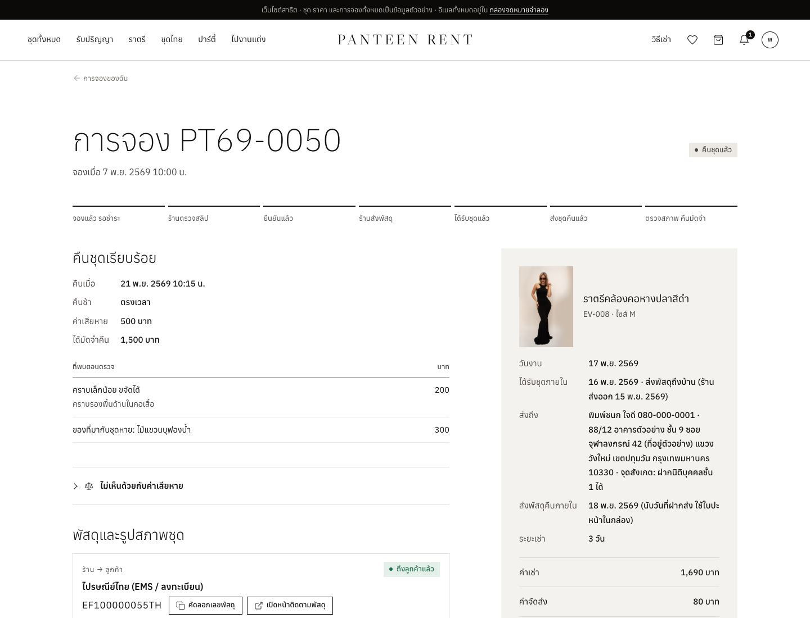

หลังร้านตรวจ ลูกค้าเห็น วันที่คืน คืนช้ากี่วัน ค่าเสียหายแยกรายการ (พร้อมหมายเหตุตำแหน่ง) และ **มัดจำที่ได้คืน**
พร้อมได้รับอีเมล "ใบสรุปการคืนชุด"

### 5.9 โต้แย้งค่าเสียหาย

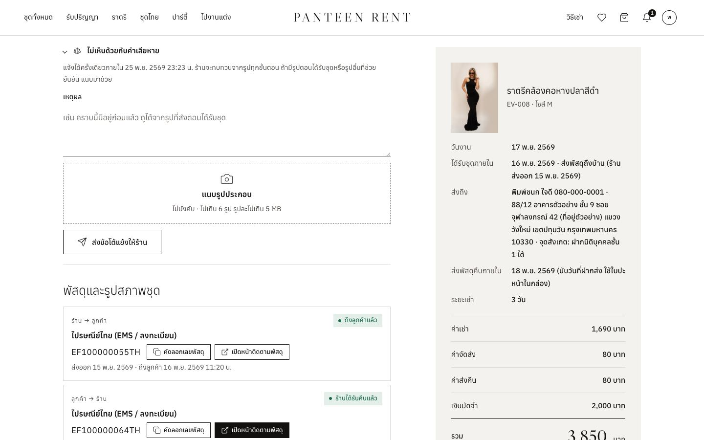

- กด "ไม่เห็นด้วยกับค่าเสียหาย" เขียนเหตุผล แนบรูปได้สูงสุด 6 รูป แล้วกด **ส่งข้อโต้แย้งให้ร้าน**
- ส่งได้ **ครั้งเดียว** และภายใน 3 วันหลังร้านตรวจ (ตั้งค่าได้)
- ร้านตอบกลับพร้อมลดค่าเสียหายได้ ถ้าลด ระบบบันทึกการคืนเงินและออก "ใบปรับปรุงค่าเสียหาย" ให้อัตโนมัติ

### 5.10 ใบเสร็จ (`/receipts/{id}`)

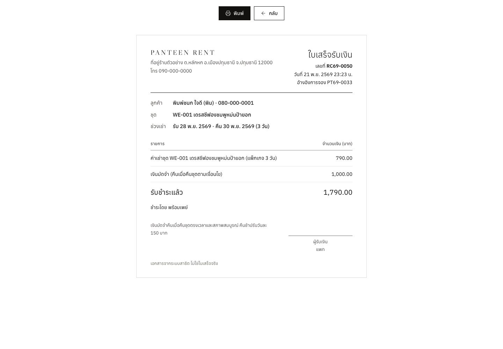

มี 3 แบบ เลขที่เรียงต่อกันทั้งปี (เช่น RC69-0001 โดย 69 คือปี พ.ศ. 2569)

| แบบ | ออกเมื่อ |
|---|---|
| ใบเสร็จค่าเช่าและมัดจำ | ร้านอนุมัติการชำระเงิน |
| ใบสรุปการคืนชุด | ร้านตรวจสภาพและปิดการเช่า |
| ใบปรับปรุงค่าเสียหาย | ร้านลดค่าเสียหายหลังมีข้อโต้แย้ง |

พิมพ์หรือบันทึกเป็น PDF จากเบราว์เซอร์ได้ (หน้าใบเสร็จจัดหน้าสำหรับพิมพ์ไว้แล้ว)

### 5.11 บัญชีของฉัน

| หน้า | ทำอะไรได้ |
|---|---|
| `/account` ข้อมูลส่วนตัว | ชื่อ ชื่อเล่น เบอร์ LINE ID สัดส่วน (อก เอว สะโพก ส่วนสูง) เปลี่ยนรหัสผ่าน |
| `/account/addresses` สมุดที่อยู่ | เก็บได้สูงสุดหลายที่อยู่ ตั้งค่าเริ่มต้น แก้ ลบ |
| `/account/favorites` ชุดที่ชอบ | รวมชุดที่กดหัวใจไว้ |
| `/account/notifications` แจ้งเตือน | ทุกความเคลื่อนไหวของการจอง กด "อ่านทั้งหมด" ได้ |
| `/account/appointments` นัดลองชุด | ขอนัดลองชุดที่ร้าน เลือกวันและช่วงเวลาที่ยังว่าง ยกเลิกนัดได้ |
| `/bookings` การจองของฉัน | รายการจองทั้งหมดพร้อมสถานะ |

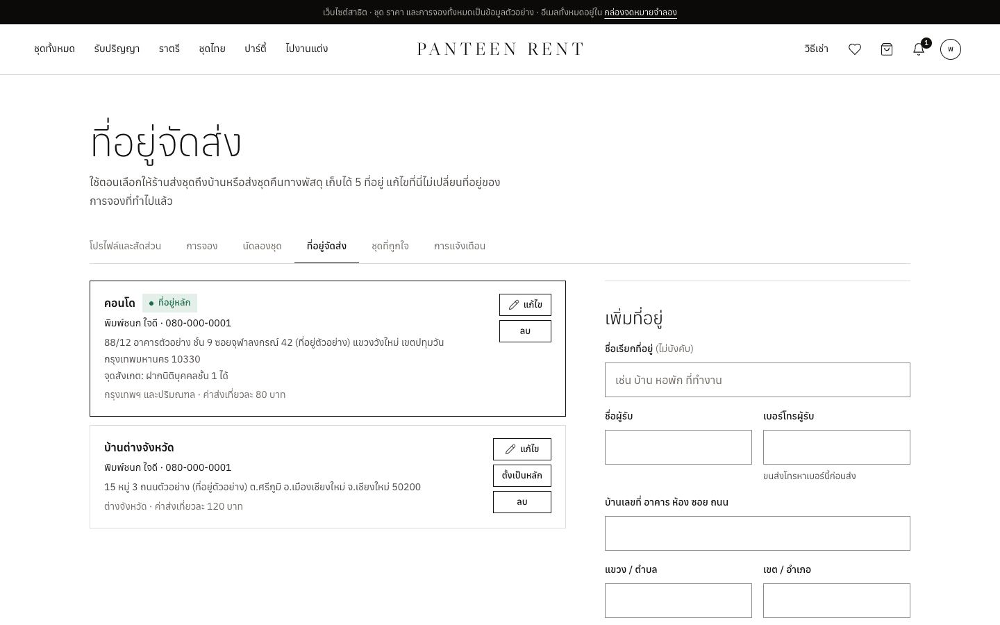

> แก้ที่อยู่ในสมุดภายหลัง **ไม่เปลี่ยน** ที่อยู่ของการจองที่ทำไปแล้ว เพราะการจองคัดลอกที่อยู่เก็บไว้ ณ ตอนจอง
> (กันพัสดุไปผิดที่โดยไม่ตั้งใจ)

### 5.12 วิธีเช่า (`/how-to-rent`)

หน้าอธิบายขั้นตอน เงื่อนไขการเช่า และส่วน "ส่งชุดถึงบ้านและส่งคืนทางพัสดุ" ที่ดึงค่าจริงจากการตั้งค่าร้าน
(ค่าส่ง วันขนส่ง เวลาตัดรอบ ระยะเวลาแจ้งสภาพ ระยะเวลาโต้แย้ง) แก้ตั้งค่าแล้วหน้านี้เปลี่ยนตามทันที

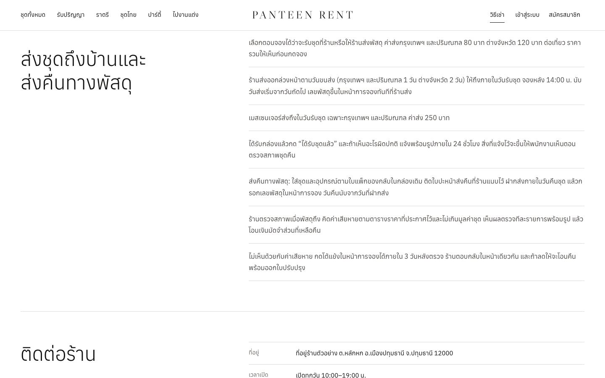

### 5.13 สมัครสมาชิก ยืนยันอีเมล ลืมรหัสผ่าน

- สมัคร: ชื่อ นามสกุล อีเมล เบอร์โทร รหัสผ่าน (อย่างน้อย 8 ตัว ต้องมีทั้งตัวอักษรและตัวเลข)
- ระบบส่งลิงก์ยืนยันอีเมล ต้องยืนยันก่อนจอง (ส่งลิงก์ใหม่ได้ที่ `/account/verify`)
- ลืมรหัสผ่าน: กรอกอีเมลที่ `/forgot` แล้วกดลิงก์ในอีเมลเพื่อตั้งรหัสใหม่ ลิงก์ใช้ได้ครั้งเดียวและมีวันหมดอายุ
- ในโหมดทดสอบ อีเมลทั้งหมดอยู่ใน "กล่องจดหมายจำลอง" `/dev/mailbox`

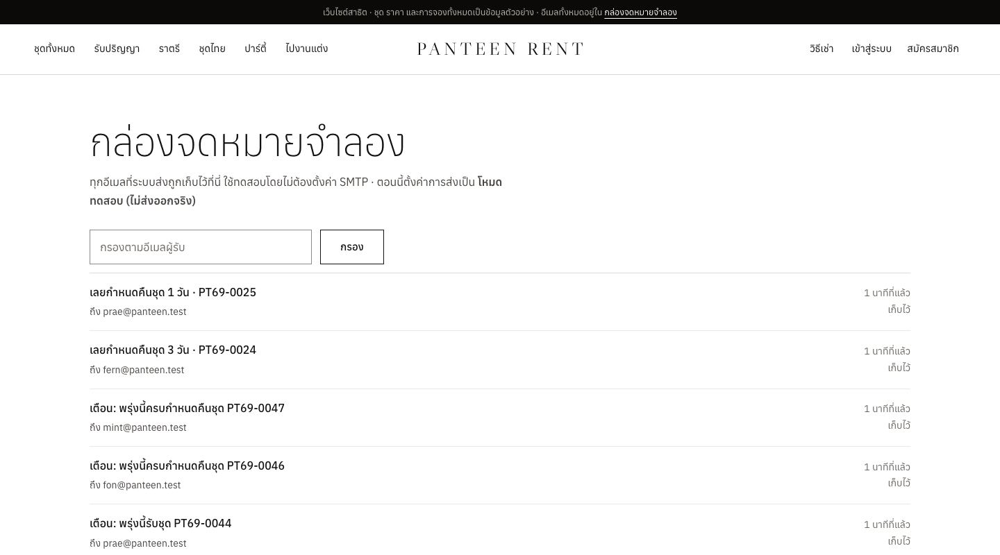

---

## 6. ฝั่งร้าน (หลังร้าน): ทุกหน้าและทุกปุ่ม

เข้าระบบด้วยบัญชีพนักงานหรือผู้ดูแล ระบบพาไปที่ `/admin` อัตโนมัติ

**โครงหน้าจอหลังร้าน**

- **เมนูซ้าย**: จองหน้าร้าน (ปุ่มดำ) วันนี้ การจอง ตรวจสลิป จัดส่งและรับคืน สแกนชุด ตารางชุด นัดหมาย ชุด หมวดชุด ค่าเสียหาย สมาชิก รายงาน ตั้งค่าร้าน
  ตัวเลขในกล่องดำข้างเมนูคือจำนวนงานที่ค้าง
- **ช่องค้นหาด้านบน**: พิมพ์เลขจอง ชื่อลูกค้า เบอร์โทร หรือรหัสชุด แล้วกระโดดไปหน้านั้นได้ทันที
- **กระดิ่ง**: แจ้งเตือนของร้าน เช่น มีสลิปใหม่ ลูกค้าแจ้งปัญหาตอนได้รับ ลูกค้าส่งพัสดุคืน มีข้อโต้แย้ง

### 6.1 วันนี้ (`/admin`)

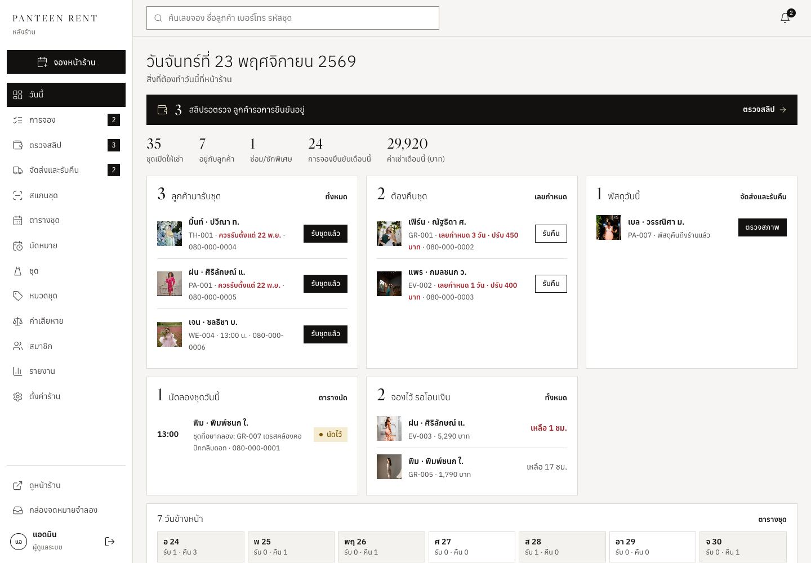

หน้าแรกของพนักงาน ตอบคำถาม "วันนี้ต้องทำอะไร"

| กล่อง | แสดง | ปุ่มลัด |
|---|---|---|
| แถบดำบนสุด | จำนวนสลิปที่รอตรวจ | ตรวจสลิป |
| ตัวเลขสรุป | ชุดเปิดให้เช่า อยู่กับลูกค้า ซ่อม/ซักพิเศษ การจองยืนยันเดือนนี้ ค่าเช่าเดือนนี้ | |
| ลูกค้ามารับชุด | คนที่ต้องมารับวันนี้ (สีแดงถ้าเลยวันรับมาแล้ว) | รับชุดแล้ว |
| ต้องคืนชุด | คนที่ครบกำหนดคืน พร้อมค่าปรับสะสมถ้าเลยกำหนด | รับคืน |
| พัสดุวันนี้ | พัสดุที่ต้องส่งออกวันนี้ และพัสดุคืนที่ถึงร้าน | ตรวจสภาพ |
| นัดลองชุดวันนี้ | เวลา ชื่อ ชุดที่อยากลอง | |
| จองไว้ รอโอนเงิน | การจองที่ใกล้หมดเวลาชำระ (สีแดงถ้าเหลือน้อย) | |
| 7 วันข้างหน้า | จำนวนรับ/คืนในแต่ละวัน | ตารางชุด |

### 6.2 จองหน้าร้าน (`/admin/bookings/new`)

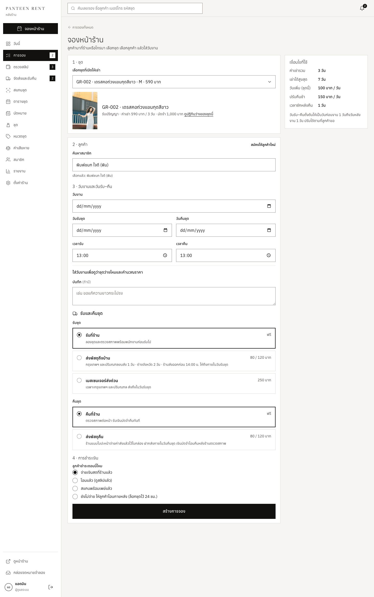

สำหรับลูกค้าที่มาที่ร้านหรือโทรมา

1. **ชุด**: เลือกชุดที่เปิดให้เช่า เห็นรูป ค่าเช่า มัดจำ และลิงก์ "ดูปฏิทินว่างของชุดนี้"
2. **ลูกค้า**: พิมพ์ชื่อหรือเบอร์เพื่อค้นหาสมาชิกเดิม ถ้าเป็นลูกค้าใหม่กด "สมัครให้ลูกค้าใหม่" แล้วระบบพากลับมาหน้านี้
3. **วันงานและวันรับ–คืน**: ใส่วันงาน ระบบตั้งวันรับก่อนงาน 1 วันและวันคืนหลังงาน 1 วันให้ (แก้ได้) ตรวจว่าชุดว่างและคำนวณราคาทันที
   ใส่บันทึกได้ (เช่น ขอแก้ความยาวกระโปรง)
4. **รับและคืนชุด**: ตัวเลือกเดียวกับฝั่งลูกค้า (รับที่ร้าน / ส่งพัสดุ / เมสเซนเจอร์ และ คืนที่ร้าน / ส่งพัสดุคืน)
   ถ้าส่งพัสดุ ระบบแสดงที่อยู่ที่ลูกค้าบันทึกไว้ให้เลือก หรือกรอกที่อยู่ใหม่ (ติ๊กบันทึกลงสมุดที่อยู่ของลูกค้าได้)
5. **การชำระเงิน** เลือก 1 ใน 4: จ่ายเงินสดที่ร้านแล้ว / โอนแล้ว (ดูสลิปแล้ว) / สแกนพร้อมเพย์แล้ว (3 แบบนี้การจองยืนยันทันทีและออกใบเสร็จ)
   หรือ **ยังไม่จ่าย ให้ลูกค้าโอนภายหลัง** (ล็อกชุดไว้ 24 ชม. เหมือนจองออนไลน์)
6. กด **สร้างการจอง**

กล่อง "เงื่อนไขที่ใช้" ด้านขวาแสดงกติกาของชุดที่เลือก (วันรวมในค่าเช่า เช่าได้สูงสุด ราคาวันเพิ่ม ค่าปรับคืนช้า เวลาซัก)
การจองหน้าร้านไม่ติดกฎ "รอชำระได้ไม่เกิน 3 รายการ" ของลูกค้า และบันทึกช่องทางเป็น "หน้าร้าน" เพื่อแยกในรายงาน

### 6.3 การจอง (`/admin/bookings`)

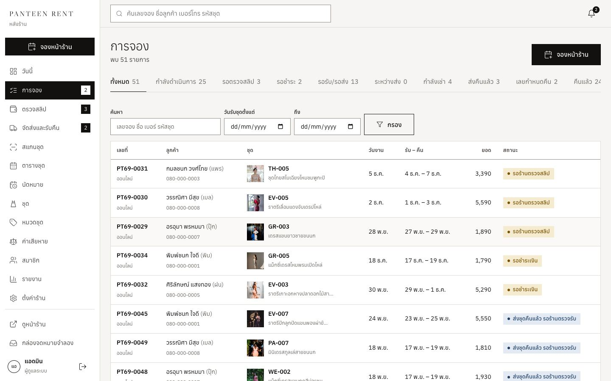

กรองตามสถานะ ช่วงวันที่ ช่องทาง ค้นหาด้วยคำ แล้วกดเข้าหน้ารายละเอียด

**หน้ารายละเอียดการจอง** (`/admin/bookings/{id}`)

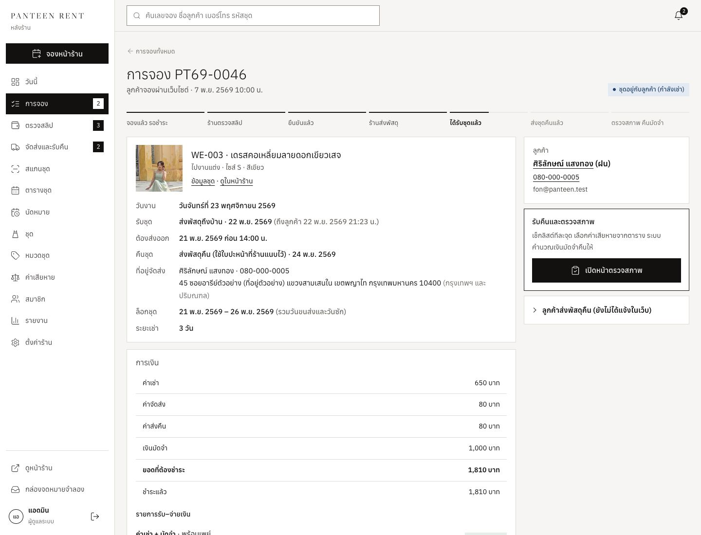

| ส่วน | อธิบาย |
|---|---|
| แถบความคืบหน้า | ขั้นที่การจองอยู่ |
| ข้อมูลชุดและวันที่ | วันงาน วิธีรับ (และเวลาที่ถึงลูกค้าจริง) วันต้องส่งออก วิธีคืน ที่อยู่จัดส่ง ช่วงล็อกชุด ระยะเช่า |
| การเงิน | ค่าเช่า ค่าจัดส่ง ค่าส่งคืน มัดจำ ยอดที่ต้องชำระ ชำระแล้ว และรายการรับ-จ่ายเงินทุกรายการ |
| กล่องขวา "งานถัดไป" | ปุ่มที่ใช้ได้ ณ สถานะนั้นเท่านั้น เช่น รับชำระ ส่งพัสดุ รับชุดแล้ว รับคืนและตรวจสภาพ |
| พัสดุและรูปสภาพชุด | ทุกพัสดุทั้งขาไปขากลับ + รูปทุกขั้น (ก่อนส่งมอบ ลูกค้าถ่ายตอนได้รับ ใบรับฝาก ตอนรับคืน หลักฐานโต้แย้ง) |
| ประวัติ | ทุกเหตุการณ์ของการจองนี้ ใครทำ เมื่อไร |
| เลื่อนวัน / ยกเลิก | เลื่อนวันได้ถ้าชุดยังว่าง ยกเลิกพร้อมกำหนดยอดคืนเงิน |

### 6.4 ตรวจสลิป (`/admin/payments`)

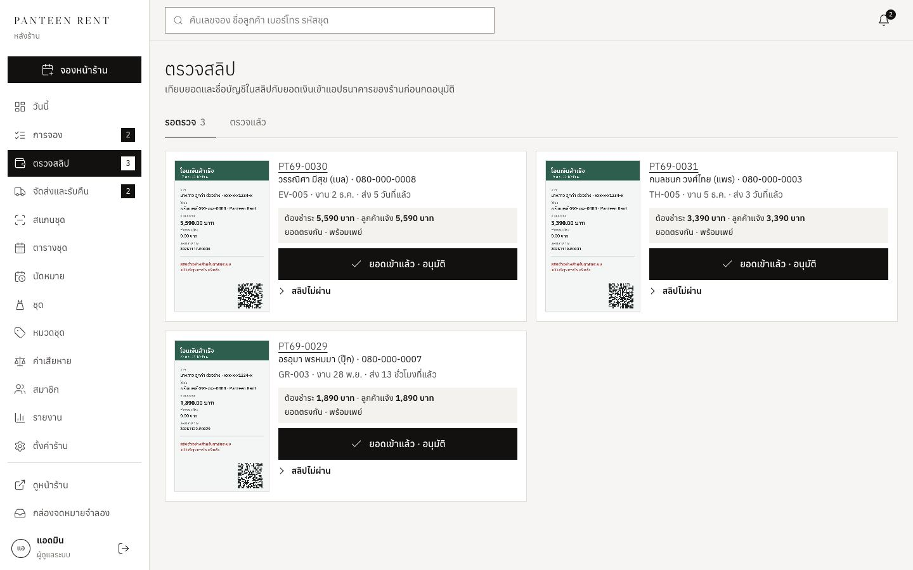

- แท็บ **รอตรวจ** / **ตรวจแล้ว**
- แต่ละการ์ดมีรูปสลิป (กดดูใหญ่ได้) เลขจอง ชื่อลูกค้า ชุด วันงาน ส่งมาเมื่อไร และกล่องเทียบ "ต้องชำระ … · ลูกค้าแจ้ง …" ว่ายอดตรงกันไหม
- ตรวจยอดเข้าในแอปธนาคารของร้านก่อน แล้วกด **ยอดเข้าแล้ว · อนุมัติ** (ยืนยันการจอง ออกใบเสร็จ ส่งอีเมล)
  หรือเปิด **สลิปไม่ผ่าน** ใส่เหตุผล (การจองกลับไปรอชำระ ลูกค้าแนบใหม่ได้)

### 6.5 จัดส่งและรับคืน (`/admin/shipping`)

ศูนย์รวมงานพัสดุ แบ่ง 6 แท็บตามลำดับงาน

| แท็บ | มีอะไร | ทำอะไรต่อ |
|---|---|---|
| ต้องส่งออก | การจองยืนยันแล้วที่ถึงวันส่งออก เรียงตามวันที่ต้องส่ง | พิมพ์ใบปะหน้า แพ็ก กรอกเลขพัสดุ |
| กำลังไปหาลูกค้า | พัสดุที่ส่งแล้วแต่ยังไม่ถึง | กด "ถึงลูกค้าแล้ว" หรือ "ส่งไม่สำเร็จ" |
| รอลูกค้าส่งคืน | ชุดที่อยู่กับลูกค้าและเลือกคืนทางพัสดุ | ติดตาม ถ้าเลยกำหนดจะเห็นจำนวนวัน |
| พัสดุคืนกำลังมา | ลูกค้าแจ้งเลขพัสดุคืนแล้ว | กด "รับพัสดุคืน" เมื่อถึง |
| รอตรวจสภาพ | พัสดุคืนถึงร้านแล้ว | ตรวจสภาพ |
| ข้อโต้แย้งรอตอบ | ลูกค้าโต้แย้งค่าเสียหาย | ตอบ |

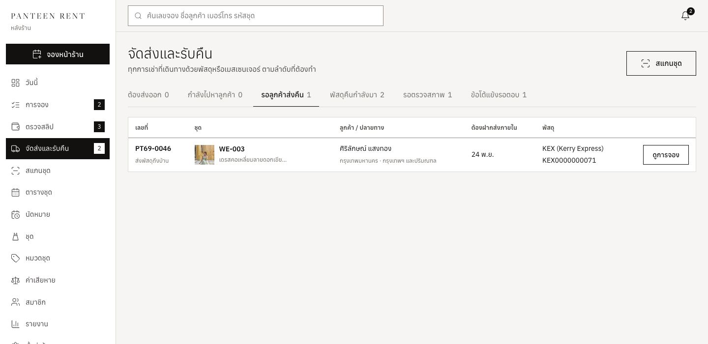

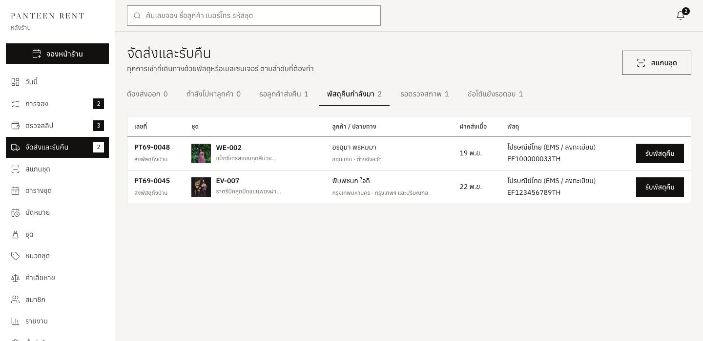

### 6.6 ใบปะหน้าและใบแพ็กของ (`/admin/bookings/{id}/label`)

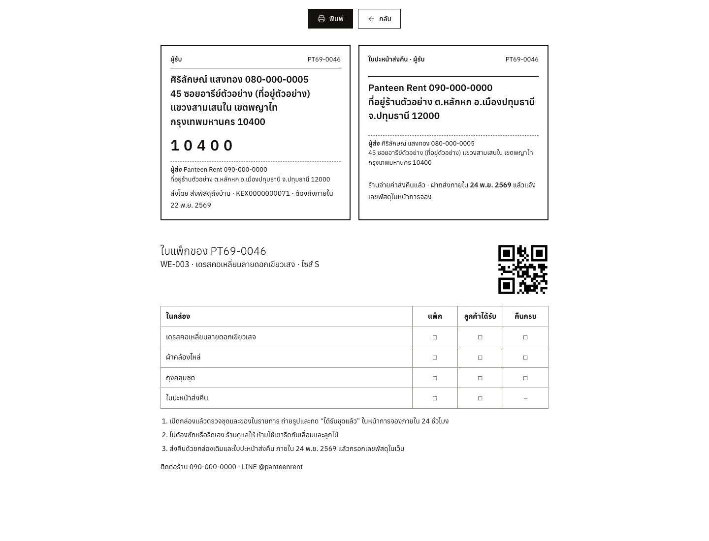

พิมพ์ได้ในกระดาษแผ่นเดียว มี 3 ส่วน

1. **ใบปะหน้าขาไป**: ผู้รับ ที่อยู่ รหัสไปรษณีย์ตัวใหญ่ ผู้ส่ง ขนส่งและเลขพัสดุ วันที่ต้องถึง
2. **ใบปะหน้าส่งคืน** (ถ้าลูกค้าเลือกส่งคืนทางพัสดุ): ผู้รับคือร้าน ผู้ส่งคือลูกค้า และข้อความ "ร้านจ่ายค่าส่งคืนแล้ว ฝากส่งภายใน…"
3. **ใบแพ็กของ**: รายการของในกล่อง (ชุด ของที่มากับชุด ถุงคลุมชุด ใบปะหน้าส่งคืน) พร้อมช่องติ๊ก "แพ็ก / ลูกค้าได้รับ / คืนครบ"
   คำแนะนำ 3 ข้อสำหรับลูกค้า และ **QR ของการจอง** สำหรับสแกนตอนพัสดุกลับมา

### 6.7 ส่งพัสดุออก

ในหน้าการจองสถานะ "ยืนยันแล้ว" ที่เลือกส่งพัสดุ:

1. (แนะนำ) แนบรูปสภาพชุดก่อนส่งมอบ เป็นหลักฐานกรณีมีข้อโต้แย้งภายหลัง
2. เลือกขนส่ง กรอกเลขพัสดุ (ระบบตรวจรูปแบบ) กด **ส่งพัสดุแล้ว**
3. สถานะเป็น "ร้านส่งชุดแล้ว" ลูกค้าได้แจ้งเตือนพร้อมเลขพัสดุ

เมื่อพัสดุถึง ลูกค้ากดยืนยันเอง หรือพนักงานกด **ถึงลูกค้าแล้ว** เมื่อเห็นสถานะในเว็บขนส่ง

### 6.8 สแกนชุด (`/admin/scan`)

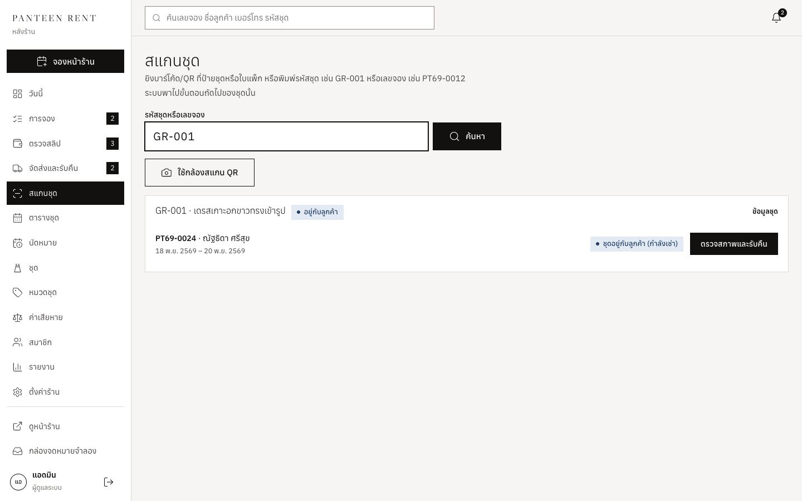

- ยิงบาร์โค้ด/QR ด้วยเครื่องสแกน หรือกด **ใช้กล้องสแกน QR** (ใช้กล้องมือถือ/แท็บเล็ต)
- พิมพ์เองก็ได้ เช่น `GR-001` หรือ `PT69-0012`
- ระบบแสดงชุด สถานะตอนนี้ การจองที่เกี่ยวข้อง และ **ปุ่มขั้นตอนถัดไป** ทันที (เช่น "ตรวจสภาพและรับคืน")
- ถ้าเจอผลเดียว ระบบพาไปหน้านั้นเลย

### 6.9 ป้าย QR ชุด (`/admin/costumes/{id}/tag`)

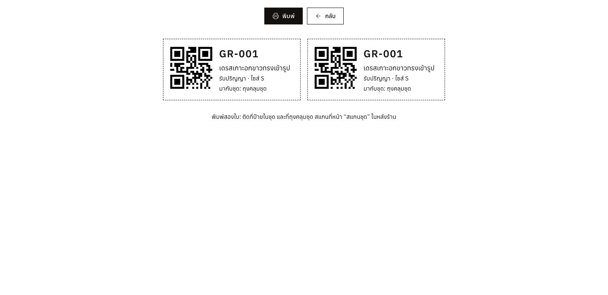

ป้ายพิมพ์ติดไม้แขวนหรือถุงคลุมชุด มีรหัสชุด ชื่อ ไซส์ และ QR สำหรับสแกนในข้อ 6.8

### 6.10 รับพัสดุคืน

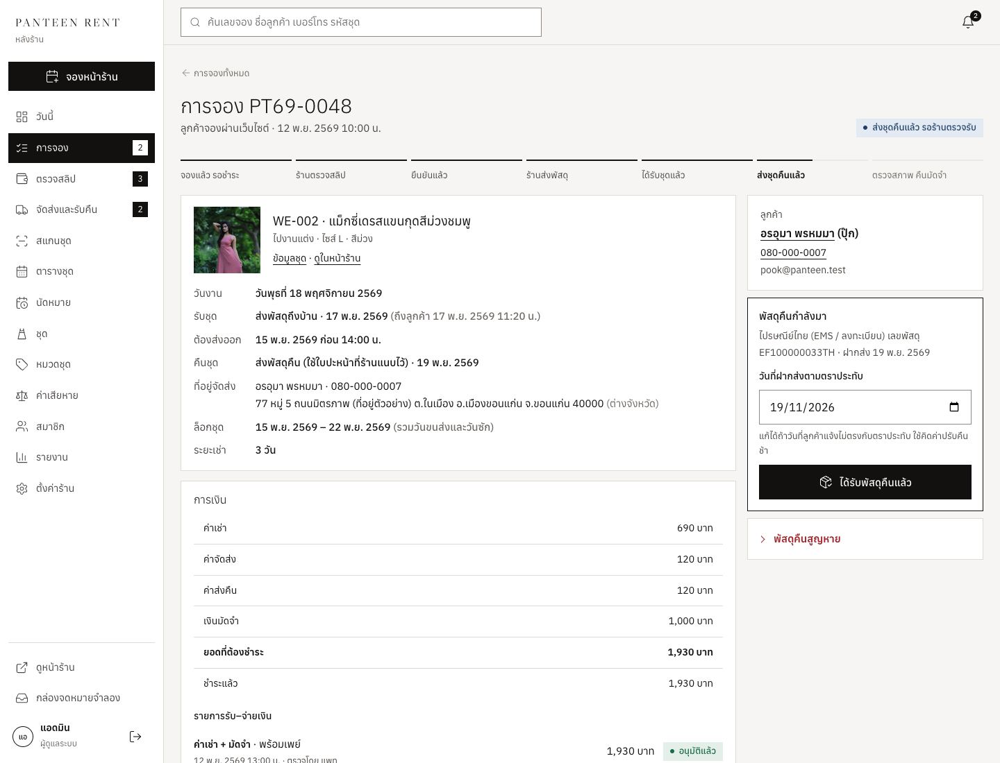

- กล่อง "พัสดุคืนกำลังมา" แสดงขนส่ง เลขพัสดุ และวันที่ลูกค้าแจ้งว่าฝากส่ง
- **วันที่ฝากส่งตามตราประทับ**: แก้ได้ถ้าวันที่ลูกค้าแจ้งไม่ตรงกับตราประทับ วันนี้ใช้คิดค่าปรับคืนช้า
- กด **ได้รับพัสดุคืนแล้ว** สถานะยังเป็น "ส่งคืนแล้ว" แต่ย้ายไปแท็บ "รอตรวจสภาพ"
- ถ้าพัสดุมาถึงโดยลูกค้าไม่ได้แจ้งในเว็บ พนักงานรับได้เลยจากหน้าการจอง (กล่อง "ลูกค้าส่งพัสดุคืน (ยังไม่ได้แจ้งในเว็บ)")
- **พัสดุคืนสูญหาย**: บันทึกเมื่อขนส่งทำหาย ลูกค้าไม่ถูกปรับคืนช้า ร้านเคลมกับขนส่งเอง

### 6.11 ตรวจสภาพชุดคืน (`/admin/bookings/{id}/inspect`)

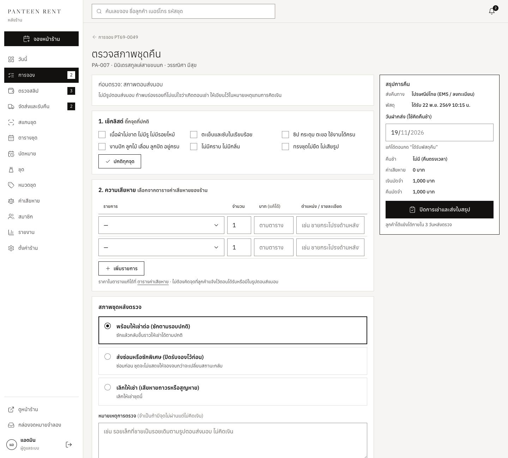

หน้าที่สำคัญที่สุดตอนรับคืน ทำทีละขั้นจากบนลงล่าง

| ขั้น | ทำอะไร |
|---|---|
| ก่อนตรวจ | ดูรูปตอนส่งมอบ และรูป/หมายเหตุที่ลูกค้าแจ้งตอนได้รับ (จุดที่ลูกค้าแจ้งแล้วห้ามคิดเงิน) |
| 1. เช็กลิสต์ | ติ๊ก 6 จุดที่ปกติ: เนื้อผ้า ตะเข็บ/ซับใน ซิป/กระดุม/ตะขอ งานปัก/ลูกไม้/เลื่อม/ลูกปัด คราบ/กลิ่น ทรงชุด หรือกด "ปกติทุกจุด" |
| 2. ความเสียหาย | เลือกรายการจากตารางค่าเสียหาย ใส่จำนวน แก้ราคาได้ ใส่ตำแหน่ง/รายละเอียด เพิ่มได้หลายแถว |
| ของที่มากับชุด | ติ๊กของที่ได้คืน ชิ้นที่ขาดระบบคิดตามราคา "ของที่มากับชุดหาย" |
| รูปตอนรับคืน | แนบรูปจุดเสียหาย |
| สภาพชุดหลังตรวจ | พร้อมให้เช่าต่อ / ส่งซ่อมหรือซักพิเศษ (ปิดรับจองไว้ก่อน) / เลิกให้เช่า |
| หมายเหตุ | จำเป็นถ้ามีจุดไม่ผ่านแต่ไม่คิดเงิน |
| กล่องสรุปขวา | วันฝากส่ง (ใช้คิดคืนช้า) คืนช้ากี่วัน ค่าเสียหาย มัดจำ มัดจำที่คืน คำนวณสดทุกครั้งที่แก้ |

กด **ปิดการเช่าและส่งใบสรุป**: สถานะเป็น "คืนชุดแล้ว" ออกใบสรุป RC บันทึกการคืนมัดจำ ส่งอีเมลให้ลูกค้า
ถ้าค่าปรับเกินมัดจำ ระบบบันทึกยอดที่ลูกค้าต้องจ่ายเพิ่ม

> ถ้าคืนที่ร้าน ใช้ปุ่ม "รับคืน" ในหน้าการจองหรือหน้าวันนี้ ซึ่งพาไปหน้าตรวจสภาพเดียวกัน

### 6.12 ตอบข้อโต้แย้ง

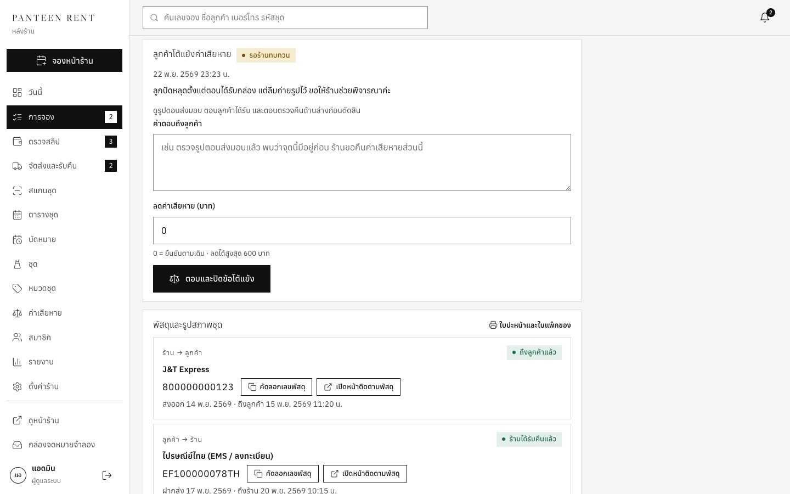

- เห็นเหตุผลและรูปที่ลูกค้าส่งมา เทียบกับรูปทุกขั้นด้านล่าง
- เขียน **คำตอบถึงลูกค้า** และใส่ **ลดค่าเสียหาย (บาท)** (0 = ยืนยันตามเดิม ลดได้ไม่เกินค่าเสียหายที่คิดไป)
- กด **ตอบและปิดข้อโต้แย้ง** ถ้าลดเงิน ระบบบันทึกการคืนเงินและออกใบปรับปรุงทันที

### 6.13 ตารางค่าเสียหาย (`/admin/damage-types`)

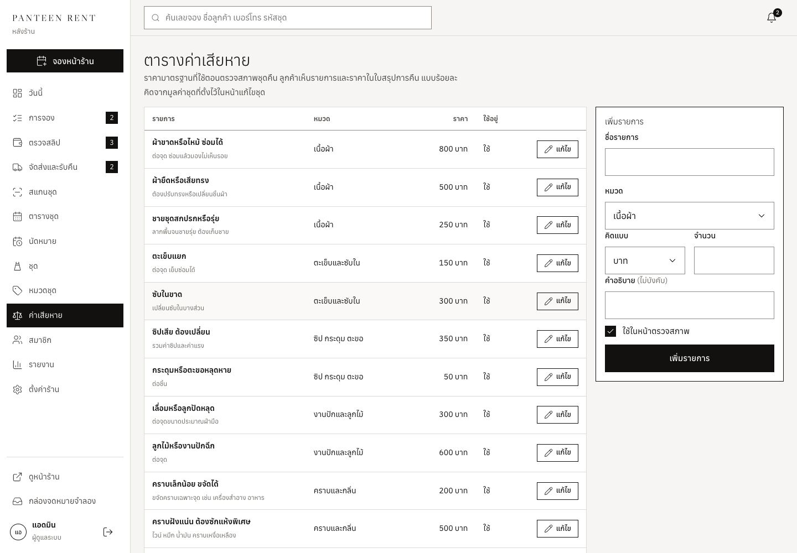

ราคามาตรฐานที่ติดตั้งมากับระบบ (ผู้ดูแลแก้ราคา เพิ่ม ปิดใช้ได้ พนักงานดูได้อย่างเดียว)

| ส่วนของชุด | รายการ | ค่าเริ่มต้น |
|---|---|--:|
| เนื้อผ้า | ผ้าขาดหรือไหม้ ซ่อมได้ (ต่อจุด) | 800 |
| เนื้อผ้า | ผ้ายืดหรือเสียทรง | 500 |
| เนื้อผ้า | ชายชุดสกปรกหรือรุ่ย | 250 |
| ตะเข็บและซับใน | ตะเข็บแยก (ต่อจุด) | 150 |
| ตะเข็บและซับใน | ซับในขาด | 300 |
| ซิป กระดุม ตะขอ | ซิปเสีย ต้องเปลี่ยน | 350 |
| ซิป กระดุม ตะขอ | กระดุมหรือตะขอหลุดหาย (ต่อชิ้น) | 50 |
| งานปักและลูกไม้ | เลื่อมหรือลูกปัดหลุด (ต่อจุดขนาดฝ่ามือ) | 300 |
| งานปักและลูกไม้ | ลูกไม้หรืองานปักฉีก (ต่อจุด) | 600 |
| คราบและกลิ่น | คราบเล็กน้อย ขจัดได้ | 200 |
| คราบและกลิ่น | คราบฝังแน่น ต้องซักแห้งพิเศษ | 500 |
| คราบและกลิ่น | กลิ่นบุหรี่หรืออับชื้น | 300 |
| ของที่มากับชุด | ของที่มากับชุดหาย (ต่อชิ้น) | 300 |
| ทั้งชุด | เสียหายจนให้เช่าต่อไม่ได้ | 100% ของมูลค่าชุด |
| ทั้งชุด | ชุดสูญหาย ไม่ได้รับคืน | 100% ของมูลค่าชุด |

ราคาแบบ "บาท" คิดเป็นจำนวนเงินคงที่ แบบ "%" คิดเป็นร้อยละของมูลค่าชุด (ตั้งไว้ในหน้าแก้ไขชุด)

### 6.14 ชุด (`/admin/costumes`) และหมวดชุด (`/admin/categories`)

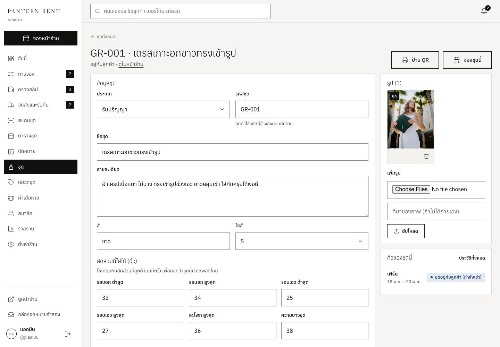

**ข้อมูลชุด**: รหัส (เช่น GR-001) หมวด ชื่อ คำอธิบาย สี ไซส์ สัดส่วน (อก/เอว/สะโพก/ความยาว)
ค่าเช่า ราคาวันเพิ่ม มัดจำ ค่าปรับคืนช้าต่อวัน มูลค่าชุด (ใช้คิดค่าเสียหายแบบ %) ของที่มากับชุด ชุดแนะนำ

**รูปชุด**: อัปโหลดหลายรูป ตั้งรูปปก ลบรูป ระบบย่อรูปเป็น 4 ขนาดอัตโนมัติ (สำหรับแถวตาราง การ์ด หน้าชุด และจอความละเอียดสูง)

**สถานะ**: เปิดให้เช่า / ซ่อม-ซักพิเศษ / เลิกให้เช่า

**หมวดชุด**: ชื่อ slug สำหรับ URL สีประจำหมวด คำอธิบาย ลำดับ เปิด/ปิด ลบได้เฉพาะหมวดที่ไม่มีชุด

### 6.15 ตารางชุด (`/admin/schedule`)

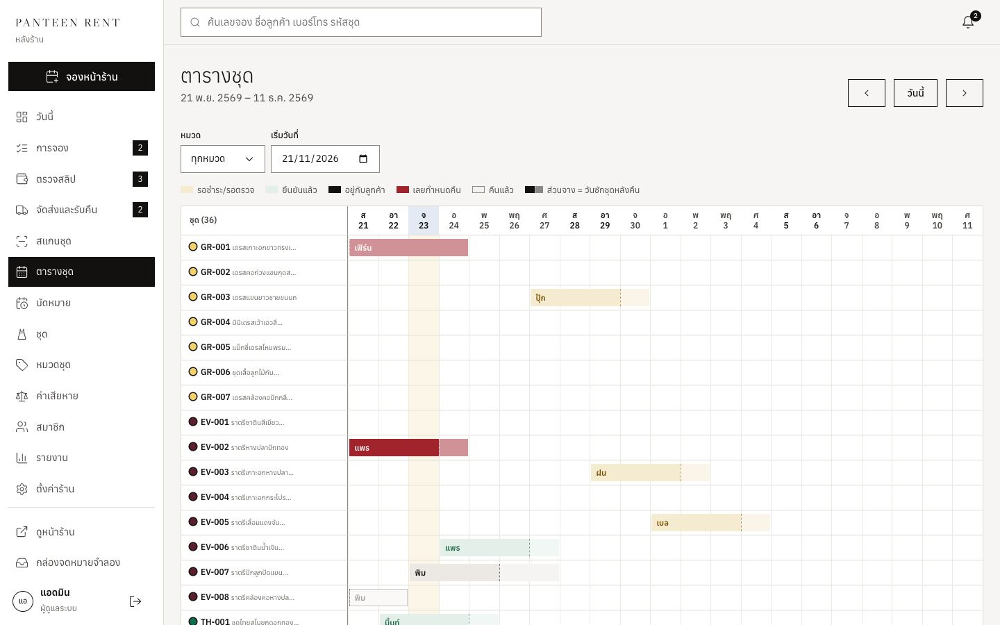

มุมมองแบบปฏิทิน 3 สัปดาห์: แถวคือชุด คอลัมน์คือวัน แถบบนแต่ละแถวคือการจอง (เขียนชื่อเล่นลูกค้า) สีบอกสถานะ

| สี | ความหมาย |
|---|---|
| เหลืองอ่อน | รอชำระ / รอตรวจสลิป |
| เขียวอ่อน | ยืนยันแล้ว |
| ดำ | อยู่กับลูกค้า |
| แดง | เลยกำหนดคืน |
| ขอบเทา | คืนแล้ว |
| ส่วนจางท้ายแถบ | วันซักชุดหลังคืน |

กรองตามหมวด เลือกวันเริ่ม หรือกดลูกศรเลื่อนช่วง ใช้หาช่องว่างให้ลูกค้าที่โทรมาถาม

### 6.16 นัดหมาย (`/admin/appointments`)

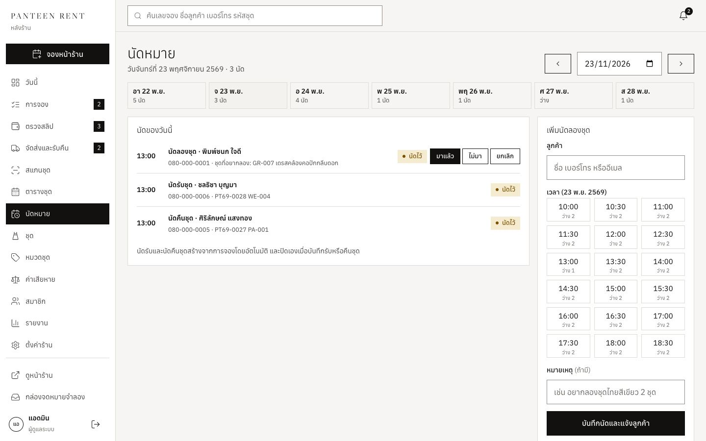

- **นัดลองชุด**: ลูกค้าขอเองจากเว็บ หรือพนักงานลงให้ ช่วงละ 30 นาที รับได้ 2 คนต่อช่วง (ห้องลอง 2 ห้อง) ภายในเวลาเปิดร้าน
- **นัดรับชุด / นัดคืนชุด**: สร้างให้อัตโนมัติเมื่อการจองที่รับ/คืนที่ร้านได้รับการยืนยัน (การจองแบบพัสดุไม่มีนัด)
- เปลี่ยนสถานะเป็น เสร็จแล้ว / ยกเลิก / ไม่มาตามนัด

### 6.17 สมาชิก (`/admin/members`)

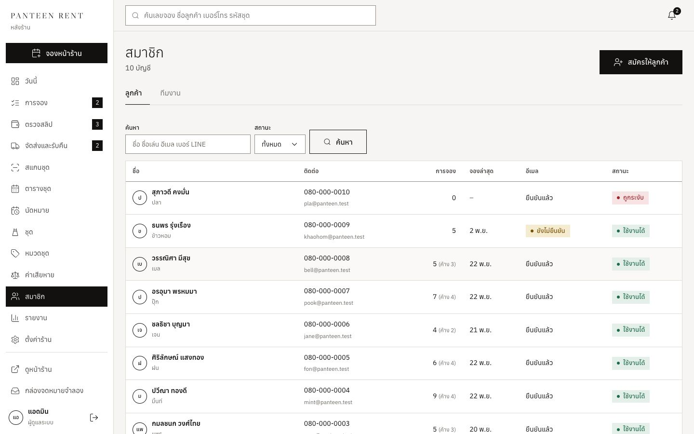

- แท็บ **ลูกค้า** / **ทีมงาน** ค้นหาด้วยชื่อ ชื่อเล่น อีเมล เบอร์ LINE กรองตามสถานะ
- ตารางแสดงจำนวนการจอง (และที่ค้างอยู่) จองล่าสุด ยืนยันอีเมลแล้วหรือยัง และสถานะบัญชี
- กดชื่อเพื่อดูประวัติการเช่า แก้ข้อมูล ปุ่ม **สมัครให้ลูกค้า** สร้างบัญชีให้ลูกค้าที่มาหน้าร้าน
- ผู้ดูแลระบบระงับบัญชี (ต้องใส่เหตุผล) ยกเลิกการระงับ และเปลี่ยนบทบาท (สมาชิก / พนักงาน / ผู้ดูแล) ได้

### 6.18 รายงาน (`/admin/reports`)

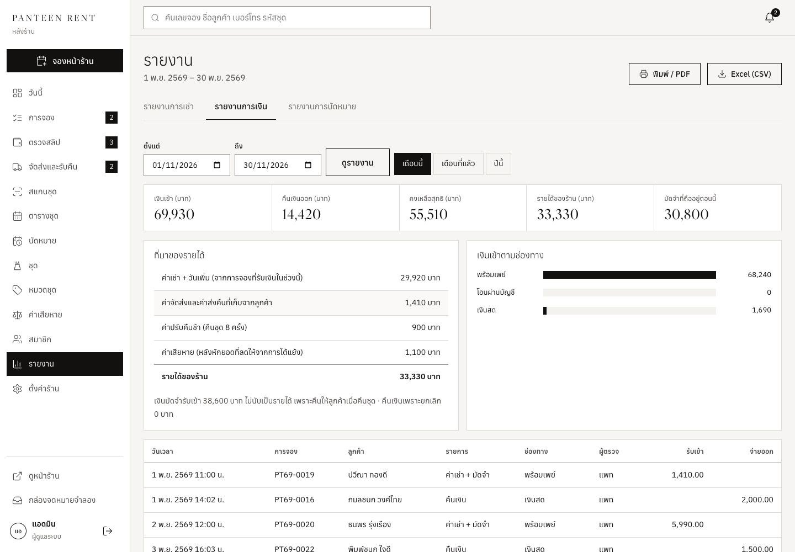

เลือกช่วงวันที่เอง หรือกดปุ่มลัด **เดือนนี้ / เดือนที่แล้ว / ปีนี้** ทุกรายงานมีปุ่ม **พิมพ์ / PDF** และ **Excel (CSV)**
(เปิดใน Excel แล้วภาษาไทยไม่เพี้ยน) รายงานการเงินแยก "รายได้ของร้าน" ออกจาก "เงินมัดจำ" ชัดเจน
เพราะมัดจำต้องคืนลูกค้า จึงไม่นับเป็นรายได้

| รายงาน | นับอะไร |
|---|---|
| การเช่า | การจองที่วันรับชุดอยู่ในช่วง: จำนวน รายได้ค่าเช่า วันเช่าเฉลี่ย คืนช้ากี่ครั้ง แยกตามสถานะ หมวด ชุดยอดนิยม ช่องทาง |
| การเงิน | เงินที่เข้าออกจริงในช่วง (นับวันที่อนุมัติ): รับเงิน ค่าเช่า ค่าจัดส่ง มัดจำรับ ค่าปรับคืนช้า ค่าเสียหาย คืนเงิน มัดจำที่ร้านถืออยู่ตอนนี้ แยกตามวิธีชำระ |
| นัดหมาย | นัดในช่วง แยกตามประเภทและสถานะ |

### 6.19 ตั้งค่าร้าน (`/admin/settings`) เฉพาะผู้ดูแลระบบ

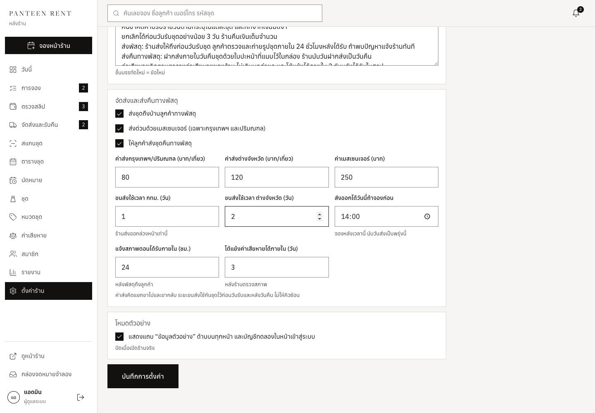

| กลุ่ม | ค่าที่ตั้งได้ | ค่าเริ่มต้น |
|---|---|---|
| ข้อมูลร้าน | ชื่อร้าน คำอธิบาย เบอร์ LINE Instagram ที่อยู่ เวลาเปิด-ปิด | ค่าตัวอย่าง |
| การรับเงิน | พร้อมเพย์ (เบอร์/เลขประจำตัว) ชื่อบัญชี ธนาคาร เลขบัญชี | ค่าตัวอย่าง |
| กติกาการเช่า | วันที่รวมในค่าเช่า (3) เช่าได้สูงสุด (7 วัน) วันซัก (1) เวลารอชำระ (24 ชม.) ยกเลิกได้ก่อนวันรับ (3 วัน) จองล่วงหน้าขั้นต่ำ (0 วัน) จองล่วงหน้าได้ไกลสุด (180 วัน) เวลารับ/คืนเริ่มต้น (13:00) เตือนก่อน (1 วัน) | ตามวงเล็บ |
| เงื่อนไขการเช่า | ข้อความที่แสดงให้ลูกค้า (ขึ้นบรรทัดใหม่ = ข้อใหม่) | 7 ข้อ |
| จัดส่ง | เปิด/ปิด ส่งพัสดุ เมสเซนเจอร์ ส่งคืนทางพัสดุ; ค่าส่ง กทม. 80 ต่างจังหวัด 120 เมสเซนเจอร์ 250; วันขนส่ง 1/2; ตัดรอบ 14:00; แจ้งสภาพภายใน 24 ชม.; โต้แย้งภายใน 3 วัน | ตามที่เขียน |
| อีเมล | โหมด log/smtp และค่า SMTP ปุ่ม "ส่งอีเมลทดสอบ" | log |
| โหมดตัวอย่าง | แสดงแถบ "ข้อมูลตัวอย่าง" และบัญชีทดลอง; ปุ่ม "รีเซ็ตข้อมูลตัวอย่าง" | เปิด |

---

## 7. กฎธุรกิจและสูตรคำนวณเงิน

### 7.1 ยอดชำระตอนจอง

```
จำนวนวันเช่า     = วันคืน − วันรับ + 1
วันเพิ่ม         = max(0, จำนวนวันเช่า − 3)
ค่าเช่ารวม      = ค่าเช่า + วันเพิ่ม × ราคาวันเพิ่ม
ยอดชำระตอนจอง  = ค่าเช่ารวม + เงินมัดจำ + ค่าจัดส่ง + ค่าส่งคืน
```

**ตัวอย่าง** ชุด GR-001 ค่าเช่า 690 มัดจำ 1,000 รับ 19 ม.ค. คืน 21 ม.ค. (3 วัน) ส่งพัสดุถึงบ้านใน กทม. คืนที่ร้าน
→ 690 + 0 + 1,000 + 80 + 0 = **1,770 บาท** (ตรงกับภาพในหัวข้อ 5.4)

### 7.2 ช่วงล็อกชุด (ชุดไม่ว่างให้คนอื่น)

```
วันเริ่มล็อก = วันรับชุด − วันขนส่งขาไป        (รับที่ร้าน/เมสเซนเจอร์ = 0 วัน, พัสดุ กทม. 1 / ต่างจังหวัด 2)
วันปลดล็อก  = วันคืนชุด + วันขนส่งขากลับ + วันซัก   (คืนที่ร้าน = 0, พัสดุ 1 หรือ 2; วันซัก 1)
สองการจองชนกันเมื่อ  เริ่มA ≤ ปลดB  และ  เริ่มB ≤ ปลดA
```

**ตัวอย่าง** (PT69-0046 ในภาพหัวข้อ 6.3) รับ 22 พ.ย. ส่งพัสดุ กทม. คืน 24 พ.ย. ส่งพัสดุคืน
→ ล็อก 21 พ.ย. (ส่งออก) ถึง 24 + 1 (ขนส่งกลับ) + 1 (ซัก) = **26 พ.ย.**

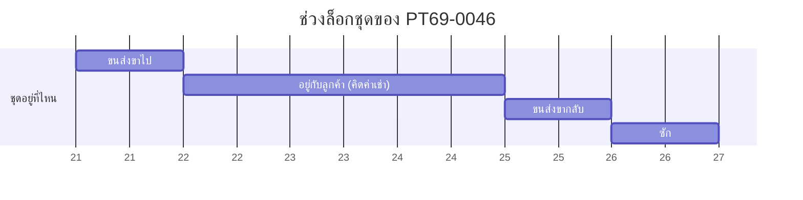

- จองหลังเวลาตัดรอบ (14:00) ระบบนับวันส่งออกเป็นพรุ่งนี้ ถ้าส่งไม่ทันวันรับชุด จะไม่ให้เลือกส่งพัสดุ
- ชุดที่ยังอยู่กับลูกค้าหลังวันคืน ระบบขยายการล็อกเองจนกว่าชุดจะกลับมาจริง + วันซัก (ไม่มีการจองซ้อนกับชุดที่ยังไม่กลับ)

### 7.3 คืนช้า

```
วันคืนจริง  = วันที่คืนที่ร้าน  หรือ  วันที่ฝากส่งพัสดุคืน (ตามตราประทับ)
วันที่ช้า    = max(0, วันคืนจริง − วันคืนชุดที่กำหนด)
ค่าปรับ     = วันที่ช้า × ค่าปรับต่อวันของชุด
```

ถ้าพัสดุคืนสูญหายระหว่างขนส่ง (ลูกค้ามีเลขพัสดุ) ไม่คิดค่าปรับคืนช้า

### 7.4 ค่าเสียหายและการคืนมัดจำ

```
ค่าเสียหาย   = Σ (ราคาต่อหน่วย × จำนวน)   โดยราคา % = ร้อยละ × มูลค่าชุด    (รวมแล้วไม่เกินมูลค่าชุด)
ค่าปรับรวม  = ค่าปรับคืนช้า + ค่าเสียหาย
มัดจำที่คืน  = max(0, มัดจำ − ค่าปรับรวม)
ต้องจ่ายเพิ่ม = max(0, ค่าปรับรวม − มัดจำ)
```

**ตัวอย่าง** (PT69-0050 ในภาพหัวข้อ 5.8) มัดจำ 2,000 คืนตรงเวลา คราบเล็กน้อย 200 + ไม้แขวนหาย 300
→ ค่าเสียหาย 500 มัดจำที่คืน **1,500 บาท**

### 7.5 กฎอื่น ๆ

| กฎ | ค่า |
|---|---|
| เวลารอชำระหลังจอง | 24 ชั่วโมง (เกินแล้วหมดเวลาอัตโนมัติ) |
| รายการรอชำระพร้อมกันต่อสมาชิก | ไม่เกิน 3 รายการ |
| เช่าได้นานสุด | 7 วัน |
| จองล่วงหน้าได้ไกลสุด | 180 วัน |
| ลูกค้ายกเลิกเองได้ถึง | 3 วันก่อนวันรับ (ถ้าส่งพัสดุ นับจากวันส่งออก) คืนเงินเต็มที่จ่ายมา |
| ร้านยกเลิก | ทำได้ทุกเวลาก่อนชุดออก กำหนดยอดคืนเงินเองได้ (ไม่เกินที่จ่ายมา) |
| เปลี่ยนเป็นรับที่ร้าน | คืนค่าจัดส่งถ้ายังไม่เคยส่งพัสดุ ถ้าส่งไปแล้วไม่สำเร็จ ไม่คืน (ค่าขนส่งจ่ายไปแล้ว) |
| แจ้งสภาพตอนได้รับ | ภายใน 24 ชม. หลังพัสดุถึง |
| โต้แย้งค่าเสียหาย | 1 ครั้ง ภายใน 3 วันหลังตรวจสภาพ |
| เลขที่เอกสาร | การจอง `PT69-0001` ใบเสร็จ `RC69-0001` (69 = พ.ศ. 2569 เรียงใหม่ทุกปี ไม่มีเลขข้าม) |

---

## 8. กรณีพิเศษทุกแบบและระบบจัดการอย่างไร

| # | กรณี | ระบบทำอะไร | ใครทำ |
|---|---|---|---|
| 1 | สองคนกดจองชุดเดียววันเดียวกันพร้อมกัน | ล็อกแถวในฐานข้อมูล คนแรกได้ คนที่สองได้ข้อความว่าชุดไม่ว่างแล้ว | ระบบ |
| 2 | จองแล้วไม่โอน | ครบ 24 ชม. เปลี่ยนเป็น "หมดเวลาชำระ" ปล่อยชุด แจ้งลูกค้า | ระบบ (งานตามเวลา) |
| 3 | สลิปไม่ถูกต้อง | ร้านกด "ไม่ผ่าน" พร้อมเหตุผล การจองกลับไปรอชำระ ลูกค้าแนบใหม่ได้ | พนักงาน |
| 4 | ลูกค้ายกเลิกก่อนกำหนด | คืนเงินที่จ่ายเต็มจำนวน บันทึกรายการคืนเงิน ปล่อยชุด | ลูกค้า |
| 5 | ลูกค้าอยากยกเลิกหลังเลยกำหนด | ปุ่มยกเลิกหาย บอกให้ติดต่อร้าน ร้านยกเลิกให้และกำหนดยอดคืนได้ | พนักงาน |
| 6 | ลูกค้าเลื่อนวัน | ร้านกด "เลื่อนวัน" ระบบตรวจชุดว่างในวันใหม่ก่อน | พนักงาน |
| 7 | ลูกค้ามาไม่ทันวันรับ | หน้าวันนี้แสดงสีแดง "ควรรับตั้งแต่…" ยังกดรับได้ | พนักงาน |
| 8 | ส่งพัสดุไม่สำเร็จ (ไม่มีคนรับ ที่อยู่ผิด ตีกลับ) | กด "ส่งไม่สำเร็จ" ใส่เหตุผล การจองกลับเป็น "ยืนยันแล้ว" เลือกส่งใหม่ / เปลี่ยนเป็นรับที่ร้าน / ยกเลิก | พนักงาน |
| 9 | พัสดุขาไปหาย | เหมือนข้อ 8 แต่บันทึกว่าหาย | พนักงาน |
| 10 | ลูกค้าได้ชุดแล้วพบตำหนิ | แจ้งพร้อมรูปภายใน 24 ชม. ร้านได้แจ้งเตือน และตอนตรวจคืนห้ามคิดเงินจุดนั้น | ลูกค้า |
| 11 | ลูกค้าไม่กด "ได้รับชุดแล้ว" | พนักงานกด "ถึงลูกค้าแล้ว" แทนได้เมื่อเห็นในเว็บขนส่ง | พนักงาน |
| 12 | ใกล้วันคืน / เลยวันคืน | เตือนก่อน 1 วัน และเตือนทุกวันที่เลยกำหนดพร้อมค่าปรับสะสม | ระบบ |
| 13 | ลูกค้าส่งคืนแต่ไม่แจ้งในเว็บ | พนักงานรับพัสดุได้เลย กรอกวันฝากส่งจากตราประทับ | พนักงาน |
| 14 | วันฝากส่งที่ลูกค้าแจ้งไม่ตรงตราประทับ | พนักงานแก้วันที่ตอนรับพัสดุ ใช้วันที่แก้คิดคืนช้า | พนักงาน |
| 15 | พัสดุขากลับหาย | กด "พัสดุคืนสูญหาย" ไม่คิดคืนช้า ตรวจสภาพปิดงานด้วยผล "เลิกให้เช่า" ร้านเคลมขนส่ง | พนักงาน |
| 16 | ค่าเสียหาย + คืนช้า เกินมัดจำ | มัดจำคืน 0 บันทึกยอด "ต้องจ่ายเพิ่ม" แสดงในใบสรุป | ระบบ |
| 17 | ชุดเสียหายต้องซ่อม | เลือก "ส่งซ่อม" ตอนตรวจ ชุดหายจากหน้าร้านจนกว่าจะเปลี่ยนสถานะกลับ | พนักงาน |
| 18 | ลูกค้าไม่เห็นด้วยกับค่าเสียหาย | โต้แย้ง 1 ครั้งใน 3 วัน ร้านตอบ ลดได้ ออกใบปรับปรุงและคืนเงิน | ลูกค้า + พนักงาน |
| 19 | ลูกค้าเปิดการจองของคนอื่น | 404 ไม่บอกว่ามีอยู่ | ระบบ |
| 20 | สมาชิกจองค้างไม่จ่ายหลายรายการ | เกิน 3 รายการรอชำระ ระบบไม่ให้จองเพิ่ม | ระบบ |
| 21 | อัปโหลดไฟล์ที่ไม่ใช่รูป | ตรวจชนิดไฟล์จริงจากเนื้อไฟล์ ไม่ใช่นามสกุล แล้ววาดรูปใหม่ (ลบข้อมูลแฝง) | ระบบ |
| 22 | เดาวรหัสผ่าน | ผิด 5 ครั้งล็อก 15 นาที | ระบบ |
| 23 | เปลี่ยนรหัสผ่าน | เครื่องอื่นที่เข้าระบบค้างไว้ถูกออกจากระบบ | ระบบ |
| 24 | ปิดชุด (ซ่อม/เลิกให้เช่า) ทั้งที่ยังมีการจองค้างอยู่ | หน้าแก้ไขชุดแสดงรายการจองที่ค้าง และเมื่อเปลี่ยนสถานะระบบขึ้นคำเตือนให้จัดการการจองเหล่านั้น | พนักงาน |
| 25 | ปิดบริการส่งพัสดุชั่วคราว | ติ๊กออกในตั้งค่า ตัวเลือกหายจากหน้าจอง การจองเดิมยังดำเนินต่อได้ | ผู้ดูแล |

---

## 9. การแจ้งเตือน อีเมล และงานตามเวลา

### 9.1 ช่องทางแจ้ง

- **กระดิ่งในเว็บ** (ลูกค้าและร้าน) เก็บในตาราง `notifications`
- **อีเมล** ส่งพร้อมกันกับกระดิ่งสำหรับเรื่องสำคัญ เก็บสำเนาใน `mail_outbox` (ดูได้ที่กล่องจดหมายจำลอง)

### 9.2 เหตุการณ์ที่แจ้ง

| ถึงลูกค้า | ถึงร้าน |
|---|---|
| ยืนยันอีเมล / รีเซ็ตรหัสผ่าน | การจองใหม่ |
| จองสำเร็จ รอชำระ | สลิปใหม่รอตรวจ |
| ใกล้หมดเวลาชำระ (เหลือไม่ถึง 3 ชม.) | ลูกค้ายกเลิก |
| สลิปผ่าน (พร้อมใบเสร็จ) / ไม่ผ่าน | ต้องส่งพัสดุ / ส่งพัสดุช้า |
| ร้านส่งพัสดุแล้ว (เลขพัสดุ) | ลูกค้าได้รับชุดแล้ว |
| เตือนก่อนวันรับ / วันคืน / วันต้องส่งพัสดุคืน | พัสดุเลยวันที่ควรถึงแต่ยังไม่ยืนยัน |
| เลยกำหนดคืน (ทุกวัน พร้อมค่าปรับสะสม) | ลูกค้าแจ้งปัญหาตอนได้รับชุด |
| เตือนนัดลองชุด | ลูกค้าส่งชุดคืนแล้ว / พัสดุคืนยังไม่ถึงร้าน |
| ใบสรุปการคืนชุด / ใบปรับปรุง | ค้างคืน (เลยกำหนด) |
| หมดเวลาชำระ / ถูกยกเลิก | ลูกค้าโต้แย้งค่าเสียหาย / นัดลองชุดใหม่ |

### 9.3 งานตามเวลา (`cli/cron.php`)

ทุก 10 นาที ระบบ:

1. ยกเลิกการจองที่หมดเวลาชำระ (ปล่อยชุดให้คนอื่นจอง)
2. เตือนลูกค้าก่อนวันรับ วันคืน วันส่งพัสดุคืน และนัดลองชุด
3. เตือนลูกค้าที่การจองจะหมดเวลาชำระภายใน 3 ชั่วโมง
4. เตือนทั้งลูกค้าและร้านเมื่อเลยกำหนดคืน (วันละครั้ง)
5. เตือนร้านเรื่องพัสดุ: ถึงวันต้องส่งหรือส่งช้า พัสดุเลยวันที่ควรถึงแต่ยังไม่มีใครยืนยัน และพัสดุคืนที่เดินทางนานผิดปกติ

ทุกการเตือนมี "กุญแจกันซ้ำ" รันซ้ำกี่รอบก็ไม่ส่งซ้ำ ถ้าไม่ได้ตั้ง cron ระบบจะรันเองเมื่อมีคนเปิดเว็บ (ไม่เกินทุก 10 นาที)
บน Docker คอนเทนเนอร์รันให้เองทุก 10 นาที

---

## 10. ความปลอดภัย

| เรื่อง | ทำอย่างไร |
|---|---|
| รหัสผ่าน | เก็บแบบ hash (`password_hash` bcrypt) อัปเกรด hash ให้เองเมื่อเข้าระบบ ตรวจรหัสผ่านใช้เวลาเท่ากันแม้อีเมลไม่มีในระบบ |
| เดารหัสผ่าน | ผิด 5 ครั้ง (นับตามอีเมลและตาม IP) ล็อก 15 นาที |
| ลิงก์ในอีเมล | เก็บเฉพาะ SHA-256 ของ token ใช้ได้ครั้งเดียว มีวันหมดอายุ ฐานข้อมูลรั่วก็ใช้ลิงก์ไม่ได้ |
| ฟอร์มทุกฟอร์ม | มี CSRF token ทุกคำขอ POST |
| Session | cookie แบบ HttpOnly, SameSite=Lax, Secure เมื่อเป็น https เปลี่ยน session id ตอนเข้าระบบ เปลี่ยนรหัสผ่านแล้ว session อื่นหลุด |
| สิทธิ์ | middleware `guest / auth / verified / staff / admin` ทุก route และตรวจเจ้าของข้อมูลทุกครั้ง (ไม่ใช่ของตัวเอง = 404) |
| ไฟล์อัปโหลด | ตรวจชนิดจากเนื้อไฟล์ จำกัด 5 MB วาดรูปใหม่ด้วย GD ตั้งชื่อไฟล์สุ่ม สลิปและรูปสภาพเก็บนอก `public/` เปิดได้ผ่าน route ที่ตรวจสิทธิ์เท่านั้น |
| SQL | ใช้ prepared statement ทั้งหมด |
| HTML | escape ทุกค่าที่แสดงด้วย `e()` |
| ลิงก์รีเซ็ตรหัสผ่าน | เชื่อ Host เฉพาะที่ตั้งไว้ใน `app.url` / `app.hosts` กันลิงก์ถูกปลอมไปเว็บอื่น |
| Header | `X-Content-Type-Options: nosniff`, `X-Frame-Options: SAMEORIGIN`, `Referrer-Policy: same-origin` |
| โฟลเดอร์ภายใน | `.htaccess` ปิดการเข้าถึง `app/ config/ storage/ database/ tests/` จากเว็บ |
| CSV | ป้องกัน formula injection (ค่าที่ขึ้นต้นด้วย `= + - @` ถูกใส่ `'` นำหน้า) |

---

## 11. โครงสร้างโค้ด

### 11.1 โฟลเดอร์

```
panteen rent/
├── public/                 ← โฟลเดอร์เดียวที่เปิดให้เว็บเข้าถึง
│   ├── index.php           ← จุดเข้าเดียวของทุกคำขอ (front controller) + /healthz
│   ├── assets/css          ← app.css (หน้าร้าน) admin.css (หลังร้าน)
│   ├── assets/js           ← app.js (ทุกลูกเล่น) qrcode.js (ไลบรารีสร้าง QR, MIT)
│   ├── assets/fonts, img   ← ฟอนต์ ไอคอน (icons.svg sprite) favicon
│   └── media/              ← รูปชุด 4 ขนาด และภาพหน้าเว็บ
├── app/
│   ├── bootstrap.php       ← autoload, โหลด config, อ่านค่า env, ตั้ง timezone
│   ├── routes.php          ← รายการ URL ทั้งหมด 113 เส้นทาง
│   ├── helpers.php         ← ฟังก์ชันช่วย: e(), url(), money(), thai_date() ฯลฯ
│   ├── Core/               ← โครงพื้นฐาน (แทน framework)
│   ├── Services/           ← กฎธุรกิจทั้งหมด
│   ├── Controllers/        ← รับคำขอ เรียก Service ส่งต่อให้ View
│   └── Views/              ← หน้าเว็บ (PHP template)
├── cli/                    ← install.php, seed.php, cron.php
├── config/                 ← config.example.php (คัดลอกเป็น config.php)
├── database/               ← schema.sql, panteen_rent.sql, photo-credits.json, สลิปตัวอย่าง
├── docker/                 ← apache.conf, php.ini, mariadb.cnf, entrypoint.sh
├── storage/                ← สลิป รูปสภาพชุด log cache (ต้องเขียนได้)
├── tests/                  ← unit, HTTP, e2e (Playwright), lint config
├── Dockerfile, docker-compose.yml, coolify.yaml
└── README.md, DESIGN.md, docs/
```

### 11.2 คำขอหนึ่งครั้งไหลอย่างไร

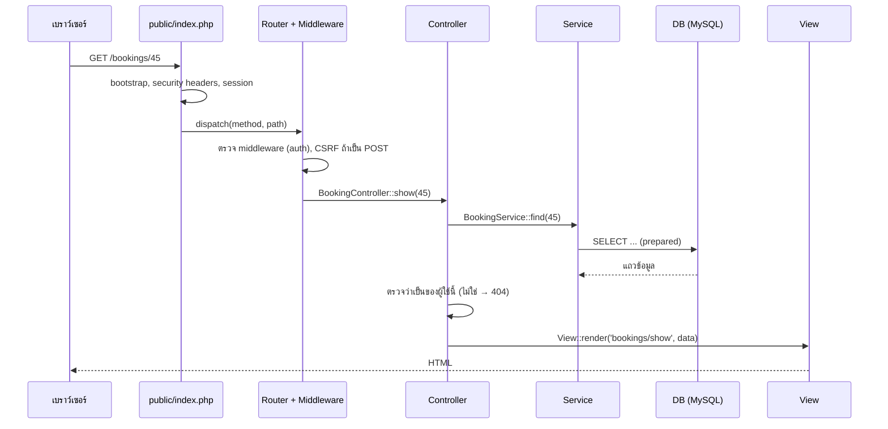

### 11.3 Core (โครงพื้นฐาน)

| ไฟล์ | หน้าที่ |
|---|---|
| `Router.php` | จับคู่ URL กับ Controller รองรับตัวแปร `{id}` `{code}` |
| `Middleware.php` | ตรวจสิทธิ์ guest / auth / verified / staff / admin |
| `DB.php` | PDO wrapper: `one() all() value() insert() update() transaction()` |
| `Auth.php` | เข้า/ออกระบบ จำกัดการเดารหัสผ่าน ตรวจ session หลังเปลี่ยนรหัส |
| `Session.php` | ตั้งค่า cookie flash message |
| `Csrf.php` | สร้างและตรวจ CSRF token |
| `Validator.php` | ตรวจข้อมูลฟอร์ม (required, email, password, date, phone ฯลฯ) ข้อความภาษาไทย |
| `Upload.php` | ตรวจและวาดรูปใหม่ ย่อขนาด |
| `View.php` | render template + layout |
| `Mailer.php`, `SmtpClient.php` | ส่งอีเมล (SMTP เขียนเอง รองรับ TLS/SSL) หรือเก็บลงกล่องจดหมายจำลอง |
| `Config.php` | อ่านค่า config แบบ `Config::get('db.host')` |
| `HttpRedirect.php` | ใช้แทน `exit()` ตอนรันในชุดทดสอบ |

### 11.4 Services (กฎธุรกิจ)

| ไฟล์ | หน้าที่ |
|---|---|
| `BookingService.php` | สร้างการจอง (ตรวจชน ล็อกแถว) เปลี่ยนสถานะตามตาราง TRANSITIONS ชำระเงิน อนุมัติ/ปฏิเสธสลิป ยกเลิก คืนเงิน รับชุด รับคืน ปิดการเช่า |
| `Availability.php` | คำนวณช่วงล็อกชุด หาการจองที่ชน ปฏิทินวันว่าง |
| `Pricing.php` | `quote()` ยอดตอนจอง `settle()` คิดคืนช้า ค่าเสียหาย มัดจำคืน |
| `Shipping.php` | โซนตามจังหวัด ค่าส่ง วันขนส่ง เวลาตัดรอบ วันส่งออก รายชื่อขนส่งและรูปแบบเลขพัสดุ ตรวจ/ทำความสะอาดที่อยู่ |
| `Fulfilment.php` | ส่งพัสดุ ถึงลูกค้า ส่งไม่สำเร็จ เปลี่ยนเป็นรับที่ร้าน ลูกค้าส่งคืน ร้านรับคืน พัสดุคืนหาย แจ้งสภาพตอนได้รับ |
| `Inspection.php` | เช็กลิสต์ ตารางค่าเสียหาย ของที่มากับชุด ผลหลังตรวจ ข้อโต้แย้งและการลดค่าเสียหาย |
| `Photos.php` | รูปสภาพชุดทุกขั้น (handover / arrival / dropoff / return / dispute) |
| `Addresses.php` | สมุดที่อยู่ของสมาชิก (จำกัดจำนวน ค่าเริ่มต้น ป้องกันแก้ของคนอื่น) |
| `Receipts.php` | ออกใบเสร็จ 3 แบบ เลขต่อเนื่อง |
| `Counter.php` | เลขเอกสารรายปีแบบไม่ข้ามเลข (ล็อกแถว) |
| `PromptPay.php` | สร้าง payload QR พร้อมเพย์ EMVCo + CRC16 |
| `Catalog.php` | ค้นหา กรอง เรียงชุดสำหรับหน้าร้าน |
| `Appointments.php` | ช่วงเวลานัดลองชุด สร้างนัดรับ/คืนอัตโนมัติ |
| `Reminders.php` | งานตามเวลา (หัวข้อ 9.3) |
| `Notifier.php` | ส่งกระดิ่ง + อีเมล พร้อมกันซ้ำด้วย dedupe key |
| `Reports.php` | รายงาน 3 แบบ และส่งออก CSV |
| `Settings.php` | ค่าตั้งร้าน (ค่าเริ่มต้นในโค้ด + ค่าที่แก้ในฐานข้อมูล) |
| `Status.php` | ชื่อภาษาไทยและสีของทุกสถานะ ใช้ที่เดียวทั้งระบบ |
| `Tokens.php` | token อีเมลแบบเก็บ hash |
| `DemoSeeder.php` | สร้างข้อมูลตัวอย่าง (ชุด 36 ชุด สมาชิก 10 คน การจองทุกสถานะ วันที่อิงวันนี้) |
| `BookingException.php` | ข้อผิดพลาดตามกฎธุรกิจที่แสดงให้ผู้ใช้เห็นได้ |

### 11.5 Controllers และเส้นทาง (URL) ทั้งหมด

<details>
<summary><b>หน้าร้านและบัญชี</b> (กดเพื่อดู)</summary>

| Method | URL | Controller | สิทธิ์ |
|---|---|---|---|
| GET | `/` | ShopController::home | ทุกคน |
| GET | `/dresses` | ShopController::index | ทุกคน |
| GET | `/c/{slug}` | ShopController::category | ทุกคน |
| GET | `/dress/{code}` | ShopController::show | ทุกคน |
| GET | `/api/dress/{code}/calendar` | ShopController::calendar | ทุกคน |
| GET | `/api/dress/{code}/quote` | ShopController::quote | ทุกคน |
| GET | `/how-to-rent` | ShopController::howTo | ทุกคน |
| GET | `/credits` | ShopController::credits | ทุกคน |
| GET/POST | `/login` | AuthController::loginForm / login | guest |
| GET/POST | `/register` | AuthController::registerForm / register | guest |
| POST | `/logout` | AuthController::logout | |
| GET | `/verify/{token}` | AuthController::verify | |
| GET/POST | `/account/verify` | AuthController::verifyNotice / resendVerification | auth |
| GET/POST | `/forgot` | AuthController::forgotForm / forgot | guest |
| GET/POST | `/reset/{token}` | AuthController::resetForm / reset | |
| GET | `/account` | AccountController::profile | auth |
| POST | `/account/profile`, `/account/measurements`, `/account/password` | AccountController | auth |
| GET/POST | `/account/addresses` | AccountController::addresses / saveAddress | auth |
| POST | `/account/addresses/{id}/default`, `/account/addresses/{id}/delete` | AccountController | auth |
| GET | `/account/favorites` | AccountController::favorites | auth |
| POST | `/favorites/{code}` | AccountController::toggleFavorite | auth |
| GET | `/account/notifications` | AccountController::notifications | auth |
| POST | `/account/notifications/read` | AccountController::readNotifications | auth |
| GET | `/account/appointments` | AccountController::appointments | auth |
| POST | `/account/appointments` | AccountController::requestAppointment | verified |
| POST | `/account/appointments/{id}/cancel` | AccountController::cancelAppointment | auth |
| GET | `/api/slots` | AccountController::slots | ทุกคน |
| GET/POST | `/book/{code}` | BookingController::create / store | verified |
| GET | `/bookings`, `/bookings/{id}` | BookingController::index / show | auth |
| POST | `/bookings/{id}/slip` | BookingController::uploadSlip | auth |
| POST | `/bookings/{id}/cancel` | BookingController::cancel | auth |
| POST | `/bookings/{id}/received` | BookingController::received | auth |
| POST | `/bookings/{id}/arrival` | BookingController::arrival | auth |
| POST | `/bookings/{id}/post-back` | BookingController::postBack | auth |
| POST | `/bookings/{id}/dispute` | BookingController::dispute | auth |
| GET | `/receipts/{id}` | BookingController::receipt | auth |
| GET | `/slips/{id}` | BookingController::slip | auth |
| GET | `/condition/{id}` | BookingController::photo | auth |
| GET | `/dev/mailbox`, `/dev/mailbox/{id}` | DevController | localhost ในโหมด dev หรือผู้ดูแล |

</details>

<details>
<summary><b>หลังร้าน</b> (กดเพื่อดู)</summary>

| Method | URL | Controller | สิทธิ์ |
|---|---|---|---|
| GET | `/admin` | DashboardController::index | staff |
| GET | `/admin/notifications` | DashboardController::notifications | staff |
| GET | `/admin/bookings` | BookingsController::index | staff |
| GET/POST | `/admin/bookings/new`, `/admin/bookings` | BookingsController::create / store | staff |
| GET | `/admin/bookings/{id}` | BookingsController::show | staff |
| POST | `/admin/bookings/{id}/pay` | BookingsController::payCounter | staff |
| POST | `/admin/bookings/{id}/pickup` | BookingsController::pickup | staff |
| POST | `/admin/bookings/{id}/return` | BookingsController::markReturned | staff |
| POST | `/admin/bookings/{id}/cancel` | BookingsController::cancel | staff |
| POST | `/admin/bookings/{id}/reschedule` | BookingsController::reschedule | staff |
| POST | `/admin/bookings/{id}/ship` | FulfilmentController::ship | staff |
| POST | `/admin/bookings/{id}/delivered` | FulfilmentController::delivered | staff |
| POST | `/admin/bookings/{id}/failed` | FulfilmentController::failed | staff |
| POST | `/admin/bookings/{id}/to-pickup` | FulfilmentController::toPickup | staff |
| POST | `/admin/bookings/{id}/post-back` | FulfilmentController::postBack | staff |
| POST | `/admin/bookings/{id}/receive` | FulfilmentController::receive | staff |
| POST | `/admin/bookings/{id}/return-lost` | FulfilmentController::returnLost | staff |
| POST | `/admin/bookings/{id}/photos` | FulfilmentController::photos | staff |
| POST | `/admin/bookings/{id}/dispute` | FulfilmentController::dispute | staff |
| GET/POST | `/admin/bookings/{id}/inspect` | FulfilmentController::inspectForm / inspect | staff |
| GET | `/admin/bookings/{id}/label` | FulfilmentController::label | staff |
| GET | `/admin/shipping` | FulfilmentController::queue | staff |
| GET | `/admin/scan` | FulfilmentController::scan | staff |
| GET | `/admin/costumes/{id}/tag` | FulfilmentController::tag | staff |
| GET | `/admin/damage-types` | FulfilmentController::damageTypes | staff |
| POST | `/admin/damage-types` | FulfilmentController::damageTypeSave | **admin** |
| GET | `/admin/schedule` | BookingsController::schedule | staff |
| GET | `/admin/api/members` | MembersController::lookup | staff |
| GET | `/admin/payments` | PaymentsController::index | staff |
| POST | `/admin/payments/{id}/approve`, `/reject` | PaymentsController | staff |
| GET/POST | `/admin/costumes`, `/admin/costumes/new`, `/admin/costumes/{id}` | CostumesController | staff |
| POST | `/admin/costumes/{id}/status` | CostumesController::status | staff |
| POST | `/admin/costumes/{id}/images`, `/images/{img}/delete`, `/images/{img}/cover` | CostumesController | staff |
| GET/POST | `/admin/categories`, `/admin/categories/{id}`, `/{id}/delete` | CategoriesController | staff |
| GET/POST | `/admin/members`, `/admin/members/new`, `/admin/members/{id}` | MembersController | staff |
| POST | `/admin/members/{id}/status`, `/admin/members/{id}/role` | MembersController | **admin** |
| GET/POST | `/admin/appointments`, `/admin/appointments/{id}/status` | AppointmentsController | staff |
| GET | `/admin/reports`, `/admin/reports/{type}` | ReportsController | staff |
| GET/POST | `/admin/settings` | SettingsController | **admin** |
| POST | `/admin/settings/test-mail`, `/admin/settings/reseed` | SettingsController | **admin** |

</details>

นอกจากนี้ `/healthz` (ใน `public/index.php`) ตอบ `ok` เมื่อฐานข้อมูลใช้งานได้ ใช้ตรวจสุขภาพคอนเทนเนอร์

### 11.6 Views และหน้าตา

- `app/Views/layouts/` โครงหน้า `shop` (หน้าร้าน) `admin` (หลังร้าน) `print` (ใบเสร็จ ใบปะหน้า ป้าย QR) `bare` (หน้า error 500 เมื่อระบบขัดข้อง ไม่ต้องใช้ฐานข้อมูล) และ `head` (ส่วน `<head>` ที่ใช้ร่วมกัน)
- `app/Views/emails/` อีเมลทุกฉบับใช้ `layout.php` + `notice.php` ตัวเดียว (หัวเรื่อง ข้อความ ตาราง ปุ่มลิงก์) ส่งค่าต่างกันตามเรื่อง
- `app/Views/shop, auth, account, booking` หน้าฝั่งลูกค้า, `app/Views/partials/` ชิ้นส่วนที่ใช้ซ้ำ 19 ชิ้น (เช่น `delivery.php` ตัวเลือกรับ/คืนชุดที่ใช้ทั้งหน้าจองของลูกค้าและจองหน้าร้าน)
- `app/Views/admin/*` หน้าหลังร้าน, `app/Views/errors/error.php` หน้า error ตัวเดียวสำหรับทุกรหัส (400 403 404 419 = หน้าหมดเวลา CSRF, 500), `app/Views/dev/` กล่องจดหมายจำลอง
- แนวทางการออกแบบ (สี ตัวอักษร ระยะ ส่วนประกอบ) อยู่ใน `DESIGN.md` สไตล์ทั้งหมดอยู่ใน `app.css` และ `admin.css`
- ไอคอนทั้งหมดอยู่ใน `public/assets/img/icons.svg` (ชุดไอคอน Lucide, ISC license) เรียกใช้ด้วย `icon('ชื่อ')`

---

## 12. ฐานข้อมูล

### 12.1 แผนภาพความสัมพันธ์

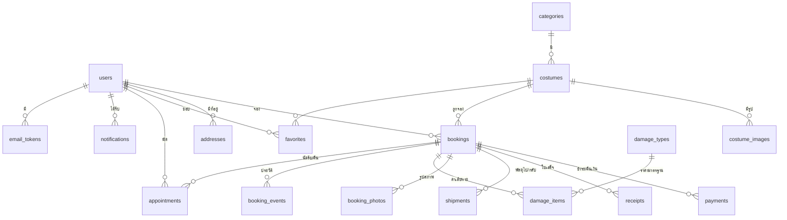

### 12.2 ตารางทั้งหมด 21 ตาราง

(รายละเอียดทุกคอลัมน์อยู่ใน [ภาคผนวก ก](#ภาคผนวก-ก-พจนานุกรมฐานข้อมูล-ทุกคอลัมน์-21-ตาราง-241-คอลัมน์))

| ตาราง | เก็บอะไร | คอลัมน์สำคัญ |
|---|---|---|
| `users` | ผู้ใช้ทุกบทบาท | role, status, email, password_hash, email_verified_at, สัดส่วน (bust_in, waist_in, hip_in, height_cm) |
| `email_tokens` | token ยืนยันอีเมล/รีเซ็ตรหัส | type, token_hash, expires_at, used_at |
| `login_attempts` | การเข้าระบบ (ใช้จำกัดการเดา) | email, ip, success |
| `categories` | หมวดชุด | name, slug, color, sort_order, is_active |
| `costumes` | ชุด | code, สัดส่วน, rent_price, extra_day_price, deposit, late_fee_per_day, replacement_value, accessories, status |
| `costume_images` | รูปชุด | path, credit, sort_order |
| `favorites` | ชุดที่ชอบ | user_id, costume_id |
| `addresses` | สมุดที่อยู่ | recipient, phone, line1, subdistrict, district, province, postcode, is_default |
| `bookings` | การจอง (ตารางหลัก) | booking_no, channel, วันงาน/รับ/คืน, delivery_method, return_method, ship_zone, ship_by_date, ที่อยู่ที่คัดลอกไว้, block_from, block_until, ยอดเงินทุกช่อง, status, hold_expires_at, late_days, late_fee, damage_fee, deposit_refund, extra_charge, inspection_json, arrival_*, dispute_*, damage_waived |
| `shipments` | พัสดุ | direction (out/back), carrier, tracking_no, shipped_on, status, arrived_at |
| `booking_photos` | รูปสภาพชุด | stage (handover/arrival/dropoff/return/dispute), path |
| `damage_types` | ตารางค่าเสียหาย | name, area, fee_type (fixed/percent), amount, is_active |
| `damage_items` | ค่าเสียหายของแต่ละการจอง | damage_type_id, label, qty, amount, note |
| `payments` | เงินเข้าออก | kind (booking/fine/refund), method, amount, slip_path, status, reviewed_by |
| `receipts` | ใบเสร็จ | receipt_no, kind (booking/settlement/adjustment), amount, items_json |
| `booking_events` | ประวัติทุกเหตุการณ์ | type, message, actor_id |
| `appointments` | นัดหมาย | type (fitting/pickup/return), starts_at, status |
| `notifications` | กระดิ่ง | type, title, body, link, dedupe_key, read_at |
| `mail_outbox` | อีเมลที่ส่ง | to_email, subject, html, status |
| `settings` | ค่าตั้งร้าน | key, value |
| `counters` | ตัวนับเลขเอกสาร | name, year, value |

ไฟล์ที่เกี่ยวข้อง: `database/schema.sql` (โครงสร้างล้วน) และ `database/panteen_rent.sql` (โครงสร้าง + ข้อมูลตัวอย่าง สำหรับนำเข้าผ่าน phpMyAdmin)

---

## 13. การติดตั้งและการตั้งค่า

### 13.1 สิ่งที่ต้องมี

| | เวอร์ชัน |
|---|---|
| PHP | 8.1 ขึ้นไป พร้อม `pdo_mysql`, `mbstring`, `gd`, `openssl` |
| ฐานข้อมูล | MySQL 8/9 หรือ MariaDB 10.4 ขึ้นไป |
| เว็บเซิร์ฟเวอร์ | Apache + mod_rewrite (หรือ `php -S` สำหรับทดลอง) |

### 13.2 ติดตั้งบน XAMPP (Windows)

1. คัดลอกโฟลเดอร์ไปที่ `C:\xampp\htdocs\panteen-rent`
2. เปิด XAMPP Control Panel กด Start ที่ Apache และ MySQL
3. สร้างฐานข้อมูล (เลือก 1 วิธี)
   - Command Prompt: `cd C:\xampp\htdocs\panteen-rent` แล้ว `C:\xampp\php\php.exe cli\install.php`
   - หรือ phpMyAdmin → Import → `database/panteen_rent.sql` (ไฟล์นี้สร้างฐานข้อมูล `panteen_rent` ให้เอง
     แต่วันที่ของการจองตัวอย่างจะเป็นวันที่ตอนส่งออกไฟล์ ถ้าอยากให้เป็นปัจจุบัน เข้าระบบผู้ดูแล → ตั้งค่าร้าน → "รีเซ็ตข้อมูลตัวอย่าง")
4. เปิด http://localhost/panteen-rent/

ระบบรู้เองว่าอยู่ในโฟลเดอร์ย่อย `/panteen-rent` ทุกลิงก์จึงถูกต้องโดยไม่ต้องตั้งค่า ไฟล์ `.htaccess` ส่งทุกคำขอเข้า `public/`
ถ้าจะเปิดทดสอบจากมือถือผ่าน Wi-Fi (เช่น `http://192.168.1.20/panteen-rent/`) ให้ใส่ `'hosts' => ['192.168.1.20']` ใน `config/config.php`

**ตั้งอีเมลส่งจริงด้วย Gmail**: host `smtp.gmail.com` port `587` encryption `tls` username = อีเมล Gmail
password = App Password 16 ตัว (Google Account → Security → 2-Step Verification → App passwords)
กรอกในหลังร้าน → ตั้งค่าร้าน → อีเมล แล้วกด "ส่งอีเมลทดสอบ"

**ตั้งงานตามเวลา** (ไม่บังคับ ถ้าไม่ตั้ง ระบบรันเองตอนมีคนเปิดเว็บ)

- Windows Task Scheduler ทุก 15 นาที: `C:\xampp\php\php.exe C:\xampp\htdocs\panteen-rent\cli\cron.php`
- Linux cron: `*/15 * * * * php /path/to/panteen-rent/cli/cron.php`

### 13.3 ไฟล์ตั้งค่า `config/config.php`

คัดลอกจาก `config/config.example.php` (ไม่มีไฟล์นี้ระบบใช้ค่าเริ่มต้นที่ตรงกับ XAMPP)

| ค่า | ความหมาย |
|---|---|
| `app.env` | `dev` = เปิดกล่องจดหมายจำลองและรายละเอียด error ให้เครื่องตัวเอง / `production` เมื่อขึ้นจริง |
| `app.url` | ที่อยู่เว็บสำหรับลิงก์ในอีเมล เช่น `https://panteenrent.s3rx.net` |
| `app.hosts` | ชื่อเครื่องอื่นที่เชื่อถือได้ (เช่นทดสอบจากมือถือผ่าน Wi-Fi) |
| `app.key` | ข้อความสุ่มยาว ๆ ต้องเปลี่ยนเมื่อใช้จริง |
| `db.*` | host, port, name, user, pass |
| `mail.driver` | `log` (เก็บในกล่องจำลอง) หรือ `smtp` |
| `mail.smtp.*` | host, port, encryption, username, password (Gmail ใช้ App Password 16 ตัว) |
| `uploads.max_bytes` | ขนาดรูปสูงสุด (5 MB) |

**ตัวแปรสภาพแวดล้อม** (ใช้แทน config.php บน Docker/Coolify)

| ตัวแปร | แทนค่า |
|---|---|
| `PANTEEN_DB_HOST`, `PANTEEN_DB_PORT`, `PANTEEN_DB_NAME`, `PANTEEN_DB_USER`, `PANTEEN_DB_PASS` | `db.*` |
| `PANTEEN_APP_ENV`, `PANTEEN_APP_URL`, `PANTEEN_APP_KEY` | `app.*` |
| `PANTEEN_MAIL_DRIVER`, `PANTEEN_MAIL_FROM` | `mail.driver`, `mail.from_email` |
| `PANTEEN_SMTP_HOST`, `PANTEEN_SMTP_USER`, `PANTEEN_SMTP_PASS` | `mail.smtp.*` |
| `PANTEEN_SEED` | `demo` = ติดตั้งพร้อมข้อมูลตัวอย่างตอนเริ่มครั้งแรก / อื่น ๆ = ไม่ใส่ |

### 13.4 ก่อนเปิดใช้งานจริง (checklist)

- [ ] ติดตั้งแบบไม่มีข้อมูลตัวอย่าง: `php cli/install.php --no-seed` (มีเฉพาะบัญชี admin@panteen.test / Admin1234)
- [ ] เข้าระบบแล้วเปลี่ยนอีเมลและรหัสผ่านผู้ดูแลทันที
- [ ] ตั้งค่าร้าน: ข้อมูลร้านจริง พร้อมเพย์ บัญชีธนาคาร
- [ ] ติ๊กออก "แสดงแถบข้อมูลตัวอย่าง" (โหมดสาธิต)
- [ ] ตั้ง `app.env = production`, `app.url`, `app.key`
- [ ] ตั้ง SMTP แล้วกด "ส่งอีเมลทดสอบ"
- [ ] ตั้ง cron ทุก 10–15 นาที (Windows Task Scheduler หรือ Linux cron) ถ้าไม่ใช้ Docker
- [ ] ตรวจราคาในตารางค่าเสียหายให้ตรงกับร้าน

### 13.5 Docker / Coolify

- `Dockerfile`: PHP 8.3 + Apache, เปิด gd/pdo_mysql/opcache, DocumentRoot = `public/`, HEALTHCHECK ที่ `/healthz`
- `docker/entrypoint.sh`: รอฐานข้อมูล → ถ้ายังไม่มีตาราง รัน `cli/install.php` ครั้งเดียว → รัน cron ทุก 10 นาทีเบื้องหลัง → เริ่ม Apache
- **แบบคอนเทนเนอร์เดียว** (`coolify.yaml` ใช้กับเว็บจริงบน Coolify): ถ้าไม่ได้ตั้ง `PANTEEN_DB_HOST` คอนเทนเนอร์จะเปิด MariaDB ในตัวเอง
  (รับเฉพาะ 127.0.0.1) สร้างฐานข้อมูล `panteen_rent` ผู้ใช้ `panteen` และสุ่มรหัสผ่านกับ app key ให้เองตอนเริ่มครั้งแรก
  เก็บไว้ที่ `/var/lib/mysql/panteen-secrets.env`
  ⚠️ ข้อมูลทั้งหมดอยู่ในคอนเทนเนอร์ **deploy ใหม่เมื่อไรข้อมูลจะกลับเป็นข้อมูลตัวอย่างชุดใหม่** ถ้าจะใช้จริงให้เพิ่ม Persistent Storage
  ใน Coolify ที่ `/var/lib/mysql`, `/var/www/panteen/storage` และ `/var/www/panteen/public/media`
- **แบบสองคอนเทนเนอร์** (`docker-compose.yml`): service `web` + `db` (MariaDB 10.11) ข้อมูลฐานข้อมูล สลิป รูปสภาพ และรูปชุดเก็บใน volume
  ไม่หายเมื่อ deploy ใหม่ รหัสผ่านฐานข้อมูลและ app key ใช้ตัวแปร `SERVICE_PASSWORD_*` (Coolify สุ่มให้เองเมื่อสร้างแบบ Docker Compose; repo ไม่มีรหัสลับ)
- รันเองด้วย Docker: `SERVICE_PASSWORD_DB=... SERVICE_PASSWORD_DBROOT=... SERVICE_PASSWORD_64_APPKEY=... PANTEEN_APP_URL=https://โดเมน docker compose up -d`

---

## 14. การทดสอบและการตรวจคุณภาพโค้ด

| ชุดทดสอบ | จำนวน | ตรวจอะไร | คำสั่ง |
|---|--:|---|---|
| Unit | 242 | ราคา วันว่าง การชนกัน (6 process พร้อมกัน) สถานะ QR พร้อมเพย์ ไอคอนครบ จัดส่ง ส่งคืน ตรวจสภาพ โต้แย้ง | `php tests/run.php unit` |
| HTTP | 203 | ยิงคำขอจริง: สิทธิ์ CSRF IDOR สมัคร→ยืนยัน→จอง→สลิป→อนุมัติ→ใบเสร็จ ส่งพัสดุ รับคืน ตรวจสภาพ | `php tests/run.php http` |
| E2E (Playwright) | 138 | เบราว์เซอร์จริงทุกขั้นตอน ทุกหน้าที่จอ 1366 และ 390 px ไม่ล้นจอ เมนูมือถือ คีย์บอร์ด | `node tests/e2e/e2e.js <โฟลเดอร์ภาพ>` |
| Accessibility (axe) | 112 หน้า | ไม่มีปัญหาการเข้าถึง | (สคริปต์ตรวจแยก) |

ชุดทดสอบใช้ฐานข้อมูลแยก `panteen_test` สร้างใหม่ทุกครั้ง ไม่แตะข้อมูลจริง

**ตรวจคุณภาพโค้ด** (ผ่านทั้งหมด ไม่มี error/warning)

- PHPStan ระดับ 6: `php phpstan.phar analyse -c tests/lint/phpstan.neon`
- ESLint: `app.js` และ `e2e.js`
- Stylelint: `app.css` และ `admin.css`
- ตรวจโค้ดที่ไม่ได้ใช้ (ฟังก์ชัน คลาส CSS import หน้าที่ไม่มีใครเรียก): ไม่พบ

---

## 15. ข้อจำกัดที่รู้อยู่และสิ่งที่ต่อยอดได้

| เรื่อง | ตอนนี้ | ต่อยอดได้ |
|---|---|---|
| บัญชีรับเงินคืนของลูกค้า | ร้านโอนมัดจำคืนเองตามช่องทางที่ตกลง ระบบบันทึกยอด | เพิ่มช่องพร้อมเพย์/บัญชีของลูกค้าในหน้าส่งคืน |
| เปลี่ยนที่อยู่หลังจอง | ร้านยกเลิกแล้วจองใหม่ หรือเปลี่ยนเป็นรับที่ร้าน | ให้แก้ที่อยู่ได้ก่อนวันส่งออก |
| จองหลายชุดพร้อมกัน | คิดค่าส่งต่อชุด | รวมกล่อง คิดค่าส่งครั้งเดียว |
| ตรวจสลิปอัตโนมัติ | พนักงานตรวจด้วยตา | เชื่อม API ตรวจสลิปของธนาคาร |
| ติดตามพัสดุอัตโนมัติ | เปิดหน้าขนส่งด้วยปุ่ม | เชื่อม API ขนส่งให้สถานะอัปเดตเอง |
| แจ้งเตือน LINE | อีเมล + กระดิ่งในเว็บ | LINE Messaging API |

---

## 16. คำถามที่พบบ่อยและการแก้ปัญหา

**ลูกค้าบอกว่าไม่ได้รับอีเมล**
ดูโหมดอีเมลในตั้งค่าร้าน ถ้าเป็น `log` อีเมลไม่ได้ส่งออกจริง อยู่ในกล่องจดหมายจำลอง `/dev/mailbox` ถ้าเป็น `smtp`
กด "ส่งอีเมลทดสอบ" และดูข้อความ error ในกล่องจดหมายจำลอง (คอลัมน์สถานะ)

**ชุดว่างแต่ลูกค้าจองไม่ได้**
ตรวจ (1) สถานะชุดต้องเป็น "เปิดให้เช่า" (2) วันขนส่ง+วันซักอาจชนกับการจองก่อน/หลัง ดูที่ตารางชุด
(3) จองหลังเวลาตัดรอบแล้วส่งพัสดุไม่ทัน (4) สมาชิกมีรายการรอชำระครบ 3 รายการ (5) ยังไม่ได้ยืนยันอีเมล

**อยากให้วันที่ของข้อมูลตัวอย่างเป็นปัจจุบัน**
ผู้ดูแลระบบ → ตั้งค่าร้าน → "รีเซ็ตข้อมูลตัวอย่าง" (ลบข้อมูลทั้งหมดแล้วสร้างใหม่ ใช้เฉพาะเว็บสาธิต)

**การจองหายไปเอง**
ไม่ได้หาย สถานะเป็น "หมดเวลาชำระ" เพราะไม่ชำระใน 24 ชม. ดูได้ในการจอง กรองสถานะนี้

**ลูกค้าส่งพัสดุคืนแต่ระบบคิดคืนช้า**
แก้ "วันที่ฝากส่งตามตราประทับ" ในหน้าการจองก่อนกดได้รับพัสดุ หรือในกล่องสรุปของหน้าตรวจสภาพ

**หน้าเว็บขึ้น 500 หรือหน้าขาว**
ดู `storage/logs/php-error.log` ตรวจว่า `storage/` เขียนได้ และฐานข้อมูลเชื่อมต่อได้ (เปิด `/healthz` ต้องได้ `ok`)

**ย้ายเครื่อง/สำรองข้อมูล**
สำรองฐานข้อมูล (mysqldump หรือ phpMyAdmin Export) + โฟลเดอร์ `storage/slips`, `storage/condition`, `public/media`

---

## ภาคผนวก

ภาคผนวกนี้สำหรับนักพัฒนาที่ต้องแก้หรือต่อยอดระบบ ข้อมูลทั้งหมดดึงจากโค้ดและฐานข้อมูลจริง

### ภาคผนวก ก: พจนานุกรมฐานข้อมูล (ทุกคอลัมน์ 21 ตาราง 241 คอลัมน์)

"ว่างได้" ✓ = เป็น NULL ได้ · ค่า enum แสดงในคอลัมน์ชนิด · ตารางเรียงตามตัวอักษร

#### `addresses`

| คอลัมน์ | ชนิด | ว่างได้ | ค่าเริ่มต้น | ความหมาย |
|---|---|:-:|---|---|
| `id` | `int unsigned` |  |  | คีย์หลัก · รหัสแถว (เลขอัตโนมัติ) |
| `user_id` | `int unsigned` |  |  | สมาชิกเจ้าของข้อมูล → users.id |
| `label` | `varchar(40)` | ✓ |  | เช่น บ้าน หอพัก ที่ทำงาน |
| `recipient` | `varchar(150)` |  |  | ชื่อผู้รับ |
| `phone` | `varchar(20)` |  |  | เบอร์ผู้รับ |
| `line1` | `varchar(255)` |  |  | บ้านเลขที่ อาคาร ห้อง ซอย ถนน |
| `subdistrict` | `varchar(100)` |  |  | แขวง/ตำบล |
| `district` | `varchar(100)` |  |  | เขต/อำเภอ |
| `province` | `varchar(60)` |  |  | จังหวัด (ใช้กำหนดโซนค่าส่ง) |
| `postcode` | `char(5)` |  |  | รหัสไปรษณีย์ 5 หลัก |
| `note` | `varchar(255)` | ✓ |  | จุดสังเกตสำหรับคนส่งของ |
| `is_default` | `tinyint(1)` |  | 0 | 1 = ที่อยู่หลัก |
| `created_at` | `datetime` |  | CURRENT_TIMESTAMP | เวลาที่สร้างแถว |
| `updated_at` | `datetime` |  | CURRENT_TIMESTAMP | เวลาที่แก้ล่าสุด |

#### `appointments`

| คอลัมน์ | ชนิด | ว่างได้ | ค่าเริ่มต้น | ความหมาย |
|---|---|:-:|---|---|
| `id` | `int unsigned` |  |  | คีย์หลัก · รหัสแถว (เลขอัตโนมัติ) |
| `user_id` | `int unsigned` |  |  | สมาชิกเจ้าของข้อมูล → users.id |
| `booking_id` | `int unsigned` | ✓ |  | การจองที่ผูก (นัดรับ/คืน) |
| `type` | `enum('fitting' 'pickup' 'return')` |  |  | fitting = ลองชุด, pickup = รับชุด, return = คืนชุด |
| `starts_at` | `datetime` |  |  | วันเวลาเริ่ม |
| `status` | `enum('scheduled' 'done' 'cancelled' 'no_show')` |  | scheduled | scheduled / done / cancelled / no_show |
| `note` | `varchar(500)` | ✓ |  | หมายเหตุ |
| `created_by` | `int unsigned` | ✓ |  | ผู้ใช้ที่บันทึก (พนักงาน/ลูกค้า) → users.id |
| `created_at` | `datetime` |  | CURRENT_TIMESTAMP | เวลาที่สร้างแถว |
| `updated_at` | `datetime` |  | CURRENT_TIMESTAMP | เวลาที่แก้ล่าสุด |

#### `booking_events`

| คอลัมน์ | ชนิด | ว่างได้ | ค่าเริ่มต้น | ความหมาย |
|---|---|:-:|---|---|
| `id` | `int unsigned` |  |  | คีย์หลัก · รหัสแถว (เลขอัตโนมัติ) |
| `booking_id` | `int unsigned` |  |  | การจองที่เกี่ยวข้อง → bookings.id |
| `actor_id` | `int unsigned` | ✓ |  | ผู้ทำ (ว่าง = ระบบ) |
| `type` | `varchar(40)` |  |  | created / slip / confirmed / receipt / shipped / delivered / arrival / picked_up / posted_back / received_back / returned / dispute / switch_pickup / cancelled / expired ฯลฯ |
| `message` | `varchar(500)` |  |  | ข้อความที่แสดงในประวัติ |
| `created_at` | `datetime` |  | CURRENT_TIMESTAMP | เวลาที่สร้างแถว |

#### `booking_photos`

| คอลัมน์ | ชนิด | ว่างได้ | ค่าเริ่มต้น | ความหมาย |
|---|---|:-:|---|---|
| `id` | `int unsigned` |  |  | คีย์หลัก · รหัสแถว (เลขอัตโนมัติ) |
| `booking_id` | `int unsigned` |  |  | การจองที่เกี่ยวข้อง → bookings.id |
| `stage` | `enum('handover' 'arrival' 'dropoff' 'return' 'dispute')` |  |  | handover = ก่อนส่งมอบ, arrival = ลูกค้าถ่ายตอนได้รับ, dropoff = ใบรับฝาก, return = ตอนรับคืน, dispute = หลักฐานโต้แย้ง |
| `path` | `varchar(255)` |  |  | ไฟล์ใน storage/condition (เปิดผ่าน /condition/{id}) |
| `created_by` | `int unsigned` | ✓ |  | ผู้ใช้ที่บันทึก (พนักงาน/ลูกค้า) → users.id |
| `created_at` | `datetime` |  | CURRENT_TIMESTAMP | เวลาที่สร้างแถว |

#### `bookings`

| คอลัมน์ | ชนิด | ว่างได้ | ค่าเริ่มต้น | ความหมาย |
|---|---|:-:|---|---|
| `id` | `int unsigned` |  |  | คีย์หลัก · รหัสแถว (เลขอัตโนมัติ) |
| `booking_no` | `varchar(20)` |  |  | เลขจอง เช่น PT69-0012 (ไม่ซ้ำ) |
| `user_id` | `int unsigned` |  |  | ลูกค้า → users.id |
| `costume_id` | `int unsigned` |  |  | ชุด → costumes.id |
| `created_by` | `int unsigned` | ✓ |  | ผู้สร้างการจอง |
| `channel` | `enum('online' 'counter')` |  | online | online = ลูกค้าจองเอง, counter = พนักงานจองหน้าร้าน |
| `event_date` | `date` |  |  | วันงาน |
| `pickup_date` | `date` |  |  | วันรับชุด (เริ่มคิดค่าเช่า) |
| `pickup_time` | `varchar(5)` |  | 13:00 | เวลารับ |
| `return_date` | `date` |  |  | วันคืนชุดที่กำหนด |
| `return_time` | `varchar(5)` |  | 13:00 | เวลาคืน |
| `delivery_method` | `enum('pickup' 'post' 'messenger')` |  | pickup | รับที่ร้าน / ส่งพัสดุ / เมสเซนเจอร์ |
| `return_method` | `enum('store' 'post')` |  | store | คืนที่ร้าน / ส่งพัสดุคืน |
| `ship_zone` | `enum('metro' 'upcountry')` | ✓ |  | metro = กทม./ปริมณฑล, upcountry = ต่างจังหวัด (ว่าง = ไม่ส่งพัสดุ) |
| `ship_by_date` | `date` | ✓ |  | วันที่ร้านต้องส่งพัสดุให้ถึงลูกค้าทันวันรับชุด |
| `ship_recipient` | `varchar(150)` | ✓ |  | ชื่อผู้รับ ณ ตอนจอง |
| `ship_phone` | `varchar(20)` | ✓ |  | เบอร์ผู้รับ ณ ตอนจอง |
| `ship_address` | `varchar(600)` | ✓ |  | ที่อยู่จัดส่ง ณ ตอนจอง (แก้สมุดที่อยู่ภายหลังไม่กระทบ) |
| `ship_province` | `varchar(60)` | ✓ |  | จังหวัด ณ ตอนจอง |
| `ship_postcode` | `char(5)` | ✓ |  | รหัสไปรษณีย์ ณ ตอนจอง |
| `block_from` | `date` |  |  | วันแรกที่ชุดไม่ว่าง (วันส่งพัสดุ หรือวันรับชุดที่ร้าน) |
| `block_until` | `date` |  |  | วันสุดท้ายที่ชุดไม่ว่าง (รวมวันขนส่งกลับและวันซัก) |
| `rental_days` | `smallint unsigned` |  |  | จำนวนวันเช่า |
| `rent_amount` | `decimal(10,2)` |  |  | ค่าเช่าพื้นฐาน |
| `extra_amount` | `decimal(10,2)` |  | 0.00 | ค่าวันเพิ่ม |
| `deposit_amount` | `decimal(10,2)` |  | 0.00 | เงินมัดจำ |
| `delivery_fee` | `decimal(10,2)` |  | 0.00 | ค่าส่งชุดถึงลูกค้า |
| `return_fee` | `decimal(10,2)` |  | 0.00 | ค่าใบปะหน้าส่งคืน (ร้านแนบไว้ในกล่อง) |
| `total_amount` | `decimal(10,2)` |  |  | ยอดที่ต้องชำระตอนจอง = ค่าเช่า + ค่าวันเพิ่ม + มัดจำ + ค่าส่ง |
| `status` | `enum('pending_payment' 'awaiting_verification' 'confirmed' 'shipped' 'picked_up' 'returning' 'returned' 'cancelled' 'expired')` |  | pending_payment | สถานะการจอง (ดูหัวข้อ 4.2) |
| `hold_expires_at` | `datetime` | ✓ |  | หมดเวลาชำระเมื่อ |
| `note` | `varchar(500)` | ✓ |  | หมายเหตุจากลูกค้า |
| `staff_note` | `varchar(500)` | ✓ |  | หมายเหตุภายในของร้าน |
| `cancel_reason` | `varchar(255)` | ✓ |  | เหตุผลยกเลิก |
| `cancelled_by` | `int unsigned` | ✓ |  | ผู้ยกเลิก |
| `cancelled_at` | `datetime` | ✓ |  | เวลายกเลิก |
| `refund_amount` | `decimal(10,2)` | ✓ |  | ยอดคืนเงินเมื่อยกเลิก |
| `confirmed_at` | `datetime` | ✓ |  | เวลายืนยัน |
| `picked_up_at` | `datetime` | ✓ |  | เวลาที่ชุดถึงมือลูกค้า |
| `returned_at` | `datetime` | ✓ |  | เวลาที่ปิดการเช่า |
| `late_days` | `smallint unsigned` |  | 0 | จำนวนวันคืนช้า |
| `late_fee` | `decimal(10,2)` |  | 0.00 | ค่าปรับคืนช้า |
| `damage_fee` | `decimal(10,2)` |  | 0.00 | ค่าเสียหายรวม |
| `damage_note` | `varchar(500)` | ✓ |  | สรุปรายการเสียหาย |
| `deposit_refund` | `decimal(10,2)` | ✓ |  | มัดจำที่คืนลูกค้า |
| `extra_charge` | `decimal(10,2)` |  | 0.00 | ค่าปรับส่วนที่เกินเงินมัดจำ |
| `inspected_at` | `datetime` | ✓ |  | เวลาตรวจสภาพ |
| `inspected_by` | `int unsigned` | ✓ |  | พนักงานผู้ตรวจ |
| `inspection_json` | `text` | ✓ |  | ผลตรวจสภาพตอนรับคืน: จุดที่ตรวจ ของที่ขาด สภาพชุดหลังตรวจ |
| `arrival_note` | `varchar(500)` | ✓ |  | ลูกค้าแจ้งปัญหาตอนได้รับพัสดุ |
| `arrival_reported_at` | `datetime` | ✓ |  | เวลาที่ลูกค้าแจ้งสภาพตอนได้รับ |
| `dispute_note` | `varchar(500)` | ✓ |  | ลูกค้าโต้แย้งค่าเสียหาย |
| `dispute_at` | `datetime` | ✓ |  | เวลาที่ลูกค้าส่งข้อโต้แย้ง |
| `dispute_reply` | `varchar(500)` | ✓ |  | คำตอบของร้าน |
| `dispute_resolved_at` | `datetime` | ✓ |  | เวลาที่ร้านปิดข้อโต้แย้ง |
| `damage_waived` | `decimal(10,2)` |  | 0.00 | ค่าเสียหายที่ร้านลดให้หลังทบทวน (คืนเงินแล้ว) |
| `created_at` | `datetime` |  | CURRENT_TIMESTAMP | เวลาที่สร้างแถว |
| `updated_at` | `datetime` |  | CURRENT_TIMESTAMP | เวลาที่แก้ล่าสุด |

#### `categories`

| คอลัมน์ | ชนิด | ว่างได้ | ค่าเริ่มต้น | ความหมาย |
|---|---|:-:|---|---|
| `id` | `int unsigned` |  |  | คีย์หลัก · รหัสแถว (เลขอัตโนมัติ) |
| `name` | `varchar(100)` |  |  | ชื่อหมวด (ไม่ซ้ำ) |
| `slug` | `varchar(100)` |  |  | ชื่อใน URL เช่น graduation → /c/graduation (ไม่ซ้ำ) |
| `color` | `char(7)` |  | #1D191C | สีประจำหมวด (hex) |
| `description` | `varchar(500)` | ✓ |  | คำอธิบายหมวด |
| `cover_image` | `varchar(255)` | ✓ |  | รูปปกหมวด |
| `sort_order` | `int` |  | 0 | ลำดับการแสดง (น้อยขึ้นก่อน) |
| `is_active` | `tinyint(1)` |  | 1 | 1 = เปิดใช้ 0 = ปิด |
| `created_at` | `datetime` |  | CURRENT_TIMESTAMP | เวลาที่สร้างแถว |
| `updated_at` | `datetime` |  | CURRENT_TIMESTAMP | เวลาที่แก้ล่าสุด |

#### `costume_images`

| คอลัมน์ | ชนิด | ว่างได้ | ค่าเริ่มต้น | ความหมาย |
|---|---|:-:|---|---|
| `id` | `int unsigned` |  |  | คีย์หลัก · รหัสแถว (เลขอัตโนมัติ) |
| `costume_id` | `int unsigned` |  |  | ชุด → costumes.id |
| `path` | `varchar(255)` |  |  | ไฟล์รูปใน public/media (มีอีก 3 ขนาดชื่อเดียวกัน) |
| `credit` | `varchar(255)` | ✓ |  | ที่มาของภาพ (ภาพตัวอย่างจากคลังภาพฟรี) |
| `sort_order` | `int` |  | 0 | ลำดับรูป (0 = รูปปก) |
| `created_at` | `datetime` |  | CURRENT_TIMESTAMP | เวลาที่สร้างแถว |

#### `costumes`

| คอลัมน์ | ชนิด | ว่างได้ | ค่าเริ่มต้น | ความหมาย |
|---|---|:-:|---|---|
| `id` | `int unsigned` |  |  | คีย์หลัก · รหัสแถว (เลขอัตโนมัติ) |
| `code` | `varchar(20)` |  |  | รหัสชุด เช่น GR-001 (ไม่ซ้ำ ใช้ใน URL และป้าย QR) |
| `category_id` | `int unsigned` |  |  | หมวด → categories.id |
| `name` | `varchar(150)` |  |  | ชื่อชุด |
| `description` | `text` | ✓ |  | คำอธิบาย |
| `color_name` | `varchar(50)` | ✓ |  | ชื่อสี |
| `size_label` | `varchar(20)` |  | M | ไซส์ เช่น S M L Free |
| `bust_min` | `decimal(4,1)` | ✓ |  | รอบอกต่ำสุดที่ใส่ได้ (นิ้ว) |
| `bust_max` | `decimal(4,1)` | ✓ |  | รอบอกสูงสุดที่ใส่ได้ (นิ้ว) |
| `waist_min` | `decimal(4,1)` | ✓ |  | รอบเอวต่ำสุด (นิ้ว) |
| `waist_max` | `decimal(4,1)` | ✓ |  | รอบเอวสูงสุด (นิ้ว) |
| `hip_max` | `decimal(4,1)` | ✓ |  | รอบสะโพกสูงสุด (นิ้ว) |
| `length_in` | `decimal(4,1)` | ✓ |  | ความยาวชุด (นิ้ว) |
| `rent_price` | `decimal(10,2)` |  |  | ค่าเช่าแพ็กเกจพื้นฐาน |
| `extra_day_price` | `decimal(10,2)` |  | 0.00 | ค่าเช่าวันถัดไปต่อวัน |
| `deposit` | `decimal(10,2)` |  | 0.00 | เงินมัดจำ (คืนเมื่อคืนชุด) |
| `late_fee_per_day` | `decimal(10,2)` |  | 0.00 | ค่าปรับคืนช้าต่อวัน |
| `replacement_value` | `decimal(10,2)` | ✓ |  | มูลค่าชุด ใช้คิดค่าเสียหายแบบร้อยละ และเป็นเพดานค่าเสียหาย |
| `accessories` | `varchar(300)` | ✓ |  | ของที่มากับชุด คั่นด้วยจุลภาค (ตรวจตอนส่งและตอนรับคืน) |
| `status` | `enum('active' 'maintenance' 'retired')` |  | active | active = เปิดให้เช่า, maintenance = ซ่อม/ซักพิเศษ, retired = เลิกให้เช่า |
| `is_featured` | `tinyint(1)` |  | 0 | 1 = ชุดแนะนำ |
| `arrived_at` | `date` | ✓ |  | วันที่ชุดเข้าร้าน (ใช้เรียง "มาใหม่") |
| `created_at` | `datetime` |  | CURRENT_TIMESTAMP | เวลาที่สร้างแถว |
| `updated_at` | `datetime` |  | CURRENT_TIMESTAMP | เวลาที่แก้ล่าสุด |

#### `counters`

| คอลัมน์ | ชนิด | ว่างได้ | ค่าเริ่มต้น | ความหมาย |
|---|---|:-:|---|---|
| `name` | `varchar(30)` |  |  | คีย์หลัก · booking หรือ receipt |
| `year` | `smallint unsigned` |  |  | คีย์หลัก · ปี ค.ศ. (เลขเอกสารแสดงเป็น พ.ศ. 2 หลัก เช่น 69) |
| `value` | `int unsigned` |  | 0 | เลขล่าสุดที่ออกไป |

#### `damage_items`

| คอลัมน์ | ชนิด | ว่างได้ | ค่าเริ่มต้น | ความหมาย |
|---|---|:-:|---|---|
| `id` | `int unsigned` |  |  | คีย์หลัก · รหัสแถว (เลขอัตโนมัติ) |
| `booking_id` | `int unsigned` |  |  | การจองที่เกี่ยวข้อง → bookings.id |
| `damage_type_id` | `int unsigned` | ✓ |  | รายการมาตรฐานที่เลือก (ว่าง = พิมพ์เอง) |
| `label` | `varchar(200)` |  |  | ชื่อรายการ ณ วันตรวจ |
| `qty` | `smallint unsigned` |  | 1 | จำนวน |
| `amount` | `decimal(10,2)` |  |  | ราคารวมของแถว ณ วันตรวจ |
| `note` | `varchar(255)` | ✓ |  | ตำแหน่ง/รายละเอียด |
| `created_by` | `int unsigned` | ✓ |  | ผู้ใช้ที่บันทึก (พนักงาน/ลูกค้า) → users.id |
| `created_at` | `datetime` |  | CURRENT_TIMESTAMP | เวลาที่สร้างแถว |

#### `damage_types`

| คอลัมน์ | ชนิด | ว่างได้ | ค่าเริ่มต้น | ความหมาย |
|---|---|:-:|---|---|
| `id` | `int unsigned` |  |  | คีย์หลัก · รหัสแถว (เลขอัตโนมัติ) |
| `name` | `varchar(120)` |  |  | ชื่อรายการ (ไม่ซ้ำ) |
| `area` | `varchar(40)` |  |  | กลุ่มจุดตรวจ: ผ้า ตะเข็บ ซิปกระดุม งานปัก คราบกลิ่น ของที่มากับชุด ทั้งชุด |
| `fee_type` | `enum('fixed' 'percent')` |  | fixed | fixed = บาทต่อหน่วย, percent = ร้อยละของมูลค่าชุด |
| `amount` | `decimal(10,2)` |  |  | ราคา (บาท หรือ %) |
| `hint` | `varchar(255)` | ✓ |  | คำแนะนำสั้นสำหรับพนักงาน |
| `sort_order` | `int` |  | 0 | ลำดับการแสดง (น้อยขึ้นก่อน) |
| `is_active` | `tinyint(1)` |  | 1 | 1 = เปิดใช้ 0 = ปิด |

#### `email_tokens`

| คอลัมน์ | ชนิด | ว่างได้ | ค่าเริ่มต้น | ความหมาย |
|---|---|:-:|---|---|
| `id` | `int unsigned` |  |  | คีย์หลัก · รหัสแถว (เลขอัตโนมัติ) |
| `user_id` | `int unsigned` |  |  | สมาชิกเจ้าของข้อมูล → users.id |
| `type` | `enum('verify' 'reset')` |  |  | verify = ยืนยันอีเมล, reset = ตั้งรหัสใหม่ |
| `token_hash` | `char(64)` |  |  | SHA-256 ของ token ในลิงก์ (ไม่เก็บ token จริง) (ไม่ซ้ำ) |
| `expires_at` | `datetime` |  |  | หมดอายุ |
| `used_at` | `datetime` | ✓ |  | ใช้แล้วเมื่อ (ใช้ได้ครั้งเดียว) |
| `created_at` | `datetime` |  | CURRENT_TIMESTAMP | เวลาที่สร้างแถว |

#### `favorites`

| คอลัมน์ | ชนิด | ว่างได้ | ค่าเริ่มต้น | ความหมาย |
|---|---|:-:|---|---|
| `user_id` | `int unsigned` |  |  | คีย์หลัก · สมาชิก |
| `costume_id` | `int unsigned` |  |  | คีย์หลัก · ชุดที่กดหัวใจ |
| `created_at` | `datetime` |  | CURRENT_TIMESTAMP | เวลาที่สร้างแถว |

#### `login_attempts`

| คอลัมน์ | ชนิด | ว่างได้ | ค่าเริ่มต้น | ความหมาย |
|---|---|:-:|---|---|
| `id` | `int unsigned` |  |  | คีย์หลัก · รหัสแถว (เลขอัตโนมัติ) |
| `email` | `varchar(190)` |  |  | อีเมลที่พยายามเข้า |
| `ip` | `varchar(45)` |  |  | IP ผู้พยายามเข้า |
| `success` | `tinyint(1)` |  | 0 | 1 = สำเร็จ 0 = ผิด |
| `created_at` | `datetime` |  | CURRENT_TIMESTAMP | เวลาที่สร้างแถว |

#### `mail_outbox`

| คอลัมน์ | ชนิด | ว่างได้ | ค่าเริ่มต้น | ความหมาย |
|---|---|:-:|---|---|
| `id` | `int unsigned` |  |  | คีย์หลัก · รหัสแถว (เลขอัตโนมัติ) |
| `to_email` | `varchar(190)` |  |  | ผู้รับ |
| `subject` | `varchar(255)` |  |  | หัวเรื่อง |
| `html` | `mediumtext` |  |  | เนื้อหา HTML |
| `text_body` | `mediumtext` |  |  | เนื้อหาตัวอักษรล้วน |
| `status` | `enum('logged' 'sent' 'failed')` |  | logged | logged = เก็บไว้ (โหมด log), sent = ส่งแล้ว, failed = ส่งไม่ได้ |
| `error` | `varchar(500)` | ✓ |  | ข้อความ error จาก SMTP |
| `created_at` | `datetime` |  | CURRENT_TIMESTAMP | เวลาที่สร้างแถว |

#### `notifications`

| คอลัมน์ | ชนิด | ว่างได้ | ค่าเริ่มต้น | ความหมาย |
|---|---|:-:|---|---|
| `id` | `int unsigned` |  |  | คีย์หลัก · รหัสแถว (เลขอัตโนมัติ) |
| `user_id` | `int unsigned` |  |  | ผู้รับ (พนักงานแต่ละคนได้แถวของตัวเอง) |
| `type` | `varchar(40)` |  |  | ชนิด (ดูภาคผนวก ค) |
| `title` | `varchar(200)` |  |  | หัวข้อ |
| `body` | `varchar(500)` | ✓ |  | รายละเอียด |
| `link` | `varchar(255)` | ✓ |  | ลิงก์เมื่อกด |
| `dedupe_key` | `varchar(120)` | ✓ |  | กุญแจกันส่งซ้ำ เช่น overdue:45:2026-11-23 (ไม่ซ้ำ) |
| `read_at` | `datetime` | ✓ |  | อ่านแล้วเมื่อ |
| `created_at` | `datetime` |  | CURRENT_TIMESTAMP | เวลาที่สร้างแถว |

#### `payments`

| คอลัมน์ | ชนิด | ว่างได้ | ค่าเริ่มต้น | ความหมาย |
|---|---|:-:|---|---|
| `id` | `int unsigned` |  |  | คีย์หลัก · รหัสแถว (เลขอัตโนมัติ) |
| `booking_id` | `int unsigned` |  |  | การจองที่เกี่ยวข้อง → bookings.id |
| `kind` | `enum('booking' 'fine' 'refund')` |  | booking | booking = ค่าจอง, fine = ค่าปรับส่วนเกินมัดจำ, refund = คืนเงิน |
| `method` | `enum('promptpay' 'transfer' 'cash')` |  | promptpay | promptpay / transfer / cash |
| `amount` | `decimal(10,2)` |  |  | จำนวนเงิน (บาท) |
| `slip_path` | `varchar(255)` | ✓ |  | ไฟล์สลิปใน storage/slips (เปิดผ่าน /slips/{id}) |
| `status` | `enum('pending' 'approved' 'rejected')` |  | pending | pending = รอตรวจ, approved = ผ่าน, rejected = ไม่ผ่าน |
| `reject_reason` | `varchar(255)` | ✓ |  | เหตุผลที่สลิปไม่ผ่าน |
| `reviewed_by` | `int unsigned` | ✓ |  | พนักงานผู้ตรวจ |
| `reviewed_at` | `datetime` | ✓ |  | เวลาตรวจ |
| `created_by` | `int unsigned` | ✓ |  | ผู้ใช้ที่บันทึก (พนักงาน/ลูกค้า) → users.id |
| `created_at` | `datetime` |  | CURRENT_TIMESTAMP | เวลาที่สร้างแถว |

#### `receipts`

| คอลัมน์ | ชนิด | ว่างได้ | ค่าเริ่มต้น | ความหมาย |
|---|---|:-:|---|---|
| `id` | `int unsigned` |  |  | คีย์หลัก · รหัสแถว (เลขอัตโนมัติ) |
| `receipt_no` | `varchar(20)` |  |  | เลขใบเสร็จ เช่น RC69-0005 (ไม่ซ้ำ) |
| `booking_id` | `int unsigned` |  |  | การจองที่เกี่ยวข้อง → bookings.id |
| `kind` | `enum('booking' 'settlement' 'adjustment')` |  |  | booking = ใบเสร็จค่าจอง, settlement = ใบสรุปการคืน, adjustment = ใบปรับปรุง |
| `amount` | `decimal(10,2)` |  |  | ยอดสุทธิในใบ |
| `items_json` | `text` |  |  | รายการบรรทัดในใบ (JSON) |
| `issued_by` | `int unsigned` | ✓ |  | ผู้ออก |
| `issued_at` | `datetime` |  | CURRENT_TIMESTAMP | วันที่ออก |
| `print_count` | `int unsigned` |  | 0 | จำนวนครั้งที่เปิดหน้าใบเสร็จ |

#### `settings`

| คอลัมน์ | ชนิด | ว่างได้ | ค่าเริ่มต้น | ความหมาย |
|---|---|:-:|---|---|
| `key` | `varchar(60)` |  |  | คีย์หลัก · ชื่อค่าตั้ง (ดูภาคผนวก ข) |
| `value` | `text` | ✓ |  | ค่าที่ผู้ดูแลแก้ (ไม่มีแถว = ใช้ค่าเริ่มต้นในโค้ด) |
| `updated_at` | `datetime` |  | CURRENT_TIMESTAMP | เวลาที่แก้ล่าสุด |

#### `shipments`

| คอลัมน์ | ชนิด | ว่างได้ | ค่าเริ่มต้น | ความหมาย |
|---|---|:-:|---|---|
| `id` | `int unsigned` |  |  | คีย์หลัก · รหัสแถว (เลขอัตโนมัติ) |
| `booking_id` | `int unsigned` |  |  | การจองที่เกี่ยวข้อง → bookings.id |
| `direction` | `enum('out' 'back')` |  |  | out = ร้าน → ลูกค้า, back = ลูกค้า → ร้าน |
| `carrier` | `varchar(20)` |  |  | thaipost / kex / flash / jnt / messenger / other |
| `tracking_no` | `varchar(40)` | ✓ |  | เลขพัสดุ |
| `shipped_on` | `date` |  |  | วันที่ฝากส่ง (ขากลับใช้คิดว่าคืนช้าหรือไม่) |
| `status` | `enum('in_transit' 'delivered' 'failed' 'received' 'lost')` |  | in_transit | ขาไป: in_transit → delivered | failed  ขากลับ: in_transit → received | lost |
| `arrived_at` | `datetime` | ✓ |  | ถึงลูกค้า (ขาไป) หรือถึงร้าน (ขากลับ) |
| `note` | `varchar(255)` | ✓ |  | เหตุผลส่งไม่สำเร็จ หรือหมายเหตุ |
| `created_by` | `int unsigned` | ✓ |  | ผู้ใช้ที่บันทึก (พนักงาน/ลูกค้า) → users.id |
| `created_at` | `datetime` |  | CURRENT_TIMESTAMP | เวลาที่สร้างแถว |
| `updated_at` | `datetime` |  | CURRENT_TIMESTAMP | เวลาที่แก้ล่าสุด |

#### `users`

| คอลัมน์ | ชนิด | ว่างได้ | ค่าเริ่มต้น | ความหมาย |
|---|---|:-:|---|---|
| `id` | `int unsigned` |  |  | คีย์หลัก · รหัสแถว (เลขอัตโนมัติ) |
| `role` | `enum('admin' 'staff' 'member')` |  | member | บทบาท |
| `status` | `enum('active' 'suspended')` |  | active | สถานะบัญชี (ระงับแล้วเข้าระบบไม่ได้) |
| `first_name` | `varchar(100)` |  |  | ชื่อ |
| `last_name` | `varchar(100)` |  |  | นามสกุล |
| `nickname` | `varchar(50)` | ✓ |  | ชื่อเล่น |
| `email` | `varchar(190)` |  |  | อีเมล (ใช้เข้าระบบ ไม่ซ้ำ) |
| `phone` | `varchar(20)` | ✓ |  | เบอร์โทร |
| `line_id` | `varchar(50)` | ✓ |  | LINE ID |
| `password_hash` | `varchar(255)` |  |  | รหัสผ่านแบบ bcrypt hash |
| `email_verified_at` | `datetime` | ✓ |  | เวลายืนยันอีเมล (ว่าง = ยังไม่ยืนยัน จองไม่ได้) |
| `bust_in` | `decimal(4,1)` | ✓ |  | รอบอก (นิ้ว) |
| `waist_in` | `decimal(4,1)` | ✓ |  | รอบเอว (นิ้ว) |
| `hip_in` | `decimal(4,1)` | ✓ |  | รอบสะโพก (นิ้ว) |
| `height_cm` | `smallint unsigned` | ✓ |  | ส่วนสูง (ซม.) |
| `suspended_reason` | `varchar(255)` | ✓ |  | เหตุผลที่ระงับบัญชี |
| `last_login_at` | `datetime` | ✓ |  | เข้าระบบครั้งล่าสุด |
| `created_at` | `datetime` |  | CURRENT_TIMESTAMP | เวลาที่สร้างแถว |
| `updated_at` | `datetime` |  | CURRENT_TIMESTAMP | เวลาที่แก้ล่าสุด |


### ภาคผนวก ข: ค่าตั้งร้านทุกตัว (`settings`)

ค่าเริ่มต้นอยู่ใน `Settings::DEFAULTS` (`app/Services/Settings.php`) เมื่อผู้ดูแลแก้ในหน้าตั้งค่าร้าน ระบบบันทึกเป็นแถวในตาราง `settings`
ทับค่าเริ่มต้น เรียกใช้ในโค้ดด้วย `setting('ชื่อ')` หรือ `Settings::int('ชื่อ')`

| ชื่อค่า | ค่าเริ่มต้น | ความหมาย |
|---|---|---|
| `shop_name` | Panteen Rent | ชื่อร้าน (โลโก้ หัวอีเมล ใบเสร็จ) |
| `shop_bio` | ร้านเช่าชุดผู้หญิง · … | คำอธิบายร้านสั้น ๆ |
| `shop_phone` | 090-000-0000 | เบอร์ร้าน |
| `shop_line` | @panteenrent | LINE ของร้าน |
| `shop_instagram` | panteen.rent | Instagram |
| `shop_address` | ที่อยู่ร้านตัวอย่าง … | ที่อยู่ร้าน (ใช้เป็นผู้ส่งในใบปะหน้า และผู้รับในใบปะหน้าส่งคืน) |
| `shop_hours` | เปิดทุกวัน 10:00–19:00 น. | ข้อความเวลาเปิดที่แสดงให้ลูกค้า |
| `open_time` / `close_time` | 10:00 / 19:00 | เวลาเปิด-ปิดจริง ใช้สร้างช่วงนัดลองชุด |
| `promptpay_id` | 0900000000 | เบอร์หรือเลขประจำตัวผู้เสียภาษีสำหรับ QR พร้อมเพย์ |
| `promptpay_name` | ร้าน Panteen Rent (ตัวอย่าง) | ชื่อบัญชีที่แสดงใต้ QR |
| `bank_name` / `bank_account` | ธนาคารตัวอย่าง / 000-0-00000-0 | บัญชีสำหรับโอน (มีปุ่มคัดลอก) |
| `base_days` | 3 | จำนวนวันที่รวมในค่าเช่า |
| `max_days` | 7 | เช่าได้นานสุด (วัน) |
| `cleaning_days` | 1 | วันซักหลังคืน (ล็อกชุดต่อ) |
| `hold_hours` | 24 | เวลารอชำระหลังจอง (ชั่วโมง) |
| `cancel_before_days` | 3 | ลูกค้ายกเลิกเองได้ถึงกี่วันก่อนวันรับ/วันส่งออก |
| `min_lead_days` | 0 | ต้องจองล่วงหน้าอย่างน้อยกี่วัน (0 = จองวันนี้รับวันนี้ได้) |
| `booking_horizon_days` | 180 | จองล่วงหน้าได้ไกลสุดกี่วัน |
| `default_pickup_time` / `default_return_time` | 13:00 / 13:00 | เวลารับ/คืนที่ตั้งให้อัตโนมัติ |
| `remind_before_days` | 1 | เตือนก่อนวันรับ/คืนกี่วัน |
| `ship_enabled` | 1 | เปิดบริการส่งพัสดุถึงบ้าน |
| `ship_fee_metro` / `ship_fee_upcountry` | 80 / 120 | ค่าส่งพัสดุต่อเที่ยว (บาท) แยกโซน ใช้ทั้งขาไปและขากลับ |
| `ship_days_metro` / `ship_days_upcountry` | 1 / 2 | จำนวนวันขนส่งแยกโซน |
| `ship_cutoff` | 14:00 | เวลาตัดรอบส่งพัสดุของวัน |
| `messenger_enabled` / `messenger_fee` | 1 / 250 | เปิดเมสเซนเจอร์และค่าบริการ |
| `return_post_enabled` | 1 | เปิดให้ส่งคืนทางพัสดุ |
| `arrival_report_hours` | 24 | ลูกค้าแจ้งสภาพตอนได้รับได้ภายในกี่ชั่วโมง |
| `dispute_days` | 3 | โต้แย้งค่าเสียหายได้ภายในกี่วัน |
| `is_demo` | 1 | โหมดสาธิต: แถบข้อมูลตัวอย่าง ปุ่มบัญชีทดลอง ปุ่มรีเซ็ต |
| `rental_terms` | 7 ข้อ | เงื่อนไขการเช่า (1 บรรทัด = 1 ข้อ) แสดงในหน้าชุด หน้าจอง และหน้าวิธีเช่า |

ค่าตั้งอีเมล (SMTP) เก็บในตารางเดียวกันเมื่อแก้จากหน้าตั้งค่า ถ้าไม่มีจะใช้ค่าใน `config/config.php` หรือตัวแปรสภาพแวดล้อม

### ภาคผนวก ค: การแจ้งเตือนและอีเมลทุกแบบ

ทุกการแจ้งเตือนผ่าน `Notifier` (`app/Services/Notifier.php`) บันทึกในตาราง `notifications` (กระดิ่ง)
ถ้ามีหัวเรื่องอีเมล จะส่งอีเมลด้วยแม่แบบ `app/Views/emails/notice.php` และเก็บสำเนาใน `mail_outbox`

**ถึงลูกค้า**

| ชนิด (`type`) | เกิดเมื่อ | อีเมล (หัวเรื่อง) | ไฟล์ |
|---|---|---|---|
| (ยืนยันอีเมล) | สมัครสมาชิก / ขอลิงก์ใหม่ | ✓ ยืนยันอีเมลของคุณ | `Tokens.php` |
| (ตั้งรหัสใหม่) | ขอรีเซ็ตรหัสผ่าน | ✓ ตั้งรหัสผ่านใหม่ | `Tokens.php` |
| `booking_created` | จองสำเร็จ | ✓ รับการจอง PT… แล้ว รอชำระเงิน | `BookingService.php` |
| `remind_pay` | เหลือเวลาชำระไม่ถึง 3 ชม. | กระดิ่งเท่านั้น | `Reminders.php` |
| `slip_received` | ลูกค้าส่งสลิป | กระดิ่งเท่านั้น | `BookingService.php` |
| `slip_rejected` | ร้านตีกลับสลิป | ✓ สลิปการจอง PT… ไม่ผ่านการตรวจสอบ | `BookingService.php` |
| `booking_confirmed` | ร้านอนุมัติ / รับเงินหน้าร้าน | ✓ ยืนยันการจอง PT… · ใบเสร็จ RC… | `BookingService.php` |
| `booking_expired` | หมดเวลาชำระ | ✓ การจอง PT… หมดเวลาชำระเงิน | `BookingService.php` |
| `booking_cancelled` | ยกเลิก (ลูกค้าหรือร้าน) | ✓ ยกเลิกการจอง PT… แล้ว | `BookingService.php` |
| `rescheduled` | ร้านเลื่อนวัน | กระดิ่งเท่านั้น | `BookingService.php` |
| `shipped` | ร้านส่งพัสดุ | ✓ ส่งชุดแล้ว PT… · เลขพัสดุ … | `Fulfilment.php` |
| `delivered` | ร้านกดถึงลูกค้าแล้ว | กระดิ่งเท่านั้น | `Fulfilment.php` |
| `delivery_failed` | ส่งไม่สำเร็จ / พัสดุหาย | ✓ ส่งชุดไม่สำเร็จ / พัสดุสูญหาย PT… | `Fulfilment.php` |
| `switch_pickup` | เปลี่ยนเป็นรับที่ร้าน | กระดิ่งเท่านั้น | `Fulfilment.php` |
| `picked_up` | รับชุดที่ร้านแล้ว | กระดิ่งเท่านั้น | `BookingService.php` |
| `remind_pickup` | ก่อนวันรับ (ตาม `remind_before_days`) | ✓ เตือน: …รับชุด PT… | `Reminders.php` |
| `remind_return` | ก่อนวันคืน | ✓ เตือน: …ครบกำหนดคืนชุด PT… | `Reminders.php` |
| `overdue` | เลยวันคืน (วันละครั้ง) | ✓ เลยกำหนดคืนชุด N วัน · PT… | `Reminders.php` |
| `posted_back` | ร้านบันทึกการส่งคืนแทนลูกค้า | กระดิ่งเท่านั้น | `Fulfilment.php` |
| `received_back` | ร้านได้รับพัสดุคืน | กระดิ่งเท่านั้น | `Fulfilment.php` |
| `return_lost` | พัสดุคืนสูญหาย | กระดิ่งเท่านั้น | `Fulfilment.php` |
| `returned` | ตรวจสภาพและปิดการเช่า | ✓ สรุปการคืนชุด PT… · RC… | `BookingService.php` |
| `dispute_resolved` | ร้านตอบข้อโต้แย้ง | ✓ ผลการทบทวนค่าเสียหาย PT… | `Inspection.php` |
| `appointment` | นัดลองชุดสำเร็จ | ✓ ยืนยันนัดลองชุด วันที่ เวลา | `Appointments.php` |
| `remind_fitting` | ก่อนวันนัดลองชุด | กระดิ่งเท่านั้น | `Reminders.php` |
| `account` | ร้านแก้สถานะบัญชี | กระดิ่งเท่านั้น | `MembersController.php` |

**ถึงร้าน** (พนักงานและผู้ดูแลทุกคน ทางกระดิ่งเท่านั้น)

| ชนิด | เกิดเมื่อ |
|---|---|
| `booking_new` | มีการจองใหม่ |
| `slip_new` | มีสลิปใหม่รอตรวจ |
| `booking_cancelled` | ลูกค้ายกเลิก |
| `ship_new` | มีการจองที่ต้องส่งพัสดุ |
| `ship_due` | ถึงวันต้องส่งพัสดุ หรือส่งช้าแล้ว |
| `ship_unconfirmed` | เลยวันที่ควรถึงแต่ยังไม่มีใครยืนยันว่าถึง |
| `delivered` | ลูกค้ากดได้รับชุดแล้ว |
| `arrival_issue` | ลูกค้าแจ้งปัญหาชุดตอนได้รับ |
| `posted_back` | ลูกค้าแจ้งส่งพัสดุคืน |
| `return_slow` | พัสดุคืนเดินทางนานผิดปกติ |
| `overdue` | การจองเลยกำหนดคืน |
| `dispute` | ลูกค้าโต้แย้งค่าเสียหาย |
| `appointment_new` | มีนัดลองชุดใหม่ |

การเตือนจากงานตามเวลามี `dedupe_key` (เช่น `overdue:45:2026-11-23`) ส่งซ้ำไม่ได้แม้รันหลายรอบ

### ภาคผนวก ง: กฎตรวจข้อมูลฟอร์มและข้อความแจ้งผู้ใช้

`app/Core/Validator.php` ใช้แบบ `Validator::make($data, ['email' => 'required|email'])` ข้อความเป็นภาษาไทย

| กฎ | ผ่านเมื่อ | ข้อความเมื่อไม่ผ่าน |
|---|---|---|
| `required` | มีค่า | กรุณากรอก{ชื่อช่อง} |
| `nullable` | ว่างได้ (ข้ามกฎอื่นถ้าว่าง) | |
| `email` | รูปแบบอีเมลถูก | รูปแบบอีเมลไม่ถูกต้อง เช่น name@example.com |
| `phone` | ตัวเลข 9–10 หลัก ขึ้นต้น 0 | เบอร์โทรต้องเป็นตัวเลข 9–10 หลัก ขึ้นต้นด้วย 0 |
| `min:n` / `max:n` | ความยาวตัวอักษร | {ชื่อช่อง} ต้องมีอย่างน้อย n ตัวอักษร / ยาวได้ไม่เกิน n ตัวอักษร |
| `num` / `int` | เป็นตัวเลข / จำนวนเต็ม | {ชื่อช่อง} ต้องเป็นตัวเลข / ต้องเป็นจำนวนเต็ม |
| `between:a,b` | ตัวเลขอยู่ในช่วง | {ชื่อช่อง} ต้องอยู่ระหว่าง a–b |
| `date` | วันที่ `YYYY-MM-DD` ที่มีจริง | {ชื่อช่อง} ไม่ใช่วันที่ที่ถูกต้อง |
| `in:a,b,c` | อยู่ในรายการ | {ชื่อช่อง} ไม่ถูกต้อง |
| `same:field` | ตรงกับอีกช่อง | รหัสผ่านทั้งสองช่องไม่ตรงกัน |
| `password` | ≥ 8 ตัว มีตัวอักษรและตัวเลข | รหัสผ่านต้องมีอย่างน้อย 8 ตัวอักษร / ต้องมีทั้งตัวอักษรและตัวเลข |
| `hex` | รหัสสี `#RRGGBB` | {ชื่อช่อง} ต้องเป็นรหัสสี เช่น #7A1846 |
| `slug` | a-z 0-9 และ - | {ชื่อช่อง} ใช้ได้เฉพาะ a-z, 0-9 และ - |
| `unique:table,column[,ignoreId]` | ไม่ซ้ำในตาราง | {ชื่อช่อง}นี้มีอยู่ในระบบแล้ว |

ข้อผิดพลาดตามกฎธุรกิจ (เช่น ชุดไม่ว่าง เกิน 3 รายการรอชำระ เลขพัสดุผิดรูปแบบ) โยนเป็น `BookingException` แล้วแสดงเป็นข้อความสีแดงในหน้าเดิม
ช่องที่ผิดได้ขอบแดงและ `aria-invalid` พร้อมข้อความใต้ช่อง ค่าที่กรอกไว้ไม่หาย (`old()`)

### ภาคผนวก จ: ฟังก์ชันช่วย (`app/helpers.php`)

| กลุ่ม | ฟังก์ชัน | ทำอะไร |
|---|---|---|
| แสดงผล | `e($v)` | escape HTML (ใช้กับทุกค่าที่แสดง) |
| | `icon($name, $class, $label)` | `<svg>` จาก sprite `icons.svg` |
| | `money($n)` / `price_tag($n)` | `1,770 บาท` (ทศนิยมเฉพาะเมื่อมีเศษ) / `590.-` สำหรับป้ายราคาสั้น |
| | `full_name($u)` / `initials($u)` / `phone_fmt($p)` | ชื่อ นามสกุล / อักษรย่อจากชื่อเล่นสำหรับวงกลม (เก็บสระหน้า เช่น "เบ") / `080-000-0003` หรือ `02-123-4567` |
| | `str_limit($s, $n)` | ตัดข้อความยาว |
| URL | `base_path()` | หาโฟลเดอร์ย่อย เช่น `/panteen-rent` |
| | `url($path, $query)` / `absolute_url()` | ลิงก์ภายใน / ลิงก์เต็มสำหรับอีเมล (ใช้ `app.url` หรือ host ที่เชื่อถือได้) |
| | `asset($path)` | ไฟล์ใน `public/assets` พร้อม `?v=` ตามเวลาแก้ไฟล์ (กัน cache เก่า) |
| | `media()` / `thumb()` / `mini()` / `large()` / `photo_srcset()` / `media_size()` | รูปชุด 4 ขนาด, `srcset` และขนาดจริงของรูป |
| | `request_path()` / `current_path_with_query()` / `is_path($prefix)` | path ปัจจุบัน (ใช้ไฮไลต์เมนู) |
| คำขอ/ตอบกลับ | `redirect()` / `back()` / `abort($code)` | เปลี่ยนหน้า / กลับหน้าก่อน / หน้า error |
| | `wants_json()` / `json_response()` | สำหรับ API (ปฏิทิน ราคา ช่วงนัด ค้นสมาชิก) |
| | `input_str()` / `input_int()` | อ่านค่าจากฟอร์มแบบตัดช่องว่าง |
| | `client_ip()` / `is_loopback_host()` / `is_local_request()` / `mailbox_open()` | IP ผู้ใช้ / ตรวจว่าเปิดจากเครื่องตัวเอง / สิทธิ์เปิดกล่องจดหมายจำลอง |
| ฟอร์ม | `csrf_token()` / `csrf_field()` | token กัน CSRF |
| | `flash()` / `take_flashes()` | ข้อความแจ้งผลหลังบันทึก |
| | `back_with_errors()` / `old()` / `form_errors()` / `field_error()` / `invalid_attr()` | ส่งกลับพร้อม error และค่าที่กรอกไว้ |
| วันที่ | `today()` / `add_days()` / `days_between()` / `to_ts()` | คำนวณวันที่ |
| | `thai_date()` / `thai_date_dow()` / `thai_date_full()` / `thai_datetime()` / `thai_month_year()` | แสดงวันที่ภาษาไทย ปี พ.ศ. เช่น `22 พ.ย. 2569` |
| | `relative_day()` / `time_ago()` | "พรุ่งนี้" "เมื่อวาน" / "3 ชั่วโมงที่แล้ว" |
| ตั้งค่า | `setting($key)` | อ่านค่าตั้งร้าน (ภาคผนวก ข) |

### ภาคผนวก ฉ: ลูกเล่นฝั่งเบราว์เซอร์ (`public/assets/js/app.js`)

ไฟล์เดียว ไม่มี framework ทุกหน้า **ใช้งานได้แม้ปิด JavaScript** (ฟอร์มส่งแบบปกติ) JavaScript แค่ทำให้สะดวกขึ้น

| ส่วน | ทำอะไร |
|---|---|
| แถบเมนูบน | โปร่งบนภาพหน้าแรก กลายเป็นทึบเมื่อเลื่อนหน้า; เมนูมือถือ; ปิดเมนูย่อยเมื่อกดที่อื่น |
| ตารางกว้าง | กล่องที่เลื่อนด้านข้างได้ ใช้คีย์บอร์ดเลื่อนได้ และตั้งชื่อให้โปรแกรมอ่านหน้าจอ |
| ปุ่มส่งฟอร์ม | กันกดซ้ำ (ปุ่มเป็น "กำลังบันทึก…") และคืนสภาพเมื่อกดย้อนกลับ |
| ช่องวันที่ | แสดงวันที่เป็นภาษาไทย ปี พ.ศ. ใต้ช่อง (ช่องวันที่ของเบราว์เซอร์แสดง ค.ศ.) |
| ตัวกรองรายการชุด | แผงข้างบนมือถือ, สวิตช์ "เฉพาะชุดที่ว่าง" กรองทันที, เลือกแล้วส่งฟอร์มเอง |
| ปฏิทินหน้าชุด | ดึงวันว่างจาก `/api/dress/{code}/calendar`, เลื่อนเดือน, ใช้ลูกศรคีย์บอร์ดได้, ระบายช่วงรับถึงคืน |
| ใบเสนอราคา | เปลี่ยนวัน/วิธีรับคืน/ที่อยู่ แล้วคำนวณราคาใหม่จาก `/api/dress/{code}/quote` ทันที; เลื่อนวันงานแล้ววันรับ-คืนเลื่อนตาม |
| ที่อยู่และโซน | เลือกที่อยู่ที่บันทึกไว้หรือกรอกใหม่, จังหวัดกำหนดโซนและค่าส่ง |
| QR | วาด QR พร้อมเพย์ (หน้าชำระ), QR เลขจอง (ใบแพ็กของ), QR รหัสชุด (ป้าย) ด้วย `qrcode.js` |
| สแกนชุด | เปิดกล้องอ่าน QR ด้วย `BarcodeDetector` ของเบราว์เซอร์ (ถ้ารองรับ) |
| อัปโหลดรูป | ตรวจว่าเป็นรูปจริง, ย่อรูปมือถือ 8–12 MB ให้เล็กก่อนส่ง, แสดงตัวอย่าง, เลือกหลายรูปพร้อมกัน |
| นับถอยหลัง | เวลาที่เหลือในการชำระ |
| คัดลอก | ปุ่มคัดลอกเลขบัญชีและเลขพัสดุ |
| จองหน้าร้าน | ค้นสมาชิกจาก `/admin/api/members` แล้วดึงที่อยู่ของสมาชิกคนนั้นมาให้เลือก |
| ตรวจสภาพ | "ปกติทุกจุด", เพิ่มแถวค่าเสียหาย (ราคาตามตาราง แก้ได้), คำนวณยอดสรุปทันที |
| นัดลองชุด | ดึงช่วงเวลาว่างจาก `/api/slots` ตามวันที่เลือก |
| หลังร้าน | เมนูมือถือ, ตัวกรองที่เปลี่ยนแล้วส่งเอง |


---

*ภาพชุดและภาพหน้าเว็บในระบบใช้สัญญาอนุญาต Pexels License รายชื่อผู้ถ่ายอยู่ที่หน้า `/credits`*
